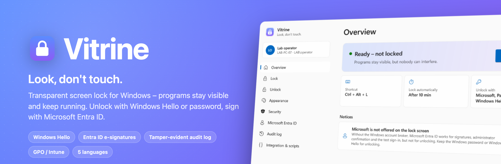
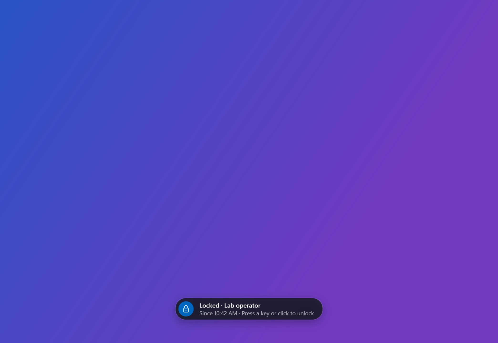
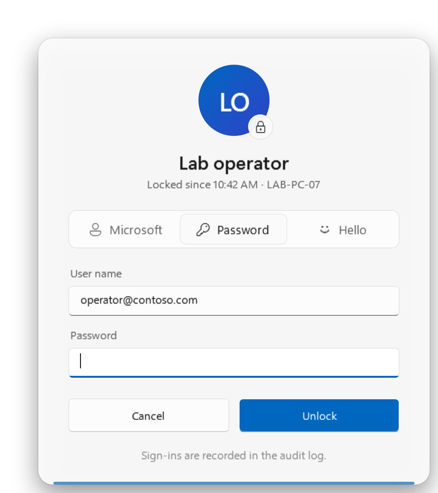
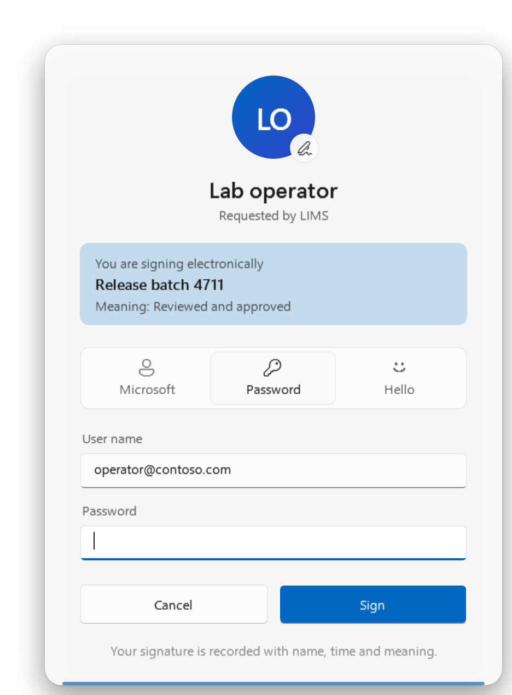
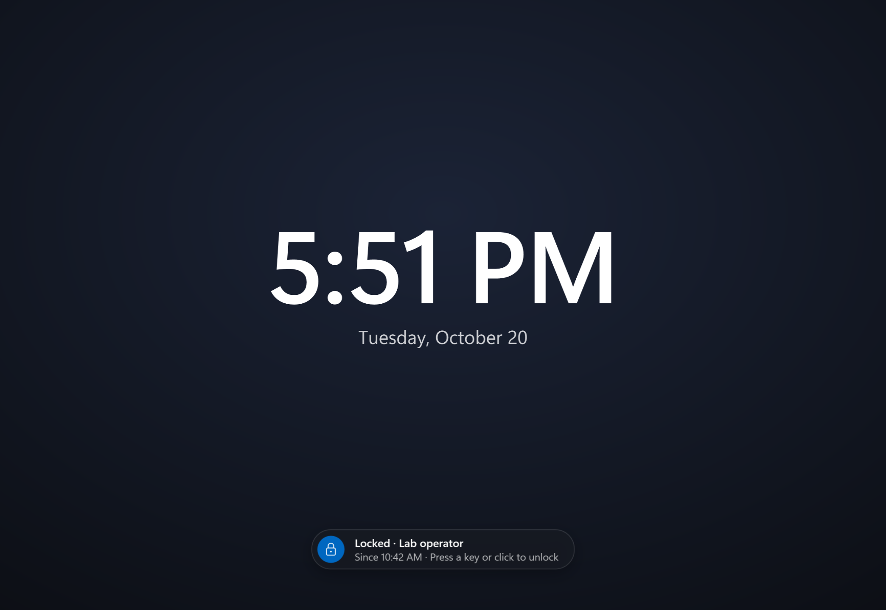
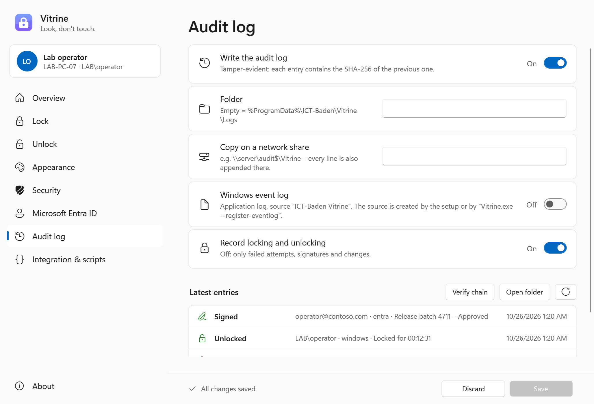
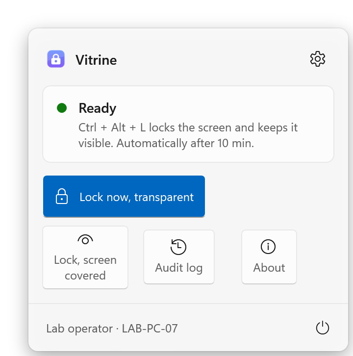
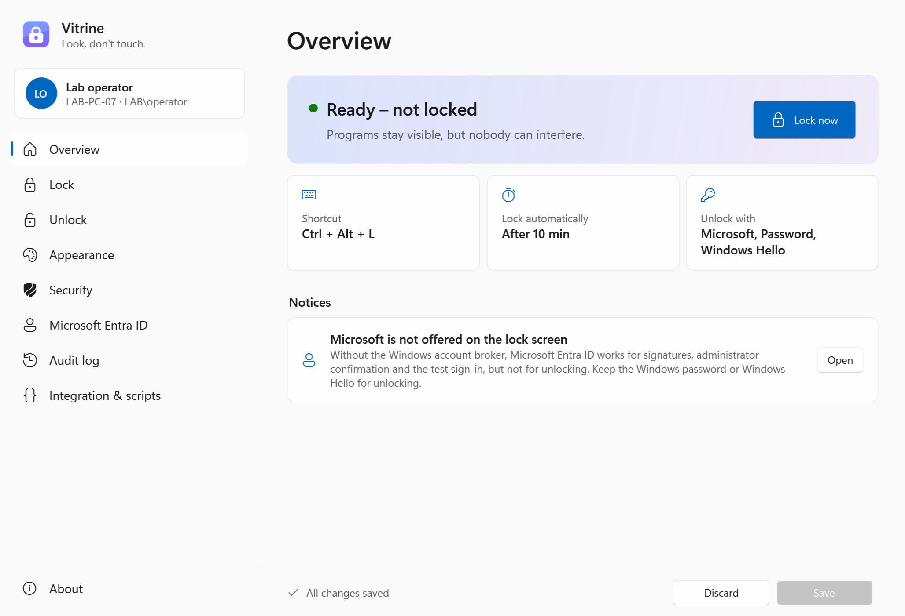
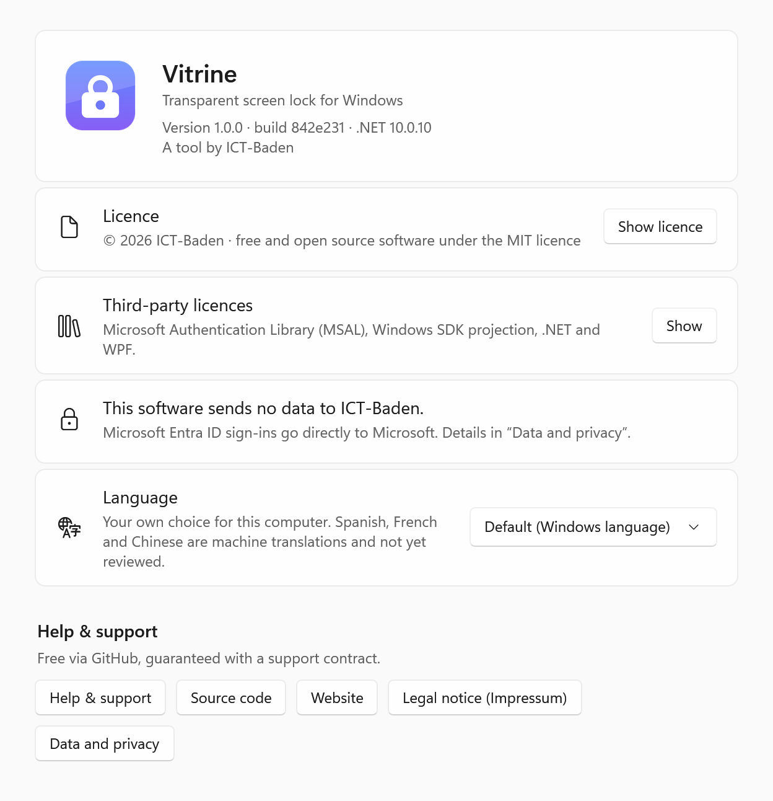

<p align="center">
  
</p>

<p align="center">
  <a href="https://github.com/ict-baden/vitrine/releases/latest"></a>
  
  
  
  
  
  <a href="https://github.com/ict-baden/vitrine/actions/workflows/build.yml"></a>
</p>

<p align="center">
  <b><a href="https://github.com/ict-baden/vitrine/releases/latest">Download</a></b>
  &nbsp;·&nbsp; <a href="#what-vitrine-does">Features</a>
  &nbsp;·&nbsp; <a href="#quick-start">Quick start</a>
  &nbsp;·&nbsp; <a href="#documentation">Documentation</a>
  &nbsp;·&nbsp; <a href="#limits-honestly">Limits</a>
</p>

<br>

<p align="center">
  <b>A transparent screen lock for Windows – unlock with your own FIDO2 key, Windows Hello or password, e-signatures with Microsoft Entra ID.</b><br>
  Vitrine blocks keyboard and mouse on a Windows workstation while every program stays visible and keeps running –<br>
  for laboratories, production lines and control rooms where a process must be watched but not touched.
</p>

Vitrine is an open-source alternative for organisations that use commercial transparent screen locks. It offers sign-in with **Microsoft Entra ID**, **electronic signatures** for line-of-business applications, a **tamper-evident audit log** written and signed by a Windows service, and central management through **Group Policy or Intune**.

> [!NOTE]
> **Deutsch:** Vitrine ist eine durchsichtige Bildschirmsperre für Windows: Entsperren mit eigenem FIDO2-Schlüssel, Windows Hello oder Kennwort, elektronische Signaturen mit Microsoft Entra ID. Tastatur und Maus sind gesperrt, alle Programme bleiben sichtbar und laufen weiter – für Labore, Produktion und Leitstände. Dazu elektronische Signaturen für Fachanwendungen, ein manipulationserkennendes Protokoll und Verwaltung per Gruppenrichtlinie oder Intune. Download: [aktuelle Version](https://github.com/ict-baden/vitrine/releases/latest) (MSI oder Einzeldatei). Die Oberfläche gibt es auf Deutsch, Englisch, Spanisch, Französisch und Chinesisch (Spanisch, Französisch und Chinesisch maschinell übersetzt); diese Dokumentation ist englisch.

## What Vitrine does

<table>
  <tr>
    <td width="33%" valign="top">
      <picture>
        <source media="(prefers-color-scheme: dark)" srcset="docs/assets/screenshots/lock-dark.png">
        
      </picture>
      <br><b>Lock transparently</b><br>
      Programs stay visible and keep running. One overlay per monitor, placed per monitor DPI, with an optional notice text. Cover single areas, or show only the windows of selected programs.
    </td>
    <td width="33%" valign="top">
      <picture>
        <source media="(prefers-color-scheme: dark)" srcset="docs/assets/screenshots/unlock-dark.png">
        
      </picture>
      <br><b>Unlock with Windows, sign with Microsoft Entra ID</b><br>
      Unlock with Microsoft Entra ID, the Windows password, the Windows sign-in dialog or Windows Hello. Microsoft sign-in runs in Vitrine's own sign-in window, which remembers nothing between people: FIDO2 security keys and passkeys, Authenticator, MFA – so on a shared workstation anyone in a local or Entra group can unlock with their own key.
    </td>
    <td width="33%" valign="top">
      <picture>
        <source media="(prefers-color-scheme: dark)" srcset="docs/assets/screenshots/sign-dark.png">
        
      </picture>
      <br><b>Electronic signatures</b><br>
      Line-of-business applications request a signature over a local interface. Person, time, reason and meaning go into the audit log.
    </td>
  </tr>
  <tr>
    <td valign="top">
      <picture>
        <source media="(prefers-color-scheme: dark)" srcset="docs/assets/screenshots/blank-dark.png">
        
      </picture>
      <br><b>Lock with the screen covered</b><br>
      For confidential content: a large clock instead of the desktop. Programs still keep running.
    </td>
    <td valign="top">
      <picture>
        <source media="(prefers-color-scheme: dark)" srcset="docs/assets/screenshots/settings-audit-dark.png">
        
      </picture>
      <br><b>Tamper-evident audit log</b><br>
      Every lock, unlock, failed attempt and signature with time (UTC), person and method. The service writes it and signs every entry (users can only read); sequence numbers and an anchor outside the file make changes, gaps and a cut-off end visible. A copy on a network share and the Windows event log add independent records.
    </td>
    <td valign="top">
      <picture>
        <source media="(prefers-color-scheme: dark)" srcset="docs/assets/screenshots/tray-dark.png">
        
      </picture>
      <br><b>Notification area</b><br>
      A flyout with status and lock buttons. Light, dark and high contrast, Windows or company accent colour.
    </td>
  </tr>
</table>

### And also

<table>
  <tr>
    <td width="50%" valign="top"><b>Lock in many ways</b><br><kbd>Ctrl</kbd> + <kbd>Alt</kbd> + <kbd>L</kbd>, notification area, idle time, schedule, at startup, as a screen saver, <code>Vitrine.exe --lock</code> or the local interface</td>
    <td width="50%" valign="top"><b>Who may unlock?</b><br>The signed-in person, administrators, groups (also Entra app roles), single accounts, or any valid account – combinable and restrictable to domains</td>
  </tr>
  <tr>
    <td valign="top"><b>Service and watchdog</b><br>If Vitrine ends or hangs while locked, the service disconnects the session and restarts Vitrine locked; without the service a watchdog locks Windows</td>
    <td valign="top"><b>Ctrl + Alt + Del restricted</b><br>Task Manager, Sign out, Change a password, the power button and Lock are hidden while locked</td>
  </tr>
  <tr>
    <td valign="top"><b>Managed centrally</b><br>ADMX/ADML (English and German) with 76 policies for Group Policy and Intune; values set by policy are locked in the settings</td>
    <td valign="top"><b>Failed attempts</b><br>Growing waiting time, and optionally lock Windows, sign out or shut down after too many attempts</td>
  </tr>
  <tr>
    <td valign="top"><b>Plugins and scripts</b><br>Own sign-in adapters (e.g. for a GxP user management) and commands on lock, unlock, failed attempt and dialog</td>
    <td valign="top"><b>Five languages</b><br>English, German, Spanish, French and Chinese (simplified; Spanish, French and Chinese are machine translations, marked as such in the language list); each user picks their own in the About window, or a policy sets it</td>
  </tr>
</table>

<table>
  <tr>
    <td width="50%" valign="top">
      <picture>
        <source media="(prefers-color-scheme: dark)" srcset="docs/assets/screenshots/settings-home-dark.png">
        
      </picture>
      <br><sub><b>Settings</b> – nine pages, from Overview to About. <a href="docs/usage.md#settings-window">Page by page →</a></sub>
    </td>
    <td width="50%" valign="top">
      <picture>
        <source media="(prefers-color-scheme: dark)" srcset="docs/assets/screenshots/about-dark.png">
        
      </picture>
      <br><sub><b>About Vitrine</b> – for every user, without administrator rights: version, licences, language, links</sub>
    </td>
  </tr>
</table>

<sub>The screenshots are drawn by the real application with sample data (<code>Vitrine.exe --screenshots</code>); names and values are examples.</sub>

## Quick start

**① Download** – the current version from [**Releases**](https://github.com/ict-baden/vitrine/releases/latest): `Vitrine-<version>-x64.msi`, `Vitrine-<version>.exe`, `Vitrine-<version>-win-x64-framework.zip`, `Vitrine-<version>-sbom.cdx.json` and `SHA256SUMS.txt`. The newest, untagged build of `main` is the pre-release [**latest**](https://github.com/ict-baden/vitrine/releases/tag/latest); these links always point to it:

| File | What it is |
|---|---|
| **[Vitrine-x64.msi](https://github.com/ict-baden/vitrine/releases/download/latest/Vitrine-x64.msi)** | Installer for all users of a PC: `%ProgramFiles%\Vitrine`, protected data folders, event source, service that starts and supervises Vitrine in every session. No .NET runtime needed. Silent: `msiexec /i Vitrine-x64.msi /qn` – for Intune or GPO. |
| **[Vitrine.exe](https://github.com/ict-baden/vitrine/releases/download/latest/Vitrine.exe)** | A single file that runs without installation and without a .NET runtime – for trying it out. |
| [Vitrine-win-x64-framework.zip](https://github.com/ict-baden/vitrine/releases/download/latest/Vitrine-win-x64-framework.zip) | Small variant with `deploy\install.ps1` and the ADMX templates; needs the .NET 10 Desktop Runtime. |
| [SHA256SUMS.txt](https://github.com/ict-baden/vitrine/releases/download/latest/SHA256SUMS.txt) | Checksums of all files. |

> [!IMPORTANT]
> **Not code-signed yet.** Until code signing is set up for ICT Baden, Windows SmartScreen warns when you start `Vitrine.exe` or the MSI. Check the download against `SHA256SUMS.txt` first: [Installation › Verifying the download](docs/installation.md#verifying-the-download).

**② Start and lock** – After the MSI install, the service starts Vitrine at once in every signed-in session (with `SERVICE=0`: at the next sign-in, or now from the Start menu). Press <kbd>Ctrl</kbd> + <kbd>Alt</kbd> + <kbd>L</kbd> or click the tray icon. Without further setup, the unlock dialog offers the Windows password and, where set up, Windows Hello. For Microsoft Entra ID (unlocking, e-signatures and administrator confirmation), register an app in Entra ID: **[Entra ID setup →](docs/entra-id.md)**

**③ Manage centrally** – Import `policy\Vitrine.admx` and the ADML files (in the installation folder and in the ZIP) into Group Policy or Intune, then set tenant, application ID, who may unlock and the action after failed attempts: **[Installation › ADMX templates →](docs/installation.md#admx-templates-for-group-policy-and-intune)** · **[Settings →](docs/settings.md)**

**Command line:**

```text
Vitrine.exe                         start in the notification area
Vitrine.exe --lock                  lock now
Vitrine.exe --settings              open the settings
Vitrine.exe --verify-log <file>     verify an audit log: signatures, chain, anchors (exit code 0 = intact, 2 = changed)
Vitrine.exe --export-audit-key <f>  public key of the audit log for a reviewer
```

All switches, the screen saver mode and examples for scheduled tasks: **[Command line →](docs/command-line.md)**

## Documentation

<table>
  <tr>
    <td width="50%" valign="top"><a href="docs/installation.md"><b>Installation</b></a><br><sub>MSI, single exe, ZIP with script, silent install, Intune and GPO, ADMX, checksums, upgrading from earlier builds, test checklist</sub></td>
    <td width="50%" valign="top"><a href="docs/usage.md"><b>Usage</b></a><br><sub>Notification area, locking, unlocking, signatures, every settings page, About window and language</sub></td>
  </tr>
  <tr>
    <td valign="top"><a href="docs/command-line.md"><b>Command line</b></a><br><sub>All switches, exit codes, screen saver, scheduled tasks, <code>VITRINE_LANGUAGE</code></sub></td>
    <td valign="top"><a href="docs/settings.md"><b>Settings</b></a><br><sub>Configuration layers, file locations, every setting with default, policies and registry mapping, scripts</sub></td>
  </tr>
  <tr>
    <td valign="top"><a href="docs/sign-in.md"><b>Sign-in and permissions</b></a><br><sub>Sign-in methods, who may unlock, administrators, unlock password, failed attempts</sub></td>
    <td valign="top"><a href="docs/entra-id.md"><b>Microsoft Entra ID</b></a><br><sub>App registration, roles, groups, Conditional Access, test sign-in</sub></td>
  </tr>
  <tr>
    <td valign="top"><a href="docs/audit-log.md"><b>Audit log</b></a><br><sub>Format, signatures, hash chain, keys, verification, network copy, event log</sub></td>
    <td valign="top"><a href="docs/interface.md"><b>Interface and e-signatures</b></a><br><sub>Named pipe, commands, signature flow, events, PowerShell client</sub></td>
  </tr>
  <tr>
    <td valign="top"><a href="docs/plugins.md"><b>Sign-in plugins</b></a><br><sub><code>IAuthProvider</code>, setup, security, the HttpAuth sample</sub></td>
    <td valign="top"><a href="docs/gxp.md"><b>Pharma / GxP</b></a><br><sub>21 CFR Part 11 and EU GMP Annex 11: what Vitrine contributes and what it does not</sub></td>
  </tr>
  <tr>
    <td valign="top"><a href="docs/data-and-privacy.md"><b>Data and privacy</b></a><br><sub>What is stored where, which connections are made, how to delete everything</sub></td>
    <td valign="top"><a href="docs/error-codes.md"><b>Error codes</b></a><br><sub>Every <code>VIT-xxxx</code> code with cause and remedy</sub></td>
  </tr>
  <tr>
    <td valign="top"><a href="docs/limitations.md"><b>Limitations</b></a><br><sub>Security model, what the lock cannot do, what has not been tested yet</sub></td>
    <td valign="top"><a href="docs/development.md"><b>Development</b></a><br><sub>Build, test, MSI, CI and releases, regenerating the screenshots</sub></td>
  </tr>
  <tr>
    <td valign="top"><a href="docs/roles-and-governance.md"><b>Roles and governance</b></a><br><sub>Configuration administrators, registrars, auditors, emergency sign-in, responsible person, change reasons, authorization report</sub></td>
    <td valign="top"><a href="docs/security-keys.md"><b>Security keys</b></a><br><sub>FIDO2 keys registered for Vitrine: registration, revocation, offline sign-in, model allow-list</sub></td>
  </tr>
</table>

## Limits, honestly

- **Not yet tested on real devices (0.5.1).** Vitrine is built and unit-tested in GitHub Actions, but has not yet been tested end to end on real devices – Entra ID with MFA, Windows Hello, Remote Desktop, multiple monitors and the MSI on a clean machine are still open. See the [checklist](docs/installation.md#tested-so-far--still-to-test-on-real-devices).
- **Ctrl + Alt + Del cannot be intercepted** by any application. Vitrine only hides Task Manager, Sign out, Change a password, the power button and *Lock* there (and switches off <kbd>Win</kbd>+<kbd>L</kbd> while locked); *Switch user* remains.
- **Vitrine runs as a normal user process, supervised by a service.** Another process of the same user can end it; the service *ICT-Baden Vitrine* then disconnects the session if it was locked and starts Vitrine again. Without the service only the watchdog remains. Administrators can stop both.
- **Transparent means visible.** Choose *Covered* for confidential content.
- **The audit log is tamper-evident:** it makes changes visible but cannot prevent them. With the service, users cannot write it, but administrators can stop the service and use its key; without the service (`SERVICE=0`, single exe) anyone who can write the file can shorten it or recompute the chain – not Part 11 capable. The network copy and the forwarded event log are the second trail.
- **Entra ID sign-in needs the network.** Keep the Windows password or Windows Hello enabled for offline cases.
- **Failed attempts:** by default there is only a growing waiting time, no action. Set *Action after too many failed attempts* for a real limit.
- **Spanish, French and Chinese** are machine translations and not yet reviewed by native speakers.

Everything else: **[Limitations →](docs/limitations.md)**

---

<sub>
Vitrine is free and open source software by <b>ICT Baden</b>. &nbsp;·&nbsp;
This software sends no data to ICT Baden. &nbsp;·&nbsp;
Licence: <a href="LICENSE">MIT</a> &nbsp;·&nbsp;
Third-party licences: <a href="THIRD-PARTY-NOTICES.txt">THIRD-PARTY-NOTICES.txt</a> &nbsp;·&nbsp;
Support: free via GitHub, guaranteed with a <a href="SUPPORT.md">support contract</a> &nbsp;·&nbsp;
<a href="SECURITY.md">Security</a> &nbsp;·&nbsp;
<a href="https://ict-baden.de/impressum/">Impressum</a> &nbsp;·&nbsp;
<a href="https://ict-baden.de/datenschutz/vitrine/">Datenschutz</a> &nbsp;·&nbsp;
<a href="https://ict-baden.de/produkte/vitrine/">ict-baden.de/produkte/vitrine</a>
</sub>
