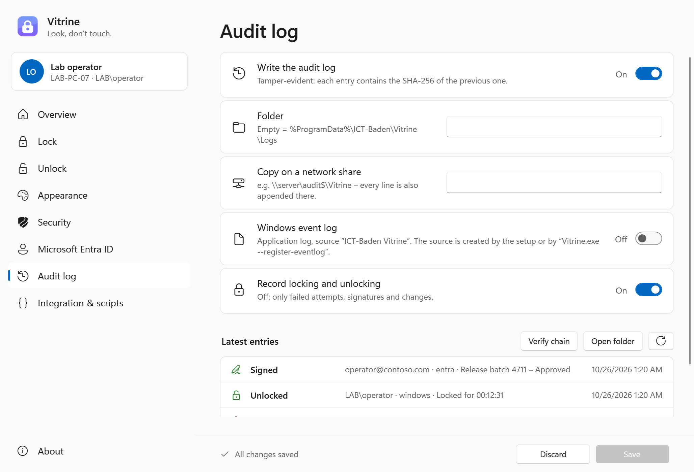
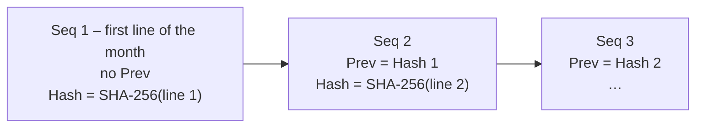
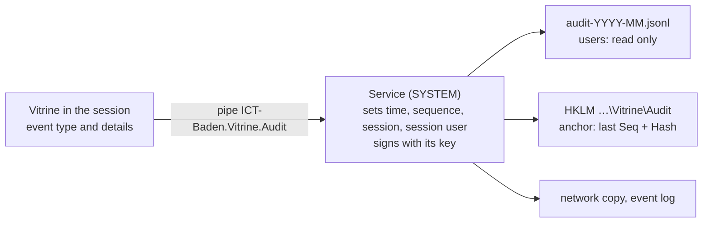

[Vitrine](../README.md) › Audit log

# Audit log

Vitrine writes every lock, unlock, failed attempt, signature and settings change to an audit log, with time, person,
method and result. With the **service** "ICT-Baden Vitrine" (MSI default), the service writes the log and **signs every
entry** with a key that only it holds; users can only read the log folder. A **hash chain** with sequence numbers and an
**anchor** kept outside the file make later changes, removed lines and swapped files visible (tamper-evident); optional
copies go to a **network share** and to the **Windows event log**.

Without the service (single `Vitrine.exe`, MSI with `SERVICE=0`, `install.ps1 -NoService`), Vitrine writes the log in
the user's session without a key, as before: **not Part 11 capable** – see [Without the service](#without-the-service-format-2).

**Contents:** [Where the files are](#where-the-files-are) · [Format](#format) · [Events](#events) ·
[Hash chain](#hash-chain) · [Signed audit log (format 3)](#signed-audit-log-format-3) ·
[Without the service (format 2)](#without-the-service-format-2) · [Verifying](#verifying) ·
[Copy on a network share](#copy-on-a-network-share) · [Windows event log](#windows-event-log) ·
[What the log does and does not prove](#what-the-log-does-and-does-not-prove)

<p align="center">
  <picture>
    <source media="(prefers-color-scheme: dark)" srcset="assets/screenshots/settings-audit-dark.png">
    
  </picture>
</p>

## Where the files are

| What | Where |
|---|---|
| **Files** | one file per month, `audit-YYYY-MM.jsonl`; the month is the **UTC** month in the Gregorian calendar, whatever the regional settings |
| **Folder** | `%ProgramData%\ICT-Baden\Vitrine\Logs`, or `Audit.Directory` (environment variables are expanded) |
| **Public keys** | `audit-keys.json` next to the files (written by the service): public keys and fingerprints for verification, see [Keys](#keys) |
| **Anchors and keys (registry)** | `HKLM\SOFTWARE\ICT-Baden\Vitrine\Audit`: last sequence number and hash per month, public keys, `Service` = 1 when the service writes the log. Only SYSTEM may write, everyone may read |
| **Per-user fallback** | `%LocalAppData%\Vitrine\Logs` – only without the service: used when the folder cannot be created, and for each line that Vitrine is not allowed to write to the folder. With the service: only for entries that Vitrine could not hand over to the service before it ended ([Service not reachable](#service-not-reachable)) |
| **Older files** | builds before 0.1.0 wrote to `%ProgramData%\Vitrine\Logs`. Vitrine no longer writes there, but the settings page still shows and verifies files from there when the other folders contain none |
| **Permissions** | with the service: users **read only** (set by the MSI, `deploy\install.ps1` and the service at every start); without the service: users may create and append – see [What the log does and does not prove](#what-the-log-does-and-does-not-prove) |

`Audit.Enabled = false` switches off the file, the network copy and the event log entries. `Audit.LogLockState = false`
leaves out only the `Locked` entries; `Unlocked`, `PromptShown` and everything else are still written. With the service,
the service reads `Audit.*` from the device configuration and computer policy (not from settings for the user only).

**Settings › Audit log** shows at the top who writes the log: *Written and signed by the service* (with the key
fingerprint), *Service not reachable* (with the number of waiting entries, or with `VIT-0330` and the reason once
entries have waited for more than a minute), or *Not Part 11 capable* (no service).

## Format

JSON Lines: one JSON object per line, UTF-8, line end LF. Fields that are empty are left out.

| Field | Content |
|---|---|
| `V` | format of the line: `3` written and signed by the service (since #15); `2` written by Vitrine in the session (since 2026-10-21, and without the service); missing in lines written before (format 1) – see [Hash chain](#hash-chain) |
| `Seq` | sequence number. Format 1/2: within the file, starting at 1. Format 3: continues across all monthly files of the computer, without gaps |
| `Time` | time in **UTC**, ISO 8601 (`2026-10-19T08:15:02.1234567+00:00`), taken from the computer's clock – in format 3 by the service, when it writes the line |
| `ClientTime` | format 3 only: the time reported by the session app, when the entry waited because the service was not reachable (differs by more than 5 s). Not checked by the service |
| `Machine` | computer name |
| `Session` | format 3 only: Windows session number of the process that reported the entry, determined by the service |
| `SessionUser` | `DOMAIN\name` of the Windows session that runs Vitrine – in format 3 taken by the service from the token of the reporting process (`SYSTEM` for its own entries) |
| `Event` | event type, see [Events](#events) |
| `Actor` | the account name of the person (see notes below) |
| `Method` | sign-in method: `entra`, `windows`, `hello`, `windowslogon`, `fido`, `pin` or a plugin ID |
| `Detail` | short text in **English**, independent of the user interface language |
| `Data` | further values, see below |
| `Assurance` | format 3 only: what the service vouches for – `service`, `verified` or `client`, see [Assurance](#assurance) |
| `Prev` | hash of the previous line (missing in the first line of a file in format 1/2, and in the very first signed line of a computer) |
| `Key` | format 3 only: ID of the key that signed the line (first 16 hex characters of its fingerprint) |
| `Hash` | SHA-256 of this line, see [Hash chain](#hash-chain) |
| `Sig` | format 3 only: ECDSA P-256 signature, see [Signed audit log](#signed-audit-log-format-3) |

Example in format 3 (shortened hashes, IDs and signature):

```json
{"V":3,"Seq":1042,"Time":"2026-10-19T08:15:02.1234567+00:00","Machine":"LAB-PC-07","Session":2,"SessionUser":"CONTOSO\\jdoe","Event":"SignatureGranted","Actor":"jdoe@contoso.com","Method":"entra","Detail":"Release batch 4711 – Approved","Data":{"userId":"0b9e…","displayName":"Lab operator","tenant":"72f9…","tid":"72f9…","oid":"0b9e…","amr":"pwd mfa","method":"entra","reason":"Release batch 4711","meaning":"Approved","requester":"LIMS","clientProcess":"lims.exe (PID 1234)"},"Assurance":"verified","Prev":"3f1c…","Key":"5d0e9a1c7b2f4e88","Hash":"9a0b…","Sig":"MEUCIQ…"}
```

The same in format 2 (without the service):

```json
{"V":2,"Seq":42,"Time":"2026-10-19T08:15:02.1234567+00:00","Machine":"LAB-PC-07","SessionUser":"CONTOSO\\jdoe","Event":"Unlocked","Actor":"jdoe@contoso.com","Method":"entra","Detail":"Locked for 00:12:05","Data":{"userId":"0b9e…","displayName":"Lab operator","tenant":"72f9…","tid":"72f9…","oid":"0b9e…","amr":"mfa","method":"entra"},"Prev":"3f1c…","Hash":"9a0b…"}
```

Vitrine uses the standard escaping of .NET's JSON serializer: non-ASCII characters and characters such as `<`, `>`,
`&`, `'` and `+` inside text values may appear as `\uXXXX`. Read the files with a JSON parser, not with text search.

**`Data`** can contain:

| Key | When |
|---|---|
| `userId`, `displayName`, `tenant` | after a sign-in: Windows SID or Entra object ID, display name, Entra tenant |
| `tid`, `oid`, `amr` | Microsoft Entra ID: tenant, object ID, and the first authentication method reference (`amr`) if the token has one |
| `localGroups` | Since 0.4.0, Microsoft Entra ID: local groups (SIDs, space-separated) the account or one of its Entra groups is a direct member of – the reason a local group in `Unlock.AllowedGroups` or *Administrators* matched ([details](sign-in.md#local-groups-with-microsoft-sign-in)) |
| `upn` | Windows password signed in by UPN (empty user name, `name@contoso.com`, `AzureAD\name@contoso.com`): that UPN. `Actor` stays the Windows name, for Entra accounts `AzureAD\name` |
| `method` | the sign-in method again |
| `shared` | `"true"` for the shared unlock password (and plugins that mark a shared secret) |
| `system` | host name of the line-of-business system ([HttpAuth sample](plugins.md#sample-httpauth)) |
| `code` | error code of a failed attempt, e.g. `VIT-0101` |
| `reason`, `meaning`, `requester` | signatures: as requested through the [interface](interface.md#electronic-signature) |
| `clientProcess` | granted signatures: the process connected to the pipe, e.g. `lims.exe (PID 1234)` |
| `key`, `fingerprint`, `publicKey` | `AuditFormatSwitched` and `AuditKeyRotated`: ID, SHA-256 fingerprint and public key (SubjectPublicKeyInfo, Base64) of the key that signs from here on |

Plugins can add further keys through `AuthOutcome.Details`.

## Events

| Event | When | `Detail` |
|---|---|---|
| `AppStarted` | Vitrine started | `Version 0.1.0 (<commit>), language <code>` |
| `AppStopped` | Vitrine exited normally | `Exit` or `Windows sign-out` |
| `Locked` | locked (unless `Audit.LogLockState = false`) | `Trigger: <trigger>`, see below |
| `PromptShown` | unlock dialog opened | – |
| `Unlocked` | unlocked | `Locked for hh:mm:ss` |
| `UnlockFailed` | sign-in failed (wrong password, cancelled Microsoft or Hello sign-in …) | the error code |
| `UnlockDenied` | sign-in succeeded, but the rules refused the person | the error code |
| `FailureActionTriggered` | the action after too many failed attempts | `5 failed attempts -> LogOff` |
| `SignatureGranted` | electronic signature given | `<reason> – <meaning>` |
| `SignatureFailed` | one failed or refused attempt in the signature dialog (with code), and once more when the dialog closes without a signature | the error code, or `Cancelled: <reason>` |
| `ConfigChanged` | settings saved, or an administrator confirmed an action | `Settings saved: <n> change(s)` (since 0.5.0; `Data`: one key per changed setting with `old -> new`, `changes`, `reason`), `Administrator approval: open settings`, `Administrator approval: exit Vitrine` (`Data`: `roles`, `reason`) |
| `Error` | an error that Vitrine caught | e.g. `VIT-0010 <exception>`, `Overlay: …`, `Ctrl+Alt+Del restrictions: …` |
| `ServiceStarted` | the service started (user `SYSTEM`) | `Version …`, `supervision off` with `SERVICE=0`, `locked before the service stopped: session 2` when it restarts Vitrine locked there |
| `ServiceStopped` | the service stopped | –, or `Windows shutdown` |
| `AgentConnected` | Vitrine in a session connected to the service; supervision runs from here (since 2026-10-20) | `Session <n>, PID <pid>` |
| `AgentLost` | Vitrine ended or stopped responding in a session | `Session <n>: locked`, `unlocked`, `not responding, locked`, `locked, sign-out not completed` … |
| `AgentStopped` | Vitrine ended after *Exit* confirmed by an administrator (not restarted until the next sign-in), or Windows announced a sign-out | `Session <n>`, or `Session <n>: sign-out announced` – if the sign-out does not follow within 20 s, an `AgentLost … sign-out not completed` follows |
| `AgentStartFailed` | the service could not start Vitrine in a session (it tries again) | `Session <n>: Win32 error …` or `no connection` |
| `SessionDisconnected` | the service disconnected a session because Vitrine ended while locked | `Session <n>` |
| `SessionEndRefused` | Windows asked to sign out or restart while the workstation was locked; Vitrine kept the lock and refused (since 2026-10-21, see [Limitations](limitations.md)) | `Logoff` or `Shutdown` |
| `AuditFormatSwitched` | the service writes and signs the log from here on: first signed line on the computer, or the first one after lines in format 1/2 in the same file (#15) | `Format 2 -> 3: entries are now written and signed by the service, key <id>` |
| `AuditKeyRotated` | the service changed its key (`--rotate-audit-key`); this line is still signed with the old key | `Key <old> -> <new>` |
| `UnlockBypass` | unlocked through the [emergency sign-in](roles-and-governance.md#emergency-sign-in) (since 0.5.0); always also a warning in the Windows event log | `Locked for hh:mm:ss`; `Data.reason` = the reason, `Data.emergency` = `true` |
| `ResponsibilityChanged` | another person than before unlocked and is now [responsible](roles-and-governance.md#responsible-person) for the computer (since 0.5.0) | `<from> -> <to>`; `Data`: `fromUser`, `fromName`, `fromMethod`, `fromSince`, `toUser`, `toName`, `method` |
| `AuditLocalMode` | Vitrine writes the log itself, without the service – at every start in that mode, and before entries that could not be handed over to the service | `Written by the session app without the service – not Part 11 capable`, `<n> entries not delivered to the service – not Part 11 capable` |
| `DesktopSwitchDetected` | while locked, another desktop than expected became the active one – a way out of the lock desktop (`Lock.Mode = Desktop`) or to a desktop of another program; Vitrine switches back (since 0.5.0, [Limitations](limitations.md#separate-lock-desktop)) | `Input desktop Default, expected Vitrine-Lock-…; switching back`, optionally `(after a secure desktop: Ctrl+Alt+Del, Windows lock or UAC)` |
| `WindowsLockDetected` | Windows locked while Vitrine was locked (since 0.5.0) | `Windows locked while Vitrine was locked: caused by Vitrine's fallback lock` or `not caused by Vitrine (…)`, plus the lock mode |
| `FidoKeyRegistered` | the service registered a security key (since 0.5.0; written only by the service, assurance `verified`, `Actor` = registrar) | `Security key '<label>' registered for <person>: <reason>`; `Data`: person, SID, key ID, AAGUID, attestation – [Security keys](security-keys.md#audit-log) |
| `FidoKeyRevoked` | the service revoked a security key (assurance `verified`, `Actor` = registrar) | `Security key '<label>' of <person> revoked: <reason>` |
| `FidoKeyRejected` | the service refused a sign-in or registration with a security key (assurance `service`) | `<code> <problem>`, e.g. `VIT-0404 signature invalid` |
| `FidoCloneSuspected` | the signature counter of a security key did not increase – possibly a copied key; the sign-in was refused | `VIT-0408 signature counter <n> not above stored <m>` |

**Trigger identifiers** (also in `%VITRINE_TRIGGER%` and the event stream): `hotkey`, `tray`, `tray-blank`, `settings`,
`win-l`, `startup`, `screensaver`, `api` or `api: <text sent by the application>`, `idle (N min)`, `schedule HH:mm`.

Notes on `Actor`:

- `Unlocked`, `UnlockDenied`, `SignatureGranted`: the account that signed in, as the method returns it (`DOMAIN\name`
  for Windows and Hello, `preferred_username` for Entra). For the shared unlock password, it is the name of the method in
  the user interface language (e.g. "Unlock password"), not a person.
- `UnlockFailed` and failed signature attempts: the **user name entered in the dialog**. For Microsoft, Hello and
  plugins without a user name field, this is the prefilled name of the session user (or empty), **not necessarily the
  person who tried**.
- `ConfigChanged` "Settings saved": since 0.5.0 the **person who opened the settings** – the Windows session user if no
  confirmation was needed, otherwise the person who confirmed (before 0.5.0 always the session user). The changed values
  are in `Data` (secrets as `(hidden)`), see [Configuration changes with reason](roles-and-governance.md#configuration-changes-with-reason).
  Switching "Start with Windows" on or off is not logged.
- `UnlockBypass`, `ResponsibilityChanged`: the account that signed in, like `Unlocked`.

`PromptClosed` exists in the list of event types (event ID 1004) but is never written.

## Hash chain



- `Hash` is the SHA-256 (lowercase hex) of the UTF-8 bytes of the line **without** the `Hash` field – that is, the line
  as written with `,"Hash":"…"` removed. `Prev` is the `Hash` of the line before.
- **Format 2** (`"V":2`, since 2026-10-21): the verification hashes exactly these bytes of the line in the file. Every
  line – also one in format 1 – must in addition look exactly as Vitrine writes it: no additional or duplicate fields,
  no other spelling or spacing; otherwise VIT-0022. Format 1 (no `V`, written before 2026-10-21) was verified by reading
  the line and writing it again, so a field **added** to a line went unnoticed. Older files stay valid, and a file that
  starts in format 1 continues in format 2 without a break. An unknown format (`V` other than 2 or 3) is reported as changed.
  Builds before 2026-10-21 report format-2 lines as changed – verify with the current version.
- If a line is changed or removed in the middle, the chain **breaks** and the verification names the line.
- Format 1/2: for **every** line, Vitrine opens the file without write sharing, reads the last entry (searching backwards from the
  end, at most 4 MB), continues the chain from it and appends the line – in the same step it also appends the line to
  the network copy. So the chain also continues after a restart and when several sessions write to the same file.
  Each monthly file starts its own chain (first line without `Prev`, `Seq` from 1). If the last line of a file cannot
  be read (or is longer than 4 MB), Vitrine starts a new chain in the same file; the verification then reports a break
  there.

## Signed audit log (format 3)

Since #15, the service "ICT-Baden Vitrine" (LocalSystem) writes the audit log when it supervises the sessions (MSI
default, `install.ps1` without `-NoService`). Vitrine in the session no longer writes files; it sends each entry over
the pipe `\\.\pipe\ICT-Baden.Vitrine.Audit` to the service.



**What the service sets itself.** `Time`, `Seq`, `Prev`, `Machine`, `Session` and `SessionUser` come from the service:
the session and the user from the pipe handle and the token of the process that connected (only `Vitrine.exe` from the
program folder is accepted), never from the text of the request. The app only sends the event type, `Actor`, `Method`,
`Detail` and `Data`. Entries that only the service writes (`SignatureGranted`, `Service…`, `Agent…`,
`SessionDisconnected`, `AuditFormatSwitched`, `AuditKeyRotated`) are refused when a session sends them; the service
writes an `Error` entry `VIT-0315` instead.

**Signature of each line.** `Sig` is an ECDSA signature (curve P-256, SHA-256, IEEE P1363 format, Base64url without
padding) over the UTF-8 bytes of the line without `,"Hash":"…","Sig":"…"`; `Hash` is the SHA-256 of the same bytes,
`Prev` the `Hash` of the line before. A line cannot be added, changed or re-chained without the private key.

**Numbering across files.** `Seq` continues across all monthly files of the computer, and the first line of a month has
the `Prev` of the last line of the previous month. Removing, inserting or reordering lines, or removing a whole file,
leaves a visible gap.

**Anchor outside the file.** After every line the service stores the month's last `Seq` and `Hash` under
`HKLM\SOFTWARE\ICT-Baden\Vitrine\Audit` (value `Anchor.YYYY-MM`). Only SYSTEM may write this key. Verification on the
computer compares the file with it, so a **cut-off end** or an older copy put back is detected (VIT-0304, VIT-0305), and
so is a **deleted file** (VIT-0306). When the service itself finds that the end of the file does not match the anchor
(only an administrator can cause that), it writes an `Error` entry `VIT-0316` and continues the chain from the anchor –
the gap stays visible.

**Event log as second trail.** With `Audit.EventLog`, every entry also goes to the Windows event log with its sequence
number, hash, assurance and key ID; forwarded to a collector, this is an independent record of the anchor over time.

### Assurance

`Assurance` says what the service vouches for. Time, sequence number, session and session user are always set by the
service.

| Value | Meaning | Entries |
|---|---|---|
| `service` | the service's own event | `ServiceStarted`, `ServiceStopped`, `Agent…`, `SessionDisconnected`, `AuditFormatSwitched`, `AuditKeyRotated`, `FidoKeyRejected`, `FidoCloneSuspected`, its own `Error` entries |
| `verified` | the **service checked the sign-in itself** | `SignatureGranted` with Windows password, Microsoft Entra ID or a security key; `SignatureFailed` written by the service; `FidoKeyRegistered`, `FidoKeyRevoked` (registrar checked by the service) |
| `client` | reported by Vitrine in the session; the service vouches for time, sequence and session, **not for person or content** | `Locked`, `Unlocked`, `UnlockFailed`, `UnlockDenied`, `ConfigChanged`, `AppStarted` …; `SignatureGranted` with Windows Hello or a plugin |

A user who controls the processes of their own session (debugger, own program) can make the service record `client`
entries with any content – but always with their own session, user name and the service's time. Only `verified`
entries prove that a person signed in.

### Electronic signatures

The service does not trust the app with signatures. A signature needs a one-time ticket that the service issues after
it has checked the sign-in, and the `SignatureGranted` entry takes person and method from that ticket:

| Method | What the service checks | `Assurance` |
|---|---|---|
| Windows password | the app sends user name, domain and password over the pipe (ACL: SYSTEM, administrators and the connecting user's own pipe instance); the **service calls `LogonUser`** itself and takes the account from the resulting token. The app no longer calls `LogonUser` for signatures | `verified` |
| Microsoft Entra ID | the app gets a one-time **nonce** from the service, signs in with MSAL (nonce sent to Microsoft) and passes the **ID token**; the service checks its RS256 signature against the keys of the tenant (`https://login.microsoftonline.com/<tenant>/discovery/v2.0/keys`), issuer, audience (`Entra.ClientId` of the device configuration), validity, that it was issued in the last 10 minutes and has not been used before, that it carries **its nonce** for this session, and that **`auth_time`** is present and – with `Entra.ForceFreshSignIn` – after the request, and within `Entra.MaxAuthAgeSeconds`; then the same rules as Vitrine (allowed tenants, authentication context). Details: [Entra ID › Signatures checked by the service](entra-id.md#signatures-checked-by-the-service) | `verified` |
| Windows Hello | cannot be checked by the service (the confirmation happens in the session). The service records the **session user** as the person – Hello can only confirm the session user anyway | `client` |
| Plugins | cannot be checked by the service; person as reported by the plugin. Shared secrets are refused | `client` |
| Shared unlock password | refused for signatures (as before) | – |

Failed checks are written by the service itself (`SignatureFailed`; `verified` when the service checked the sign-in,
`client` when it refused a method it cannot check – shared password, unknown method, a plugin or Windows Hello that is
not in `Unlock.Methods`); at most 10 checks per session and minute (VIT-0314). Tickets are valid for 2 minutes and only once (VIT-0313). Signatures with `client` assurance are not
checked by the service: **for 21 CFR Part 11 electronic signatures, use the Windows password or Microsoft Entra ID**.
The interface answer contains `assurance` so the requesting application can refuse others ([Interface](interface.md#electronic-signature)).

The service must reach `https://login.microsoftonline.com` as the computer (account SYSTEM) for Microsoft signatures;
otherwise they are refused (VIT-0312).

### Service not reachable

If the service writes the log but Vitrine cannot reach it (service stopped, being updated, starting):

- **Locking and unlocking keep working.** Entries wait in memory (up to 10,000) and are sent in order when the service
  is back; they then carry the app's time as `ClientTime`. If more wait, the rest are dropped and an `Error` entry
  `VIT-0318` follows. If Vitrine ends first (sign-out), the waiting entries are written to the per-user fallback
  folder (format 2, after an `AuditLocalMode` entry) – unprotected, but not lost.
- If the service is reachable but cannot write (folder missing, disk full), it answers with VIT-0322 and Vitrine keeps
  the entry and sends it again after a few seconds – it is not dropped.
- **Electronic signatures are refused** with VIT-0300 (in the dialog and in the interface answer), because nobody could
  check and record them.
- If a connection breaks between sending an entry and the service's answer, Vitrine sends it again; it can then appear
  twice.
- **Duplicates and order after a retry.** When the service answers VIT-0322 for one entry, Vitrine sends all entries
  that are still unconfirmed again – including ones the service already wrote but whose answer had not arrived yet. Such
  an entry then appears **twice**, and entries can appear **out of their original order** (the later copy gets a higher
  `Seq`). The chain stays intact: each copy is a normal, signed entry with its own `Seq` and `Hash`, and `--verify-log`
  reports nothing. When reading the log, treat two entries with the same `Event`, `Actor`, `Detail` and `ClientTime` as
  one (`ClientTime` is set when an entry was delayed); the service's `Time` and `Seq` show when it was written, `ClientTime` when it happened.
- **Waiting is not silent.** If the oldest waiting entry is older than one minute, Vitrine writes `VIT-0330` with the
  number of entries and the reason to the Windows event log (Application, source "ICT-Baden Vitrine", event ID 1012,
  also without `Audit.EventLog`), adds an `Error` entry `VIT-0330` to the waiting entries (so the signed log shows the
  gap later), and **Settings › Audit log** shows the message instead of *Written and signed by the service*.
- The service only talks to `Vitrine.exe` from its own program folder. It compares the path of the connecting process
  (`QueryFullProcessImageName`, resolved with `GetFinalPathNameByHandle`, so 8.3 names, casing and links do not matter)
  with its own. A refused connection is written to the signed log and the event log as `Error` `VIT-0331` with PID,
  session, both paths and the reason; if the service cannot determine the user of the connection, `VIT-0332`; any other
  failure while serving a connection, `VIT-0333` – each cause at most every 10 minutes.

#### Troubleshooting: entries of the session app missing from the signed log

In 0.2.0 and 0.3.0 the service closed every connection of the session app without an answer (it failed to
read the user of the connection, see the changelog), so `Locked`, `Unlocked`, `UnlockFailed`, `ConfigChanged` and
other entries of the app never reached the signed log; they ended up in the per-user fallback folder when Vitrine
ended. To check a computer (PowerShell, as administrator):

```powershell
$log = "$env:ProgramData\ICT-Baden\Vitrine\Logs\audit-$(Get-Date -Format yyyy-MM).jsonl"
# Entries of the session app (assurance client) in the signed log – lock and unlock once, then run again
Get-Content $log | ConvertFrom-Json | Where-Object Assurance -eq 'client' |
    Select-Object -Last 10 Seq, Time, Event, Session, SessionUser, Method
# Refused or failed connections (VIT-0330 to VIT-0333) in the event log
Get-WinEvent -FilterHashtable @{ LogName = 'Application'; ProviderName = 'ICT-Baden Vitrine'; StartTime = (Get-Date).AddDays(-1) } |
    Where-Object Message -match 'VIT-033[0-3]' | Format-List TimeCreated, Message
```

If entries are missing, look for `VIT-0331` (the program is not the service's `Vitrine.exe` – the entry names both
paths) or `VIT-0332`, and for `VIT-0330` in the session's event log entries (the reason says whether the service was not
reachable, refused the connection, or could not write).

### Keys

| Topic | How it works |
|---|---|
| **Creation** | at the first start of the service (after installation): a CNG machine key (Microsoft Software Key Storage Provider, ECDSA P-256, **not exportable**, access for SYSTEM only), name `ICT-Baden.Vitrine.Audit.<date>.<random>` |
| **Public key** | in the registry (`Key.<id>`), in `audit-keys.json` next to the files and – with a network copy – as `<COMPUTER>-audit-keys.json` on the share. The first signed line (`AuditFormatSwitched`) also contains it |
| **For the reviewer** | `Vitrine.exe --export-audit-key <file>` (no administrator rights needed) writes the public keys and the current anchors; without a file it shows the fingerprint. **Record the fingerprint in your validation documents** (IQ): a key file is only as trustworthy as the fingerprint you compare it with |
| **Rotation** | `Vitrine.exe --rotate-audit-key` as administrator: the service creates a new key and writes `AuditKeyRotated` with the new public key, **signed with the old key**. Verification accepts the new key from that entry even if the reviewer only trusts the first one |
| **Reinstallation, update** | key and anchors stay (they are not removed by the MSI), so the chain continues |
| **Uninstallation** | key, anchors and files stay. Remove the key only after archiving the logs together with `audit-keys.json` |
| **New computer** | the new computer creates its own key and starts its own chain. Archive the old logs with their `audit-keys.json` (or the export) – they stay verifiable anywhere with `--verify-log <file> --keys <file>` |

### Transition from format 1/2

Files in format 1 and 2 stay verifiable as before. When the service writes into a file whose last line is in format 1
or 2 (update from an earlier build in the middle of a month), it continues the chain there and writes
`AuditFormatSwitched` first; from that line on, every line must be signed (VIT-0308 otherwise). The unsigned lines before
are reported as such by the verification ("… not signed"). On a computer without earlier files, the first line is an
`AuditFormatSwitched` entry without `Prev`.

> [!NOTE]
> If you switch an installation back to `SERVICE=0` in the middle of a month, Vitrine writes unsigned lines after the
> signed ones, and verification reports VIT-0308 for that file. Expected; the following months are unsigned files.

## Without the service (format 2)

With the single `Vitrine.exe`, the MSI with `SERVICE=0` or `install.ps1 -NoService`, Vitrine writes the log in the
user's session as before: format 2, hash chain **without a key**. Every run starts with an `AuditLocalMode` entry
("not Part 11 capable"), the settings show *Not Part 11 capable*, and the interface answers signatures with
`"assurance":"local"`. Anyone who can append to the file can add lines with a valid hash – see
[What the log does and does not prove](#what-the-log-does-and-does-not-prove).

Vitrine opens the file with the *append data* right only, and without write sharing, so that only one process
appends at a time. If the file is busy (another session is writing), Vitrine retries for about one second; if it still
cannot write, the line goes to the per-user fallback folder. No message is shown. Because every line continues the
chain from the last line actually in the file, a line that was never written leaves no break – compare with the
network copy and the event log to find gaps.

## Verifying

**Settings › Audit log › Verify chain** verifies the newest `audit-*.jsonl` file. It looks in the configured folder,
then in the per-user folder, then in the old folder, and uses the first folder that contains a file. The page also
lists the latest 80 entries (in local time) and opens the folder. *Audit log* in the notification area flyout opens
this page.

**Command line:**

```powershell
Vitrine.exe --verify-log "C:\ProgramData\ICT-Baden\Vitrine\Logs\audit-2026-10.jsonl"   # one file
Vitrine.exe --verify-log "C:\ProgramData\ICT-Baden\Vitrine\Logs"                       # all months, and missing ones
Vitrine.exe --verify-log "D:\Archive\LAB-PC-07\audit-2026-10.jsonl" --keys "D:\Archive\LAB-PC-07\keys.json"
```

Signatures are checked with the keys from `--keys` (a file from `--export-audit-key`, including its anchors); otherwise,
for files of this computer, with the public keys in the registry, and for other files with the key file **of the same
prefix** next to the file (`audit-keys.json` for `audit-*.jsonl`, `<COMPUTER>-audit-keys.json` for a network copy) –
never with another computer's key file in the same folder. Only the current key may sign: a line signed with another
trusted key (e.g. an old one after a rotation) is reported (VIT-0324); the key changes only with an `AuditKeyRotated`
entry signed by the key before it. On the computer that wrote the
log, the anchors in the registry are used as well; elsewhere, those from the `--keys` file. The message names the
number of signed and unsigned entries and the key IDs – compare them with your recorded fingerprint.

`--verify-log` shows the result in a message box and waits for **OK**; add `--quiet` for unattended checks.

| Result | Message | Exit code |
|---|---|:---:|
| intact | "Audit log intact" – "Entries: *N* · chain complete · *n* signed by the service (key …)" (and "… not signed" for format 1/2 lines) | 0 |
| line not readable (not JSON, cut off, `null`) | "Audit log changed!" – VIT-0020 | 2 |
| chain broken (line before missing or changed) | "Audit log changed!" – VIT-0021 with line and sequence number | 2 |
| line content changed | "Audit log changed!" – VIT-0022 with line and sequence number | 2 |
| file missing or not readable | "Audit log changed!" – VIT-0023 | 2 |
| signature invalid, unknown key, no key | VIT-0301, VIT-0302, VIT-0310 | 2 |
| sequence gap, end cut off, anchor mismatch, monthly file missing | VIT-0303, VIT-0304, VIT-0305, VIT-0306 | 2 |
| line from another month, unsigned line after signed ones, previous month not continued | VIT-0307, VIT-0308, VIT-0309 | 2 |

To read the exit code in PowerShell: `(Start-Process Vitrine.exe -ArgumentList '--verify-log', $file -Wait -PassThru).ExitCode`.

Lines that Vitrine writes to the per-user fallback folder because it cannot write to the main folder (format 2) form
their own chain in the fallback file, which can be verified on its own. They are missing in the main file without a
break there. All codes: [Error codes](error-codes.md#vit-03xx--audit-service-and-signed-audit-log).

## Copy on a network share

With `Audit.NetworkDirectory` (e.g. `\\server\audit$\Vitrine`), Vitrine appends every line also to
`<COMPUTERNAME>-audit-YYYY-MM.jsonl` there. The content is identical, so the copy can be verified with `--verify-log`
too. The copy is written in the same step as the local line, while the local file is held, so lines of several
sessions arrive in the same order as locally. If the share is not reachable or access is denied, the line is missing in
the copy (no message). Lines that went to the per-user fallback folder are appended to the same copy; they carry their
own chain, so verifying the copy then reports a break. Give users only the right to create and append files on the
share; the share's permissions are your responsibility.

With the service, the **service** writes the copy – on a domain computer as the **computer account**
(`DOMAIN\COMPUTER$`), not as the user. Give the computer accounts (e.g. the group *Domain Computers*) the right to
create and append files on the share, and nobody else the right to change them. The service also puts
`<COMPUTERNAME>-audit-keys.json` there, so the copy can be verified on the server.

## Windows event log

`Audit.EventLog` (default on) writes every entry also to the **Application** log, source **"ICT-Baden Vitrine"**.
The text contains the event, session user, person, method, detail, sequence number and hash, in format 3 also assurance and key ID; `Data` is not included. With the service, the service writes these entries.

| ID | Event | Type |
|---:|---|---|
| 1000 | AppStarted | Information |
| 1001 | AppStopped | Information |
| 1002 | Locked | Information |
| 1003 | PromptShown | Information |
| 1004 | PromptClosed (reserved, not written) | – |
| 1005 | Unlocked | Success Audit |
| 1006 | UnlockFailed | Failure Audit |
| 1007 | UnlockDenied | Failure Audit |
| 1008 | FailureActionTriggered | Warning |
| 1009 | SignatureGranted | Success Audit |
| 1010 | SignatureFailed | Failure Audit |
| 1011 | ConfigChanged | Information |
| 1012 | Error | Warning |
| 1013 | ServiceStarted | Information |
| 1014 | ServiceStopped | Information |
| 1015 | AgentLost | Information |
| 1016 | AgentStopped | Information |
| 1017 | AgentStartFailed | Information |
| 1018 | SessionDisconnected | Information |
| 1019 | AgentConnected | Information |
| 1020 | SessionEndRefused | Warning |
| 1021 | AuditFormatSwitched | Information |
| 1022 | AuditKeyRotated | Information |
| 1023 | AuditLocalMode | Warning |
| 1024 | UnlockBypass | Warning – written also when `Audit.EventLog` is off |
| 1025 | ResponsibilityChanged | Information |
| 1026 | DesktopSwitchDetected | Warning |
| 1027 | WindowsLockDetected | Warning |
| 1028 | FidoKeyRegistered | Information |
| 1029 | FidoKeyRevoked | Information |
| 1030 | FidoKeyRejected | Failure Audit |
| 1031 | FidoCloneSuspected | Warning |

The ID is 1000 + the number of the event type. The source must be registered, by the MSI, `deploy\install.ps1` or
`Vitrine.exe --register-eventlog` (as administrator). Builds before 0.1.0 used the source **"Vitrine"**: if only that
old source is registered, Vitrine still writes to it, so existing filters in SIEM systems keep working until you
register the new one. If neither source is registered, no event log entries are written and no error is shown.

## What the log does and does not prove

> [!CAUTION]
> **Tamper-evident only: changes become visible, they are not prevented.** Neither the signature nor the hash chain
> stops anyone from changing a file. They make changes visible to someone who verifies the file.

### With the service (format 3)

**Detected** by `--verify-log` (on the computer, or elsewhere with `--keys`):

- a line **appended** by someone else, in any format (VIT-0302 unknown key, VIT-0308 unsigned line, VIT-0301);
- a **changed** line, also with recomputed hash (VIT-0301, VIT-0022);
- a **removed, inserted or reordered** line (VIT-0021, VIT-0303);
- a **cut-off end** or an older copy put back (VIT-0304, VIT-0305 – needs the anchors);
- a **deleted** monthly file (VIT-0306 – needs the anchors; VIT-0309 at the following month);
- a file **from another month** put in place of this one (VIT-0307);
- a signature entry that the session app made up: the service only writes `SignatureGranted` with a ticket from its own
  check of the sign-in; for Windows password and Entra ID that check is the service's own (`verified`).

**Not detected – and what remains:**

- **Administrators** (and anything running as administrator or SYSTEM) can stop the service, take over the CNG key
  (change its permissions) and the registry key with the anchors, and then write lines with a valid signature, or
  rewrite a file together with its anchor. This cannot be prevented on the computer itself. That is why the **network
  copy** (on a share the computer may only append to) and the **event log forwarded to a collector** remain useful as
  a second trail: they hold the sequence numbers and hashes outside the reach of a local administrator. Record who
  is administrator on GxP workstations ([GxP](gxp.md)).
- `client` entries (lock, unlock, failed attempts, Hello and plugin signatures) carry the session's own statement: a user
  who manipulates the processes of their own session can have wrong content recorded – with their own session user,
  never with another's.
- Lines that never reached the service (Vitrine ended while the service was unreachable) are in the per-user fallback
  folder, unsigned.
- Wrong times: `Time` comes from the computer's clock (but from the service, not from the session).
- Without the anchors (verification on another computer without exported anchors), a cut-off end of the **newest**
  file is not visible; older months are covered by the link to the following month.

**File permissions.** With the service, the MSI (`SERVICE=1`), `deploy\install.ps1` and the service itself at every
start set the log folder `%ProgramData%\ICT-Baden\Vitrine\Logs` to: administrators and SYSTEM full control, users
**read only**, *OWNER RIGHTS* read only (so that users who created files in earlier versions cannot change their
permissions). SDDL: `D:PAI(A;OICI;FA;;;BA)(A;OICI;FA;;;SY)(A;OICI;0x1200a9;;;BU)(A;OICI;0x1200a9;;;OW)`. A folder
set with `Audit.Directory` is **not** changed by the service: the service only uses it if it and its parent folder
belong to administrators or SYSTEM, are no junction or link and nobody else may change them – otherwise it writes to
the default folder and logs VIT-0323. The service never writes through a junction or symbolic link (folder, log file,
`audit-keys.json`). When the service stops writing the log (`SERVICE=0`, or its key cannot be loaded), it gives users
the right to create and append in the default folder again, as for an installation without the service.

### Without the service (format 2)

> [!WARNING]
> **Not Part 11 capable.** The chain uses plain SHA-256 without a key. Anyone who can write the file can produce a new,
> valid chain.

**Detected:**

- a changed line in the middle of a file (VIT-0022, or VIT-0021 at the next line),
- a removed or inserted line in the middle, unless the following lines are recomputed,
- a new chain started because the last line could not be read.

**Not detected without further measures:**

- **rewriting the chain:** whoever can write the file can change lines and recompute all following hashes;
- **truncating the end:** removing the last lines leaves a valid chain;
- deleting a whole monthly file;
- **forged entries appended at the end:** the chain has no key, so anyone who can append to the file – under the
  installer's permissions **every user of the computer** – can append lines with a correct `Prev` and `Hash`, for
  example a fake `Unlocked` or `SignatureGranted` entry. Such lines are indistinguishable from real ones in the file
  itself; only the independent copies (network copy written by Vitrine, event log) show that they are missing there;
- lines that could not be written (write error) – the next line continues from the last line in the file;
- wrong times: `Time` comes from the computer's clock.

**File permissions.** With `SERVICE=0` and `install.ps1 -NoService`, the log folder gets: administrators and SYSTEM full
control; users may create files in the folder, and may only **read and append** to the files – they cannot overwrite,
shorten or delete them, nor change permissions (an *OWNER RIGHTS* entry removes the creator's implicit right to change
permissions). The SDDL is in [`installer/Package.wxs`](../installer/Package.wxs):
`D:PAI(A;OICI;FA;;;BA)(A;OICI;FA;;;SY)(A;;0x1200ab;;;BU)(A;OIIO;0x12008d;;;BU)(A;OICI;0x1200a9;;;OW)`.

> [!WARNING]
> **Folders installed by earlier builds without the service keep the old, weaker permissions.** There, the users' right
> to create files was inherited by the files as *write data*, so **users can overwrite or shorten existing log files**
> (but not delete them). Install the current MSI again or run `deploy\install.ps1` again, or set the permissions above
> by hand.

**No protection** applies to:

- the **per-user fallback folder** `%LocalAppData%\Vitrine\Logs` – the user has full control there;
- a folder set with `Audit.Directory` – it has whatever permissions you give it;
- the single `Vitrine.exe` run without the MSI or `install.ps1` – the folder then gets the default `%ProgramData%`
  permissions, under which the user who created a file has full control over it.

**Independent copies** are what makes rewriting or truncation detectable: the **network copy** (on a share where users
can only append) and the **Windows event log**, ideally forwarded to a central collector (Windows Event Forwarding or a
SIEM). Compare the last sequence number and hash in the local file with the copies.

### In both formats

**Several sessions at once** (Remote Desktop, fast user switching): all sessions write into the same monthly file – with
the service through the service, without it each Vitrine instance itself, chained to the last line in the file at the
moment of writing. The lines of all sessions form one continuous chain; `SessionUser` (and `Session` in format 3) shows
which session reported a line.

**Without an audit log** (`Audit.Enabled = false`) signatures still work; the response then contains `auditSeq` "0" and
an empty `auditHash`.

---

<p align="center"><sub>
<a href="installation.md">Installation</a> · <a href="usage.md">Usage</a> · <a href="command-line.md">Command line</a> · <a href="settings.md">Settings</a> · <a href="sign-in.md">Sign-in</a> · <a href="entra-id.md">Entra ID</a> · <b>Audit log</b> · <a href="interface.md">Interface</a> · <a href="plugins.md">Plugins</a> · <a href="gxp.md">GxP</a> · <a href="data-and-privacy.md">Data and privacy</a> · <a href="error-codes.md">Error codes</a> · <a href="limitations.md">Limitations</a> · <a href="development.md">Development</a><br>
<a href="../README.md">← Back to Vitrine</a>
</sub></p>
