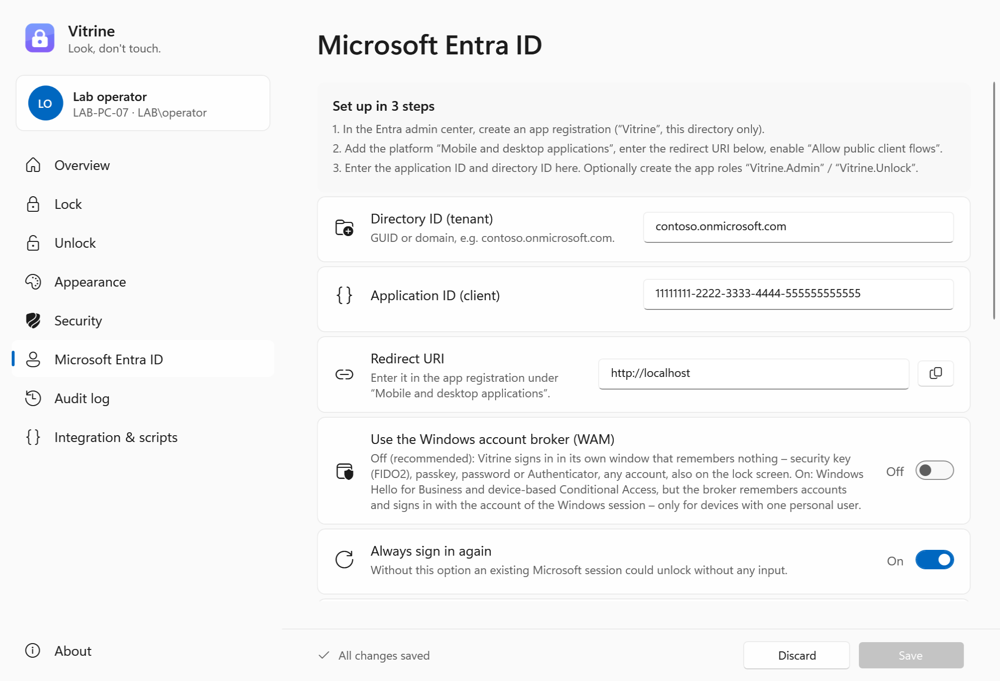
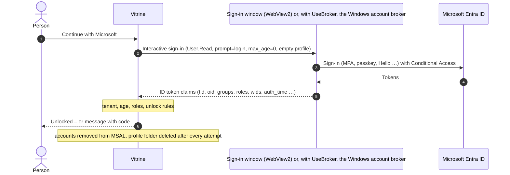

[Vitrine](../README.md) › Microsoft Entra ID

# Microsoft Entra ID

With Entra ID, people sign in with **Continue with Microsoft**: for electronic signatures, for administrator
confirmations, in the test sign-in and to unlock. Vitrine uses the Microsoft Authentication Library (MSAL) and, by
default, **its own sign-in window** (Microsoft Edge WebView2) that **remembers nothing**: every attempt starts with an
empty, private browser profile that is deleted afterwards. Any account can sign in, nobody is signed in silently with
the Windows account of the session, and everything the tenant allows works – **FIDO2 security keys and passkeys**
(through the Windows security dialog), password + MFA, Authenticator – also while Vitrine is locked
([Sign-in window](#sign-in-window)). Conditional Access applies, except conditions that need the Windows device
identity ([Conditional Access](#conditional-access)).

> [!IMPORTANT]
> **New default (0.4.0): own sign-in window instead of the Windows account broker (WAM).** `Entra.UseBroker` is now
> `false`. A device test showed that WAM signs in with the Windows account of the session without asking (one-click
> unlock), keeps every account that ever signed in for the next attempt and – with the session's account as hint –
> makes it hard to choose another account; its window also got no input while Vitrine was locked. Register the redirect
> URI **`http://localhost`** (*Mobile and desktop applications*) in the app registration (step 2 below). Devices whose
> `config.json` was saved by the settings window before this version contain `"UseBroker": true` and keep using WAM –
> the settings overview and the audit log show **VIT-0191** there; switch it off deliberately. The broker stays
> available for devices with one personal user ([Windows account broker](#windows-account-broker-usebroker--true)).

**Contents:** [App registration](#app-registration) · [Settings](#settings) · [Sign-in window](#sign-in-window) ·
[Windows account broker](#windows-account-broker-usebroker--true) · [Tenant check](#tenant-check) ·
[What Vitrine checks](#what-vitrine-checks) · [Test sign-in](#test-sign-in) · [Conditional Access](#conditional-access) ·
[Good to know](#good-to-know) · [When Microsoft is not offered for unlocking](#when-microsoft-is-not-offered-for-unlocking) ·
[Windows account broker (WAM) and Microsoft licence terms](#windows-account-broker-wam-and-microsoft-licence-terms)

<p align="center">
  <picture>
    <source media="(prefers-color-scheme: dark)" srcset="assets/screenshots/settings-entra-dark.png">
    
  </picture>
</p>

## App registration

1. **Microsoft Entra admin center › App registrations › New registration.** Name `Vitrine`, supported account types
   *Accounts in this organizational directory only* (single tenant).
2. **Authentication › Add a platform › Mobile and desktop applications.**
   - Redirect URI: **`http://localhost`** for Vitrine's sign-in window (default). Add
     `ms-appx-web://microsoft.aad.brokerplugin/<application ID>` as well only if some devices use the Windows account
     broker (`Entra.UseBroker = true`). The settings page shows the URI that applies and copies it with one click.
   - **Allow public client flows: Yes.**
3. **API permissions:** delegated `User.Read` for Vitrine's own sign-in. If applications may ask for access tokens
   through the interface (`Entra.AllowedTokenScopes`, [below](#passing-the-sign-in-to-applications)), Vitrine also
   requests exactly those scopes – add them here and grant consent.
4. **Optional – app roles** (recommended over groups). Create them under *App roles* (allowed member type: users/groups)
   and assign them under *Enterprise applications › Vitrine › Users and groups*:
   - `Vitrine.Admin` – may open the settings, exit Vitrine and counts as administrator when unlocking. Only effective
     when the tenant is pinned ([Tenant check](#tenant-check)).
   - `Vitrine.Unlock` – enter it under *Unlock › Groups* **and** switch on *Specific groups* under *Authorised
     people*. Everyone with the role may then unlock.
5. **Optional – groups:** *Token configuration › Add groups claim* (security groups). Enter the group object IDs under
   *Unlock › Groups* and switch on *Specific groups*. Group names do not work for Entra sign-ins, only object IDs.
   The groups claim is also needed if **Entra groups are members of a local group** in `Unlock.AllowedGroups` (for
   example `Vitrine-Entsperrer` filled by Intune) – see
   [local groups with Microsoft sign-in](sign-in.md#local-groups-with-microsoft-sign-in).
   Group names never grant administrator rights; only membership of the local Administrators group does
   ([What Vitrine checks](#what-vitrine-checks)).
6. **`auth_time` – required for unlocking (since 0.4.0) and for signatures with the service:** *Token configuration › Add optional claim › ID ›
   `auth_time`*. Entra includes this claim only when it is configured; without it, `Entra.MaxAuthAgeSeconds` cannot
   check anything (see [Settings](#settings)), and on installations with the service **Microsoft signatures are
   refused** (VIT-0320): the service must see when the person actually signed in ([Signatures checked by the
   service](#signatures-checked-by-the-service)). Since 0.4.0, **unlocking and administrator confirmation** with
   Microsoft are refused without it too (VIT-0180) – see [One-click sign-in is refused](#one-click-sign-in-is-refused).
7. **In Vitrine,** under *Microsoft Entra ID*, enter the directory (tenant) ID as a GUID and the application ID, then
   click **Test sign-in**.

> [!TIP]
> If `entra` is in the sign-in methods but no application ID is set, the settings overview shows "Entra ID is not set
> up yet" and the dialog does not offer Microsoft.

## Settings

| Key | Default | Meaning |
|---|---|---|
| `Entra.TenantId` | `organizations` | tenant as GUID or domain (e.g. `contoso.onmicrosoft.com`); also the MSAL authority |
| `Entra.ClientId` | *empty* | application ID; while empty, Microsoft is not offered |
| `Entra.UseBroker` | `false` | `false`: Vitrine's own sign-in window, nothing remembered ([Sign-in window](#sign-in-window)); `true`: Windows account broker (WAM) – remembers accounts, signs in with the session's account, only for devices with one personal user (VIT-0191) |
| `Entra.ForceFreshSignIn` | `true` | "Always sign in again" (only with the broker; the sign-in window always asks for a new sign-in) |
| `Entra.MaxAuthAgeSeconds` | `300` | refuse sign-ins older than this (VIT-0114); 0 = no check |
| `Entra.AllowedTenants` | *empty* | further allowed tenant IDs (`tid`) |

All values can also be set by policy ([Settings](settings.md)).

**`ForceFreshSignIn`.** Only matters with the broker – leave it on there. Vitrine then asks Microsoft for a new
sign-in (`prompt=login`); without it, Vitrine asks only for an account choice, and an existing Microsoft session could
unlock without any input. The sign-in window always sends `prompt=login` (it has no session to choose from anyway).
After every attempt Vitrine removes all accounts from its MSAL instance; it writes no token cache to disk. What the
Windows account broker keeps for the Windows user is managed by Windows, not by Vitrine.

**`MaxAuthAgeSeconds`.** Vitrine compares the claim `auth_time` with the current time. For **unlocking**, Vitrine
additionally requires a sign-in after the attempt started (below); for **signatures**, the service requires the claim and rejects tokens without it (VIT-0320) – and Entra includes it in the ID token only if you add it as an optional claim (step 6 of
the [app registration](#app-registration)). Without that claim, the freshness of a sign-in relies on
`ForceFreshSignIn` ("Always sign in again", `prompt=login`) alone.

### One-click sign-in is refused

**Security fix in 0.4.0.** In 0.3.0, with `entra` in `Unlock.Methods`, the Windows account broker could unlock with a
single click and **no credential at all**: WAM silently used the Primary Refresh Token of the account signed in to
Windows (Entra sign-in log: incoming token type *Primary refresh token*). `ForceFreshSignIn` (`prompt=login`) is not
honoured by WAM, and `MaxAuthAgeSeconds` was skipped when the token had no `auth_time`. On a device where a
technical account stays signed in, anyone could unlock as that account.

Since 0.4.0, for **unlocking and administrator confirmation** the ID token must prove a sign-in **after the attempt
started**: `auth_time` must be present (otherwise VIT-0180) and at most 2 minutes (clock skew) before the start
(otherwise VIT-0181). The comparison uses Entra's clock: Vitrine estimates how far the computer clock is off from
the token's `iat` (issue time) and the time it received the token, so a fast or slow computer clock does not cause
VIT-0181 (since 0.4.0; without `iat`, the computer clock is used). Vitrine also sends the OpenID Connect parameter `max_age=0`, which asks for a new
authentication where it is honoured. Signatures keep their own checks in the service (nonce, `auth_time`, VIT-0320,
VIT-0321). Since the same version the default is Vitrine's own [sign-in window](#sign-in-window), which never uses the
session's sign-in: each person signs in with their own account, for example with their FIDO2 security key.

**`UseBroker`.** Off by default (since 0.4.0). See [Windows account broker](#windows-account-broker-usebroker--true)
for when to switch it on. In a build without the broker (`-p:WamBroker=false`) the switch is greyed out.

**No sign-in hint for unlocking.** The Microsoft method has no user name field. For **unlocking and administrator
confirmation** Vitrine passes no account hint: anyone allowed by the unlock rules may sign in, and on shared devices the
session's account is often a technical account. In the sign-in window no hint is passed for signatures either (the
interface does not say who should sign). Only with the broker does a signature pass the session user's UPN as hint.

## Sign-in window

The default way to sign in (`Entra.UseBroker = false`). MSAL hands the Microsoft sign-in page to a Vitrine window that
hosts Microsoft Edge WebView2 (MSAL *custom web UI*):

- **Nothing is remembered.** Each attempt gets a new browser profile in
  `%LocalAppData%\ICT-Baden\Vitrine\WebView\<random ID>`, opened in private mode (cookies only in memory). After the
  window closes, Vitrine waits for the browser processes to end and deletes the folder; leftovers (crash, locked file)
  are deleted at the next start or attempt (folders older than 10 minutes). No account, no cookie and no "stay signed
  in" survives to the next attempt.
- **No silent sign-in with the Windows account.** WebView2 can sign in with the Windows account (Primary Refresh Token)
  only when an app allows it (`AllowSingleSignOnUsingOSPrimaryAccount`); Vitrine does not. Every sign-in needs the
  person's own credential, and `prompt=login` plus `max_age=0` are sent; `auth_time` is checked as before
  ([One-click sign-in is refused](#one-click-sign-in-is-refused)).
- **Any account.** No account hint for unlocking and administrator confirmation.
- **FIDO2 security keys and passkeys** work through the Windows WebAuthn API: Windows shows its security dialog for the
  key, its PIN and touch (`CredentialUIBroker.exe`/`CredDialogHost.exe`), or a QR code for a passkey on a phone.
- **While locked:** the window belongs to Vitrine and is allowed by window handle like the unlock dialog (its WebView2
  content runs in `msedgewebview2.exe` child windows, which count as part of it); it lies above the covers. The Windows
  security dialog gets input through `Security.AuthUiProcesses`. The dialog's countdown pauses; the sign-in is
  cancelled after 2 minutes ([Sign-in](sign-in.md#input-while-the-microsoft-or-hello-window-is-open)).
- **Not a browser.** No address bar, no new windows (links such as *Terms of use* do nothing), no downloads, no
  developer tools, no context menu, no permission prompts (camera, location …), no other programs (`ms-settings:`,
  `mailto:` …), no *Save as*, no screen capture, no printing and no file selection (blocked in every page). The redirect
  to `http://localhost` is never loaded – Vitrine takes the code from the address and hands it to MSAL.
- **Only sign-in pages.** The window (and every frame in it) opens only HTTPS pages on Microsoft's sign-in hosts –
  `login.microsoftonline.com`, `login.microsoft.com` (security keys, passkeys), `device.login.microsoftonline.com` and
  `certauth.login.microsoftonline.com` / `*.certauth.login.microsoftonline.com` (certificate-based sign-in) – and on the
  hosts in **`Entra.AllowedSignInHosts`**. Scripts, styles and images load from Microsoft's CDNs as usual; they are not
  page navigations. A link or redirect to any other address ends the sign-in with **VIT-0193**, naming the host.
  Deliberately not allowed: `autologon.microsoftazuread-sso.com` (seamless single sign-on with the session's Kerberos
  ticket), `login.live.com` (personal Microsoft accounts), password reset and the registration of sign-in methods
  (`passwordreset…`, `mysignins…`) – people do that on their own device. **Federated domains** (AD FS, Okta, Ping …):
  add the identity provider's host, for example `adfs.contoso.com` or `*.okta.com` (`*.` allows subdomains only). Add
  only sign-in pages you trust: while Vitrine is locked, anyone at the device can use them.
- **Redirect URI** `http://localhost` (*Mobile and desktop applications*).

**Microsoft Edge WebView2 Runtime required.** It is part of Windows 11 and of current Windows 10 versions; some
Windows 10 LTSC images lack it. Without it, Microsoft is not available (**VIT-0190**, on the settings overview and once
per start in the audit log) and the unlock dialog does not offer it – Vitrine deliberately does not fall back to the
default browser, which would remember accounts. Install the
[WebView2 Runtime](https://developer.microsoft.com/microsoft-edge/webview2/) (Evergreen) or use the broker.

## Windows account broker (`UseBroker = true`)

With `Entra.UseBroker = true` (in a build with the broker) MSAL signs in through the Windows account broker (WAM)
instead. Only the broker can use the **Windows device identity**: Windows Hello for Business and Conditional Access
conditions such as *require compliant device* or *require hybrid joined device*. The price:

- WAM **remembers accounts** that signed in once and offers them again next time.
- WAM can sign in **with the account of the Windows session** (Primary Refresh Token) without asking; Vitrine refuses
  such sign-ins for unlocking (VIT-0180, VIT-0181), but the person has to notice why.
- Its windows run in system processes (`Microsoft.AAD.BrokerPlugin.exe`, `AccountsControlHost.exe` in
  `ApplicationFrameHost.exe`); while locked, Vitrine lets the processes in `Security.AuthUiProcesses` receive input –
  only from Windows' own folders ([Sign-in](sign-in.md#input-while-the-microsoft-or-hello-window-is-open)).

Use it **only on devices with one personal user**. While it is on, the settings page shows a warning under the switch,
and the settings overview and the audit log (once per start) show **VIT-0191**. The broker redirect URI
`ms-appx-web://microsoft.aad.brokerplugin/<application ID>` must be registered.

## Tenant check

> [!IMPORTANT]
> **Microsoft sign-in needs a pinned tenant** (since 2026-10-21): a tenant ID (GUID) in `Entra.TenantId` or in
> `Entra.AllowedTenants`. With the default `organizations` (or `common`, or a domain name) and no GUID in
> `AllowedTenants`, Vitrine refuses every Microsoft sign-in before the browser opens (VIT-0117) – unlock, signatures,
> administrator approval and the test sign-in. Before, Vitrine accepted a token from **any** work or school tenant.
>
> **Set `Entra.TenantId` to your tenant ID (GUID).** Keep `organizations` and list GUIDs in `AllowedTenants` only if
> several of your own tenants must sign in; every listed tenant is trusted equally (also for the administrator role).
> Entries that are not GUIDs are ignored. A token without `tid` or from another tenant is refused (VIT-0113).

Guest (B2B) accounts that sign in through your tenant receive your tenant's `tid` and pass the tenant check. Their
`preferred_username` is usually their home address; use `Unlock.AllowedDomains` or app roles to keep them out.

## What Vitrine checks

After a successful Microsoft sign-in, Vitrine evaluates the claims of the ID token (`EntraClaims.cs`), in this order:

1. **Before the sign-in:** a tenant must be pinned (VIT-0117, see above).
2. **Tenant:** `tid` must be in the allowed list (see above), otherwise VIT-0113.
3. **Age:** unlocking and administrator confirmation need `auth_time` after the start of the attempt (2 minutes tolerance; VIT-0180, VIT-0181). If `MaxAuthAgeSeconds > 0` and `auth_time` is present, the sign-in must not be older; otherwise VIT-0114.
4. **Identity:** user name = `preferred_username` (shown and logged), display name = `name`, user ID = `oid`.
5. **Groups and roles:** the values of `groups` (object IDs) and `roles` (app roles) become the groups that
   `Unlock.AllowedGroups` is compared with.
6. **Administrator:** only if the `roles` claim contains the app role `Vitrine.Admin` or `wids` contains the template ID
   of *Global Administrator* (`62e90394-69f5-4237-9190-012177145e10`). A group named `Vitrine.Admin` in the `groups`
   claim does not count. Since 0.4.0, when unlocking or confirming as administrator, also when the account or one of
   its Entra groups is a direct member of the local Administrators group (step 8).
7. **Session user** (since 2026-10-21, by immutable IDs only): the optional claim `onprem_sid` equals the SID of the
   Windows session (hybrid accounts – add `onprem_sid` as optional claim of the ID token in the app registration), or,
   on Entra-joined devices, the SID Windows derives from `oid` (`S-1-12-1-…`) equals it. `preferred_username` is no
   longer used: it can be changed and is not unique. Without either, a Microsoft sign-in never counts as the session
   user – allow the person through `Unlock.AllowedUsers`, groups or app roles instead.
8. **Local groups** (since 0.4.0, in the app when unlocking, for administrator confirmation and the test sign-in):
   Vitrine derives the SIDs `S-1-12-1-…` of the account (`oid`) and of the Entra groups (`groups` claim) and checks
   the direct members of each local group in `Unlock.AllowedGroups` and of *BUILTIN\Administrators*. Matches are
   added as SIDs to the groups and logged as `localGroups`. Without a `groups` claim (not configured, or more than 200
   groups – overage with `_claim_names`) only the account itself counts; Vitrine does not call Microsoft Graph.
   Details: [local groups with Microsoft sign-in](sign-in.md#local-groups-with-microsoft-sign-in).

Then the [unlock rules](sign-in.md#who-may-unlock) apply. The audit log records `tid`, `oid` and, if present, `amr`
(authentication methods) in `Data` ([Audit log](audit-log.md)).

### Signatures checked by the service

On installations with the service, the service checks the ID token of a Microsoft **signature** itself, because it does
not trust the app in the session ([Audit log › Electronic signatures](audit-log.md#electronic-signatures)). In addition
to the checks above:

1. **Nonce:** before the sign-in, Vitrine asks the service for a one-time value and passes it to Microsoft as OpenID
   Connect `nonce`. The ID token must contain exactly this value, for the same Windows session, within 10 minutes, and
   only once – otherwise VIT-0311. This binds the token to this signature request.
2. **`auth_time` is required** (VIT-0320 without it). A token from a single sign-on session is freshly *issued* but
   keeps the old `auth_time`; someone who controls the session app could otherwise get a token from the browser
   session of a person who signed earlier.
3. With `Entra.ForceFreshSignIn` (default), `auth_time` must be after the signature request (2 minutes tolerance for
   the clocks) – otherwise VIT-0321. With `Entra.MaxAuthAgeSeconds > 0`, it must not be older than that (VIT-0321).
   With both switched off, a sign-in of any age counts: do not do that on GxP workstations.
4. Signature of the token with the tenant's keys, issuer, audience (`Entra.ClientId` of the **device** configuration),
   validity and age (VIT-0311, VIT-0312).

The `nonce` is sent with MSAL's extra query parameters; whether Microsoft returns it in the ID token has not yet been
tested with a real tenant – if it does not, Microsoft signatures fail with VIT-0311 ("nonce"), they are never accepted
without it.

Microsoft errors appear as "Microsoft Entra ID: *message*" (VIT-0112), a cancelled sign-in as VIT-0111, which counts
as a [failed attempt](sign-in.md#failed-attempts).



## Test sign-in

**Test sign-in** on the settings page signs in with the current values, including values not saved yet, and shows what
Vitrine sees:

- name and user name, object ID, tenant
- whether it is the session user
- administrator yes/no
- up to eight groups and roles, or "group claim not configured"
- whether the person **may unlock** under the current (unsaved) rules, with the reason if not

The test sign-in applies the tenant and age checks, but it is **not** written to the audit log and does not count as a
failed attempt.

## Sign-in methods

Vitrine does not implement sign-in methods itself. MSAL opens Microsoft's sign-in in Vitrine's
[sign-in window](#sign-in-window) (with `UseBroker`: in the Windows account broker), which offers **every method the
tenant allows** for the account:

| Method | Notes |
|---|---|
| Password + MFA (Authenticator push, code, SMS, call) | as configured in the tenant |
| Passwordless with Microsoft Authenticator | number matching on the phone |
| **Passkeys** – FIDO2 security keys (USB, NFC) | the Windows security dialog asks for the key and its PIN (`CredentialUIBroker.exe`) |
| **Passkeys** in Microsoft Authenticator or on another phone (cross-device, QR code) | the same Windows dialog shows the QR code; needs Bluetooth on the PC |
| Windows Hello for Business | only with the broker (`UseBroker = true`; Entra-joined or hybrid-joined devices) |
| Certificate-based authentication / smartcard | if the tenant offers it |
| Temporary Access Pass | e.g. for new accounts |

Which methods appear, and which are required, is decided by the tenant (authentication methods policy, Conditional
Access), not by Vitrine. Each unlock or signature is a new interactive sign-in (`ForceFreshSignIn`); Vitrine keeps no
tokens afterwards. The methods Microsoft reports in the token (`amr`, e.g. `fido`, `mfa`), if any, are written to the
audit log and passed to the application in the interface answer.

## Requiring passkeys and other strong methods

To require a specific method, use a Conditional Access **authentication strength** (e.g. *Phishing-resistant MFA*,
which allows passkeys, Windows Hello for Business and certificate-based authentication):

- **For every Vitrine sign-in:** a Conditional Access policy for the app registration *Vitrine* with that
  authentication strength. No setting in Vitrine is needed.
- **Only for some actions, e.g. signatures:** create an *authentication context* (Entra admin centre › Protection ›
  Conditional Access › Authentication contexts, e.g. `c2` "Signature"), a Conditional Access policy for that context
  with the authentication strength, and set `Entra.SignatureAuthenticationContext = c2`. `Entra.AuthenticationContext`
  does the same for every sign-in (unlock, signature, administrator).

Vitrine requests the context with the `claims` parameter; **Microsoft Entra ID enforces the policy** – Vitrine cannot
check it itself in most cases: Entra reports the fulfilled contexts (`acrs`) in the access token, and Vitrine only
evaluates the ID token. Only if the ID token carries `acrs` and the requested context is missing does Vitrine refuse
the sign-in (VIT-0115). A value other than `c1` … `c99` is never silently dropped: Vitrine refuses every Microsoft
sign-in that would need it (VIT-0116) and the settings overview shows the error. Test with **Test sign-in** before
rollout, and check in the Entra sign-in logs that the Conditional Access policy for the context applied.

## Passing the sign-in to applications

Applications that request a sign-in or signature through the [local interface](interface.md#tokens-for-the-application)
always get the person, tenant and object ID. Two settings pass more, both off by default:

- `Entra.ShareIdToken = true`: the **ID token** of the sign-in (`idToken`). The application can verify the signature
  against the tenant's keys, the issuer and the audience (the application ID of Vitrine) itself.
- `Entra.AllowedTokenScopes`: scopes such as `api://lims/Signature.Write` for which an application may ask for an
  **access token** (`"scopes":[…]` in the request). Only scopes on this list and of one resource per request are
  accepted (VIT-0211, VIT-0212). The API must accept tokens issued to the Vitrine app registration (add Vitrine as an
  authorised client application of the API, or grant admin consent). With scopes, the dialog offers only Microsoft.

Tokens are given only to the connection that asked, never written to the audit log or the event stream.

## Conditional Access

A Conditional Access policy for the app "Vitrine" can, for example, require MFA or a phishing-resistant method
(authentication strength) – this works with the sign-in window.

> [!WARNING]
> **Device-based conditions are not met by the sign-in window.** *Require device to be marked as compliant*, *Require
> Microsoft Entra hybrid joined device* and similar grant controls need the Windows device identity, which only the
> broker passes; the empty, private profile of the sign-in window does not. Sign-ins fail with an `AADSTS` error such as
> 53000/53003. Either **exclude the Vitrine app registration** from such policies (and protect it with an
> authentication strength instead), or use `Entra.UseBroker = true` on devices with one personal user
> ([Windows account broker](#windows-account-broker-usebroker--true)).

Test every policy with **Test sign-in** before rollout, and keep a method that works offline (see below).

## Good to know

- **Network:** the Microsoft sign-in needs a connection to Microsoft. For offline situations keep the Windows password
  (cached logon) or Hello enabled.
- **Smartcards:** Vitrine has no smartcard code of its own. A smartcard works if the tenant offers
  certificate-based authentication, or through a [plugin](plugins.md).
- **No default browser.** Vitrine never opens the default browser for Microsoft (before 0.4.0 it did without the
  broker). Without the WebView2 Runtime and without the broker, Microsoft is not available (VIT-0190).
- **Input:** while the sign-in window is open, Vitrine passes input only to it, to the pop-ups of its own WebView2
  processes and to the processes in `Security.AuthUiProcesses` from protected folders – never to file, print or other
  standard dialogs ([Sign-in](sign-in.md#input-while-the-microsoft-or-hello-window-is-open)).
- **Not tested on real tenants yet:** version 0.5.1 has not been tested end to end with real tenants, MFA and
  Conditional Access ([Limitations](limitations.md)).

<a id="without-the-windows-account-broker"></a>

## When Microsoft is not offered for unlocking

Since 0.4.0 Microsoft is offered for unlocking with the sign-in window (default) and with the broker. It is **not**
offered only when the Microsoft Edge WebView2 Runtime is missing and the broker is not used (`UseBroker = false`, or a
build made with `-p:WamBroker=false`) – VIT-0190. (Up to 0.3.0, every configuration without the broker behaved like
this, also the release packages from 2026-10-20 up to 0.2.0.) What that means for configurations set up for Microsoft
unlocking:

| Configuration | Behaviour | Message |
|---|---|---|
| `Unlock.Methods` contains `entra` and other methods | The unlock dialog offers the other methods. | **VIT-0190** on the settings overview |
| `Unlock.Methods` contains **only** `entra` | Vitrine unlocks with the **Windows password**. `Entra.AuthenticationContext` (for example a passkey requirement) and Conditional Access **do not apply to unlocking** any more – only the Windows sign-in rules of the device do. | **VIT-0016** in the audit log, as a warning in the Windows event log and on the settings overview |
| `Unlock.AllowedDomains` contains only UPN suffixes (`contoso.com`), and only Windows password or Windows Hello remain at the lock screen | Windows reports `CONTOSO\name`, so **nobody can unlock – not even an administrator**. | **VIT-0017** (as above) |
| `Unlock.Allowed` allows only groups, and `Unlock.AllowedGroups` contains only Entra group IDs (GUIDs) | Windows reports group SIDs, so nobody can unlock. | **VIT-0017** |

Before updating devices set up for Microsoft-only unlocking, add `windows` or `hello` to `Unlock.Methods` deliberately,
add the NetBIOS domain name (`CONTOSO`) to `Unlock.AllowedDomains`, and Windows groups (`CONTOSO\Lab operators` or a
SID) to `Unlock.AllowedGroups`. If unlocking must require Microsoft (for example passkeys through an authentication
context), install the WebView2 Runtime. Without it, signatures, administrator confirmation and the test sign-in with
Microsoft fail with VIT-0190 too. With the sign-in window or the broker, none of these warnings appears.

## Windows account broker (WAM) and Microsoft licence terms

The broker support comes from Microsoft's MSAL runtime (`msalruntime.dll` and
`Microsoft.Identity.Client.NativeInterop.dll`, NuGet package `Microsoft.Identity.Client.NativeInterop`, pulled in by
`Microsoft.Identity.Client.Broker`). Its licence changed between versions:

| `Microsoft.Identity.Client.NativeInterop` | Licence on nuget.org |
|---|---|
| 0.18.1 – **0.20.4** | **MIT** (licence expression `MIT` in the package metadata, `https://licenses.nuget.org/MIT`) |
| 0.20.6 (2026-05-27), 0.20.7 (2026-10-23) | Microsoft Software License Terms in the package's `LICENSE` file: they do not permit to "share, publish, distribute, or lease the software" (clause 3 e), and allow data collection by Microsoft (clause 2) and automatic updates (clause 6) |

`Microsoft.Identity.Client.Broker` 4.84.2 and later require NativeInterop 0.20.6. Vitrine therefore pins
**MSAL.NET and the broker package to 4.84.1** and **NativeInterop to exactly 0.20.4** (MIT), and ships that version in
all release packages (MSI, single file, ZIP); it is used only with `Entra.UseBroker = true`. The question to Microsoft
about the licence change is open:
[AzureAD/microsoft-authentication-library-for-dotnet#6118](https://github.com/AzureAD/microsoft-authentication-library-for-dotnet/issues/6118).

Evidence for the shipped version:

- Package `microsoft.identity.client.nativeinterop.0.20.4.nupkg`, SHA-256
  `5b89bba3da0ba3c934e8ef441053717c635668c887bcbc62187ef2612f696ec2`, author-signed by Microsoft Corporation and
  repository-signed by nuget.org; its `.nuspec` declares `<license type="expression">MIT</license>` and the package
  contains no separate licence file.
- `msalruntime.dll` (win-x64) from that package, SHA-256
  `b17764a728a8a182bf1dd442ddbf579ec1c8890acdd463ac9419d2a4dd8944a9`, Authenticode-signed by Microsoft Corporation.

The build fails if any of this changes: `.github/scripts/check-broker-licence.ps1` checks that the restored
NativeInterop is exactly 0.20.4, that its `.nuspec` names the licence expression `MIT` (MSAL and the broker package
4.84.1 as well), and that `msalruntime.dll` in the ZIP, in the single-file `Vitrine.exe` and in the MSI has the hash
above; the MSI test checks the installed file again. Dependabot does not propose MSAL ≥ 4.84.2 or NativeInterop
≥ 0.20.5. MSAL.NET 4.84.2 to 4.91.1 contain no fix that applies to the way Vitrine uses MSAL (interactive sign-in only,
no token cache, no logging, no WS-Trust or username/password flows); the MSAL runtime's own changes after 0.20.4 are not
published.

**Build without the broker.** An organisation that does not want the Microsoft runtime can build without it; Entra ID
then always uses the [sign-in window](#sign-in-window):

```powershell
dotnet publish src/Vitrine/Vitrine.csproj -c Release -r win-x64 -p:PublishSingleFile=true -p:SelfContained=true -p:WamBroker=false -o publish
```

What the runtime contacts and whether it updates itself: [Data and privacy](data-and-privacy.md#network-connections).

### WebView2 SDK licence

The sign-in window uses the NuGet package `Microsoft.Web.WebView2` **1.0.4258.31**. Vitrine ships its managed
assemblies and the loader `WebView2Loader.dll` (win-x64 SHA-256
`3426dcc55fdfb8b5e7ac623cf33b4ccf283fbf68a0c5a65bddfdb4d749a8abee`; package SHA-256
`56f7f4b8bf9aee4b8efefbbdd4f67d5f74ebd1b100ed0806da71bf76af481aa9`, signed by Microsoft). The package declares
`<license type="file">LICENSE.txt</license>`: a BSD-style licence that permits redistribution in binary form with the
copyright notice and disclaimer (text in `THIRD-PARTY-NOTICES.txt`, section D). The package's `NOTICE.txt` lists
Antlr3 and StringTemplate4, which belong to its build tools and are not shipped. The WebView2 **Runtime** is not shipped –
it is part of Windows. `.github/scripts/check-broker-licence.ps1` also fails the build if another WebView2 version is
restored, if the licence file's text changes (hash) or if `WebView2Loader.dll` is missing or different in ZIP, single
file or MSI.

---

<p align="center"><sub>
<a href="installation.md">Installation</a> · <a href="usage.md">Usage</a> · <a href="command-line.md">Command line</a> · <a href="settings.md">Settings</a> · <a href="sign-in.md">Sign-in</a> · <b>Entra ID</b> · <a href="audit-log.md">Audit log</a> · <a href="interface.md">Interface</a> · <a href="plugins.md">Plugins</a> · <a href="gxp.md">GxP</a> · <a href="data-and-privacy.md">Data and privacy</a> · <a href="error-codes.md">Error codes</a> · <a href="limitations.md">Limitations</a> · <a href="development.md">Development</a><br>
<a href="../README.md">← Back to Vitrine</a>
</sub></p>
