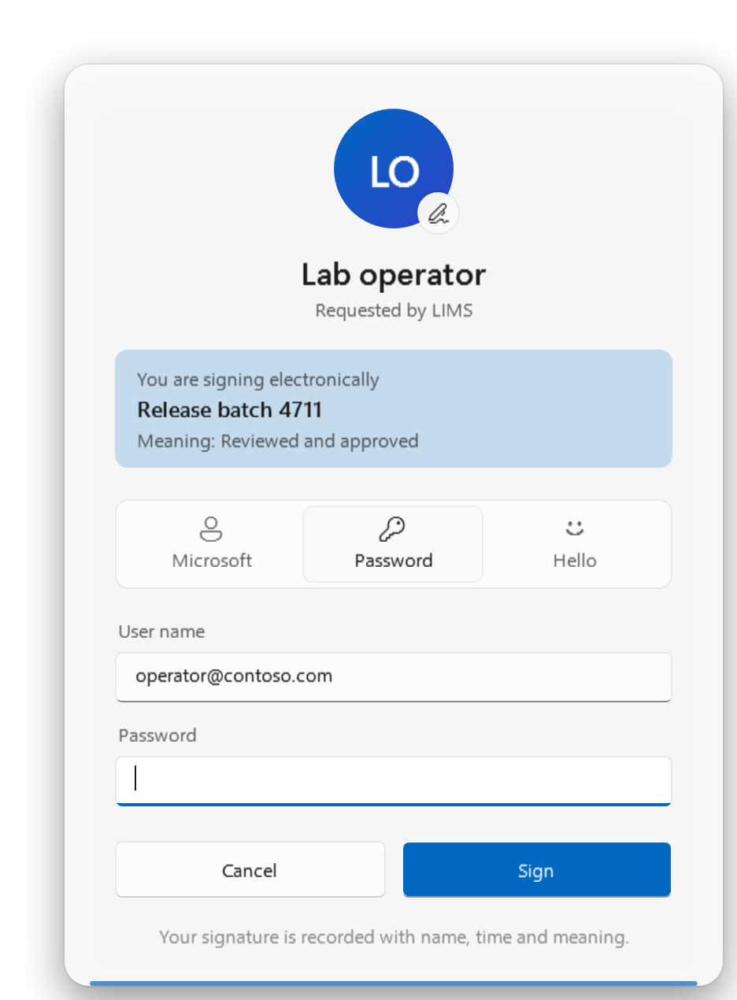
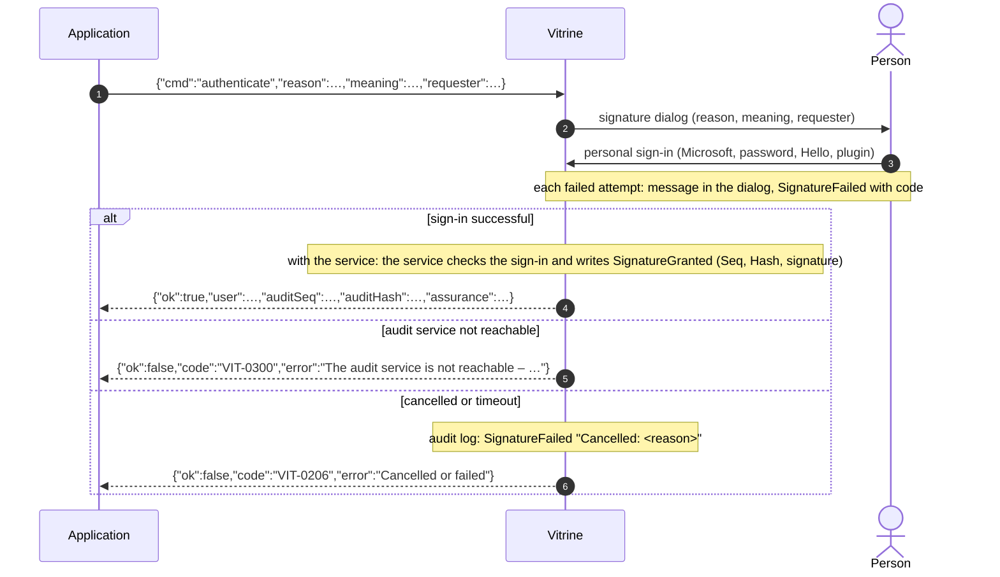

[Vitrine](../README.md) › Interface and electronic signatures

# Interface and electronic signatures

Line-of-business applications – a LIMS, chromatography software, an MES client or your own script – talk to Vitrine
through a **local named pipe**: query the status, lock, request **electronic signatures** and subscribe to events.

**Contents:** [Connection](#connection) · [Protocol](#protocol) · [Commands](#commands) ·
[Electronic signature](#electronic-signature) · [Event stream](#event-stream) · [Errors and limits](#errors-and-limits) ·
[When the interface is switched off](#when-the-interface-is-switched-off) · [Verifying the server](#verifying-the-server) · [PowerShell client](#powershell-client) ·
[Change in 0.1.0: new pipe name](#change-in-010-new-pipe-name)

## Connection

| Topic | Details |
|---|---|
| **Name** | `\\.\pipe\ICT-Baden.Vitrine.<session>` – one pipe per Windows session; `<session>` is the session ID of the Vitrine process (in PowerShell: `(Get-Process -Id $PID).SessionId`). Settings › Integration & scripts shows the exact name. |
| **Access** | the user of the session (read/write), SYSTEM (full control) and the local Administrators group (read/write). Other users cannot open the pipe. |
| **Clients** | several connections at the same time; several requests one after another on one connection |

> [!NOTE]
> The interface does not authenticate the client: **every process running as the session user** can use it – lock,
> read the status, subscribe to events and open a signature dialog. A signature still needs a person to sign in in
> that dialog. The pipe name is predictable, and the client cannot tell from the name alone that Vitrine is the
> server. Check the server process before you trust a signature response – see [Verifying the server](#verifying-the-server).

Vitrine creates its first pipe instance so that it fails if the name already exists (`FILE_FLAG_FIRST_PIPE_INSTANCE`).
If another process – of any user – owns the name first, Vitrine does **not** offer the interface and writes an `Error`
entry with VIT-0210 to the audit log. A second start of `Vitrine.exe` hands over `--lock` or the settings only if the
pipe server is Vitrine itself (same file or Vitrine build of the same publisher); otherwise `--lock` locks Windows – see [Command line](command-line.md).

## Protocol

- UTF-8, **one JSON object per line** for each request and each response, line end LF (CR LF is accepted).
- The command is in `cmd`; command names are not case-sensitive.
- Responses are part of the programming interface and therefore always in **English**, independent of the user
  interface language. Errors carry a language-independent `code`.
- Times are **UTC** in ISO 8601 (`2026-10-19T08:15:02.1234567+00:00`).
- Strings use standard JSON escaping; Vitrine may write characters such as `+`, `<`, `>`, `&`, `'` and non-ASCII
  characters as `\uXXXX`. Use a JSON parser.
- Text fields that are not strings (numbers, objects) are ignored, as if they were missing.

## Commands

| Command | Effect | Works with `Integration.PipeEnabled = false` |
|---|---|:---:|
| `status` | lock state and session | no |
| `lock` | lock, optionally with `"trigger"` as text for the audit log | yes |
| `settings` | open the settings window (the administrator check still applies) | yes |
| `authenticate` (alias `sign`) | request an electronic signature | no |
| `subscribe` | receive events | no |

```text
→ {"cmd":"status"}
← {"ok":true,"locked":false,"lockedSince":null,"lastUnlockedBy":"Lab operator","machine":"LAB-PC-07","sessionUser":"CONTOSO\\jdoe"}
```

| Field | Content |
|---|---|
| `locked` | `true` while locked |
| `lockedSince` | start of the current lock (UTC), otherwise `null` |
| `lastUnlockedBy` | display name of the last person who unlocked since Vitrine started, otherwise `null` |
| `machine`, `sessionUser` | computer name and `DOMAIN\name` of the session |

```text
→ {"cmd":"lock","trigger":"LIMS: measurement started"}
← {"ok":true,"locked":true,"lockedSince":"2026-10-19T08:03:11.4610000+00:00","lastUnlockedBy":null,"machine":"LAB-PC-07","sessionUser":"CONTOSO\\jdoe"}
```

`lock` locks with the configured appearance (`Appearance.Visual`); a request cannot choose transparent or covered. It
answers with the status. The
audit log records the trigger as `api: LIMS: measurement started`, or `api` without `trigger`. If the workstation is
already locked, nothing changes.

```text
→ {"cmd":"settings"}
← {"ok":true}
```

`settings` answers at once. The window opens only if the workstation is not locked and, with
`Security.SettingsAdminOnly`, after an administrator confirmation.

## Electronic signature

<table>
  <tr>
    <td width="55%" valign="top">
      <picture>
        <source media="(prefers-color-scheme: dark)" srcset="assets/screenshots/sign-dark.png">
        
      </picture>
    </td>
    <td width="45%" valign="top">
      The dialog <b>"Vitrine – Electronic signature"</b> shows:<br><br>
      • as heading, name and initials of the <b>session user</b> (not necessarily the person who signs)<br>
      • "Requested by …" (<code>requester</code> and the client process with PID)<br>
      • "You are signing electronically"<br>
      • the <b>reason</b> (<code>reason</code>)<br>
      • "Meaning: …" (<code>meaning</code>)<br>
      • the sign-in methods and the button "Sign"<br>
      • "Your signature is recorded with name, time and meaning."<br><br>
      Timeout as for unlocking (<code>Unlock.PromptTimeoutSeconds</code>), but at least 60 s. The response arrives when the dialog closes.
    </td>
  </tr>
</table>



**Request** – `reason` is required, `meaning` and `requester` are optional:

```text
→ {"cmd":"authenticate","reason":"Release batch 4711","meaning":"Reviewed and approved","requester":"LIMS"}
← {"ok":true,"user":"jdoe@contoso.com","displayName":"Lab operator","userId":"0b9e…","tenantId":"72f9…","method":"entra",
   "time":"2026-10-19T08:21:40.0270000+00:00","reason":"Release batch 4711","meaning":"Reviewed and approved",
   "auditSeq":"1057","auditHash":"c41d…","assurance":"verified"}
```

(The response is one line; it is wrapped here for reading.)

| Response field | Content |
|---|---|
| `user` | account name of the person who signed: UPN for Entra, `DOMAIN\name` for Windows password and Hello, as returned by a plugin |
| `displayName` | display name |
| `userId` | Entra object ID or Windows SID |
| `tenantId` | Entra tenant; `null` for Windows password and Hello |
| `method` | `entra`, `windows`, `hello`, `windowslogon` or a plugin ID |
| `time` | time of the **response** (UTC), not the time stamp of the audit entry |
| `reason`, `meaning` | as requested (after cleaning, see [limits](#errors-and-limits)); `meaning` is `null` if not sent |
| `auditSeq`, `auditHash` | `Seq` (as a string) and `Hash` of the `SignatureGranted` entry – they link the signature to the [audit log](audit-log.md) |
| `assurance` | what the audit entry vouches for (since #15): `verified` – the service checked the sign-in itself (Windows password, Microsoft Entra ID); `client` – reported by Vitrine in the session, not checked by the service (Windows Hello, plugins); `local` – no service, the log is not Part 11 capable. An application that needs 21 CFR Part 11 signatures should accept only `verified` ([Audit log › Electronic signatures](audit-log.md#electronic-signatures)) |

**Who may sign:** any person with a successful **personal** sign-in, including someone other than the session user.
`Unlock.Allowed`, groups and accounts do not apply; `Unlock.AllowedDomains` and the Entra tenant check do. The shared
unlock password is not offered. Details: [Sign-in › Signatures](sign-in.md#signatures).

**Audit service not reachable:** when the service writes the audit log but Vitrine cannot reach it, `authenticate` and
`sign` answer `{"ok":false,"code":"VIT-0300",…}` without opening a dialog; ask again later. Other refusals by the
service (e.g. VIT-0311, VIT-0313) are answered with their code as well.

**In the audit log** a signature is a `SignatureGranted` entry: person, method, detail `<reason> – <meaning>`, and in
`Data` the values `reason`, `meaning`, `requester`, `clientProcess`, `userId`, `displayName`, `tenant` (for Entra also
`tid`, `oid`, `amr`). Every failed attempt and the closing of the dialog without a signature are written as `SignatureFailed`.

**Good to know:**

- If a dialog is already open (unlock, administrator or another signature), the request is answered at once with
  VIT-0206 and **no** audit entry is written.
- While the workstation is locked, `authenticate`/`sign` is refused at once with
  `{"ok":false,"code":"VIT-0209","error":"Workstation is locked"}`; no dialog opens and no audit entry is written.
- The dialog shows "Requested by *requester* · *process* (PID *n*)", e.g. "Requested by LIMS · lims.exe (PID 1234)".
  The process is the one that is really connected to the pipe (Win32 `GetNamedPipeClientProcessId`); `requester` is
  only what the client claims. The `SignatureGranted` entry contains the process in `Data.clientProcess`.
- The connection stays open until the dialog closes; other connections are served in the meantime.

## Tokens for the application

With Microsoft Entra ID, the answer to `authenticate` and `sign` can carry tokens ([Entra ID](entra-id.md#passing-the-sign-in-to-applications)):

```json
{"cmd":"sign","reason":"Release batch 4711","meaning":"Approved","requester":"LIMS","scopes":["api://lims/Signature.Write"]}
```

| Field in the answer | When | Content |
|---|---|---|
| `amr` | if Microsoft reports it | authentication methods, space-separated (e.g. `fido mfa`) |
| `idToken` | `Entra.ShareIdToken = true` and the person signed in with Microsoft | the ID token (JWT) |
| `accessToken`, `expiresOn`, `scopes` | the request had `scopes` | access token for these scopes, its expiry (UTC) and the granted scopes |

- `scopes`: a list of strings or one string with spaces, at most 10. Each must be listed in `Entra.AllowedTokenScopes`,
  and all must belong to one resource. OpenID scopes (`openid`, `profile`, `email`, `offline_access`) may be added,
  but only together with at least one allowed API scope. An empty `Entra.AllowedTokenScopes` means **no access tokens
  at all** on this device. Otherwise the answer is an error (VIT-0211, VIT-0212) and no dialog opens. Without
  Microsoft Entra ID set up: VIT-0213. For the ID token alone, leave out `scopes` (see `Entra.ShareIdToken`).
- With `scopes`, the dialog offers only *Microsoft*.
- Tokens are sent only on this connection. They are not written to the audit log, the Windows event log or the event
  stream. Treat them like a password in the application.

## Event stream

```text
→ {"cmd":"subscribe"}
← {"ok":true,"subscribed":true}
← {"event":"Locked","time":"2026-10-19T08:03:11.4630000+00:00","actor":null,"method":null,"detail":"Trigger: hotkey","seq":55,"hash":"8e02…"}
← {"event":"UnlockFailed","time":"…","actor":"jdoe@contoso.com","method":"entra","detail":"VIT-0111","seq":56,"hash":"…"}
← {"event":"Unlocked","time":"…","actor":"jdoe@contoso.com","method":"entra","detail":"Locked for 00:12:05","seq":57,"hash":"…"}
```

After the confirmation, every audit entry written by the lock logic follows as one line with the fields `event`,
`time`, `actor`, `method`, `detail`, `seq` and `hash` (the same values as in the [audit log](audit-log.md#events),
without `Data`), until the client disconnects. After `subscribe`, Vitrine reads no further requests on that connection –
open a second connection for commands.

| Sent | Not sent |
|---|---|
| `Locked` (only with `Audit.LogLockState`), `PromptShown`, `Unlocked`, `UnlockFailed`, `UnlockDenied`, `FailureActionTriggered`, `SignatureGranted`, `SignatureFailed`, `ConfigChanged` (settings saved, administrator approvals), `Error` entries of the lock logic | `AppStarted`, `AppStopped`, unexpected errors (VIT-0010) |

With `Audit.Enabled = false`, events are still sent, with `seq` 0 and `hash` `null`.

## Errors and limits

Every error response has the form `{"ok":false,"code":"VIT-02nn","error":"<English message>"}`:

| Code | `error` | When |
|---|---|---|
| VIT-0201 | `Invalid JSON` | the line is not valid JSON |
| VIT-0202 | `JSON object expected` | valid JSON, but not an object (e.g. an array) |
| VIT-0203 | `'reason' is missing` | `authenticate`/`sign` without `reason`, or `reason` empty |
| VIT-0204 | `Unknown command '<cmd>'` | `cmd` missing or unknown |
| VIT-0205 | `Interface is disabled` | `Integration.PipeEnabled = false` and the command is not `lock` or `settings` |
| VIT-0206 | `Cancelled or failed` | the signature was not given: cancelled, timeout, or another dialog was open |
| VIT-0207 | `Request longer than 16384 characters` | the line is too long; Vitrine closes the connection |
| VIT-0208 | `'<field>' is longer than 500 characters` | `reason`, `meaning`, `requester` or `trigger` too long |
| VIT-0209 | `Workstation is locked` | `authenticate`/`sign` while the workstation is locked |

Limits and cleaning:

- **Line length:** at most 16,384 characters per request line. Longer lines are answered with VIT-0207, and the
  connection is closed without reading the rest.
- **Field length:** `reason`, `meaning`, `requester` and `trigger` at most 500 characters each.
- **Control characters** (line breaks, tabs, escape sequences) in these fields are replaced by spaces, and the field is
  trimmed, before the length check. The cleaned text is what the dialog shows and the audit log records.
- The checks run in this order: JSON, object, field lengths, command, `reason`.

Full list with what to do: [Error codes](error-codes.md#vit-02xx--interface).

## When the interface is switched off

`Integration.PipeEnabled = false` does **not** remove the pipe: a second start of `Vitrine.exe` (for example
`Vitrine.exe --lock`) hands its command to the running instance through it. With the setting off:

- `lock` and `settings` work as usual;
- `status`, `authenticate`/`sign` and `subscribe` are answered with VIT-0205;
- invalid requests are answered with VIT-0205 too, unless they are a `lock` or `settings` request (so that a switched-off
  interface reveals nothing about its commands);
- VIT-0207 (line too long) is always returned.

## Verifying the server

Any process can create a pipe with the expected name before Vitrine starts. Before a line-of-business client trusts a
signature response, it should check that the server is Vitrine:

1. Ask Windows for the server process of the connected pipe: `GetNamedPipeServerProcessId` (kernel32).
2. Check that the process runs `%ProgramFiles%\Vitrine\Vitrine.exe` (MSI or `install.ps1`) …
3. … and runs as the user of the session.

If any check fails, do not send the request (or ignore the response). Vitrine itself checks the server in the same way
before a second start hands over a command.

```powershell
Add-Type -Namespace Win32 -Name Pipe -MemberDefinition @'
[DllImport("kernel32.dll", SetLastError = true)]
public static extern bool GetNamedPipeServerProcessId(Microsoft.Win32.SafeHandles.SafePipeHandle pipe, out uint serverProcessId);
'@
$session = (Get-Process -Id $PID).SessionId
$pipe = New-Object IO.Pipes.NamedPipeClientStream('.', "ICT-Baden.Vitrine.$session", [IO.Pipes.PipeDirection]::InOut)
$pipe.Connect(3000)
[uint32]$serverPid = 0
if (-not [Win32.Pipe]::GetNamedPipeServerProcessId($pipe.SafePipeHandle, [ref]$serverPid)) { throw 'Pipe server unknown' }
$server = Get-CimInstance Win32_Process -Filter "ProcessId = $serverPid"
$owner  = Invoke-CimMethod -InputObject $server -MethodName GetOwner
if ($server.ExecutablePath -ne "$env:ProgramFiles\Vitrine\Vitrine.exe" -or
    "$($owner.Domain)\$($owner.User)" -ne "$env:USERDOMAIN\$env:USERNAME") { $pipe.Dispose(); throw 'Not Vitrine' }
```

In C#, declare the same function with `[DllImport("kernel32.dll", SetLastError = true)]`, call it with
`NamedPipeClientStream.SafePipeHandle`, and compare `Process.GetProcessById((int)pid).MainModule.FileName` with the
expected path. The sample client below does not perform this check.

## PowerShell client

[`samples/clients/Vitrine.Client.ps1`](../samples/clients/Vitrine.Client.ps1) shows the interface in a few lines:

```powershell
.\Vitrine.Client.ps1 status
.\Vitrine.Client.ps1 lock
.\Vitrine.Client.ps1 sign -Reason "Release batch 4711" -Meaning "Reviewed and approved"
.\Vitrine.Client.ps1 subscribe          # Ctrl+C stops
```

The client connects to the pipe of its own session (timeout 3 s), sends `authenticate` for `sign` (`-Requester`
defaults to `PowerShell`) and prints the response as a list. It does not know `settings` and does not check
`-Reason` itself: without a reason Vitrine answers VIT-0203.

Other sign-in methods instead of the interface? See [Plugins](plugins.md).

## Change in 0.1.0: new pipe name

Builds before 0.1.0 used `\\.\pipe\Vitrine-<session>`. Since 0.1.0 the name is `\\.\pipe\ICT-Baden.Vitrine.<session>`
(naming guideline of ICT-Baden). **Clients built for the old name cannot connect any more** and must be updated. Error
responses now carry a `code`, and their texts are English (previously German).

---

<p align="center"><sub>
<a href="installation.md">Installation</a> · <a href="usage.md">Usage</a> · <a href="command-line.md">Command line</a> · <a href="settings.md">Settings</a> · <a href="sign-in.md">Sign-in</a> · <a href="entra-id.md">Entra ID</a> · <a href="audit-log.md">Audit log</a> · <b>Interface</b> · <a href="plugins.md">Plugins</a> · <a href="gxp.md">GxP</a> · <a href="data-and-privacy.md">Data and privacy</a> · <a href="error-codes.md">Error codes</a> · <a href="limitations.md">Limitations</a> · <a href="development.md">Development</a><br>
<a href="../README.md">← Back to Vitrine</a>
</sub></p>
