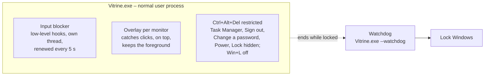

[Vitrine](../README.md) › Limitations

# Limitations and security model

What the lock technically does – and what it honestly cannot do.

**Contents:** [How the lock works](#how-the-lock-works) · [Ctrl+Alt+Del](#ctrlaltdel) · [Win+L](#winl-and-other-ways-windows-locks) · [Watchdog](#watchdog) · [Limits at a glance](#limits-at-a-glance) · [Licences and legal questions](#licences-and-legal-questions) · [Test status](#test-status) · [Independent review](#independent-review-2026-10-19)

## How the lock works

- **Input blocker:** system-wide low-level hooks swallow keyboard and mouse input. They run on their own thread with the highest priority and are re-installed every 5 seconds (the new hook first, then the old one is removed – no gap), so the lock survives a hanging UI or Windows removing a hook after a timeout. If Windows removes a hook, input can get through until the next re-install, for up to 5 seconds.
- **Overlays** (since 2026-10-21) catch clicks themselves while locked: they are not click-through, stay on top of all windows (also "always on top" ones), are not in <kbd>Alt</kbd>+<kbd>Tab</kbd>, and Vitrine takes the foreground back every 0.5 seconds if another window has it. Reason: the hooks of a process without administrator rights do **not** see input that goes to windows with a higher integrity level (UIPI) – Task Manager or a console started as administrator, device software running elevated. With the overlay on top and Vitrine in the foreground, clicks and keys go to Vitrine instead. During a Microsoft or Hello sign-in the overlays still catch clicks but are no longer "always on top": they lie over all ordinary windows, and the sign-in window that opens afterwards lies over them. Such a sign-in is limited to 2 minutes.
- **Elevated windows (remaining gap):** if a window running as administrator takes the foreground by itself during the lock (for example an elevated program that pops up a window), keystrokes can reach it until Vitrine takes the foreground back (≤ 0.5 s). Windows does not always hand the foreground back from an elevated window; if such a window keeps it for 2 seconds, Vitrine locks Windows (`LockWorkStation`, logged as `Error`) – the programs keep running, but the Windows password is needed. Windows that are "always on top" and elevated can lie over the overlays during a Hello or Microsoft sign-in. Lock with no elevated windows open, or run such software under a separate account. Closing this completely needs `uiAccess` (a signed program in *Program Files*) – planned once code signing is available.
- **System shortcuts** – Windows key, <kbd>Alt</kbd>+<kbd>Tab</kbd>, <kbd>Alt</kbd>+<kbd>Esc</kbd>, <kbd>Alt</kbd>+<kbd>F4</kbd>, <kbd>Ctrl</kbd>+<kbd>Esc</kbd>, the context-menu key – are always blocked while locked, also while a dialog is open.
- **Dialog:** input only reaches the unlock dialog and Vitrine's Microsoft sign-in window (allowed by window handle, not by process). During a Microsoft or Hello sign-in, pop-ups of Vitrine's own sign-in window and windows of the processes in `Security.AuthUiProcesses` (only from protected folders) may receive input too – for `msedgewebview2.exe` only windows that were **not already visible** when the sign-in started, and never standard dialogs (file, print). Teams, Outlook and other apps that use WebView2 stay blocked, but a window that one of them opens *during* those 2 minutes would get input – the same as before 0.4.0. The sign-in window shows only Microsoft's sign-in pages and the hosts in `Entra.AllowedSignInHosts`; a federation page added there can be used by anyone at the locked device.
- **Microsoft sign-in window** (default since 0.4.0): Conditional Access conditions that need the Windows device identity (*require compliant device*, *require hybrid joined device*) are **not** met – exclude the Vitrine app from such policies or use `Entra.UseBroker = true` on single-user devices ([Entra ID](entra-id.md#conditional-access)). Windows Hello for Business is not offered in the window (only with the broker). The window needs the Microsoft Edge WebView2 Runtime (VIT-0190 without it; no fallback to the default browser). Its profile folder is deleted after the browser processes end; if that fails (file still locked), it is deleted at the next start or sign-in – until then it holds no cookies (private mode) but browser caches of Microsoft's sign-in page. FIDO2 security keys and passkeys in the window and while locked have not yet been tested on a device.
- **Crash-safe:** at start, Vitrine cleans up leftovers of an earlier session (Ctrl+Alt+Del values, its own `DisableLockWorkstation`, mouse pointers, lock state). The lock sets the input blocker and overlays first; if a later step fails (e.g. the Ctrl+Alt+Del values), the lock stays complete and the error is logged.
- **No administrator rights:** Vitrine runs as a normal user process (`asInvoker`).

## Ctrl+Alt+Del

No application can intercept this key combination – Windows protects it. While locked, Vitrine therefore sets the user policies *DisableTaskMgr*, *DisableChangePassword*, *NoLogoff* and (since 2026-10-21) *NoClose*: **Task Manager, Sign out, Change a password and the power button (Restart, Shut down)** disappear from the Ctrl+Alt+Del screen. Since 2026-10-26 it also sets *DisableLockWorkstation*, so **Lock** disappears too and <kbd>Win</kbd>+<kbd>L</kbd> does nothing – see [Win+L](#winl-and-other-ways-windows-locks).

- **Switch user** remains. It does not change the running programs; it shows the Windows sign-in screen, and coming back needs the Windows password.
- Vitrine backs up the previous values first, then sets them on every lock, and restores them after unlocking, on exit, at the next start after a crash, or through the watchdog. Only these four values are ever written back. *DisableLockWorkstation* has its own, stricter handling (next section).
- **Restart or sign-out while locked** (since 2026-10-21): when Windows asks whether the session may end, a locked Vitrine **refuses** and keeps the lock (audit event `SessionEndRefused`). Windows then lists Vitrine among the apps that prevent the restart; *Restart anyway* ends the session, *Cancel* returns to the locked workstation. Before, Vitrine cleaned up at the question already – if the restart was then cancelled because another program blocked it, the workstation was open for up to 20 s. Forced restarts (`shutdown /r /f`, updates after their deadline) end Vitrine as before; so do Vitrine's own actions after failed attempts (`FailureAction` sign-out and shut-down are forced since 2026-10-21). Vitrine cleans up only when Windows confirms the end of the session (`WM_ENDSESSION` after the query, while Windows is shutting down) – not when the Restart Manager closes single apps for an update, and not for a message sent by another program. An unattended, non-forced restart of a locked workstation therefore waits until someone chooses *Restart anyway* or unlocks.
- If the user may not write these values (e.g. locked by Group Policy), Vitrine skips the step.
- Can be switched off with `Security.RestrictCtrlAltDel`.

## Win+L and other ways Windows locks

<kbd>Win</kbd>+<kbd>L</kbd> is handled by Windows itself (Winlogon); a low-level keyboard hook cannot intercept it. Until
2026-10-26 Win+L during a Vitrine lock showed the Windows lock screen: safe, but the workstation was no longer visible –
exactly what Vitrine is meant to avoid.

**While locked** (with `Security.RestrictCtrlAltDel`, default on) Vitrine sets the user policy
`HKCU\Software\Microsoft\Windows\CurrentVersion\Policies\System\DisableLockWorkstation = 1`. Win+L then does nothing, and
*Lock* disappears from the Ctrl+Alt+Del screen. On unlock the value is removed again.

**`Lock.ReplaceWinL`** (default off): while Vitrine runs, the value stays set also when unlocked, and Win+L locks with
Vitrine (trigger `win-l`). For this Vitrine installs a **keyboard-only low-level hook** that runs while the setting is on,
also when unlocked – the only hook Vitrine keeps outside a lock. It passes every key on unchanged and only watches for
<kbd>L</kbd> with the Windows key held (without <kbd>Ctrl</kbd>/<kbd>Alt</kbd>); it runs on its own thread and is
re-installed every 5 seconds like the input blocker. Without the setting, Win+L locks Windows as usual while unlocked.

**Previous state and policies.**

- Vitrine remembers that it set the value in `HKCU\Software\ICT-Baden\Vitrine\State`, value
  `DisableLockWorkstationBefore` (the previous value, `-1` = not set). Only with this marker, and only while the value is
  still `1`, does Vitrine remove its value (or write the previous value back). If the marker cannot be written, Vitrine
  does not set the value (VIT-0162) – Win+L then keeps locking Windows, which is safe.
- A value set by someone else is **never overwritten or deleted**: if `HKCU` already has `DisableLockWorkstation = 1`
  (Group Policy *Remove Lock Computer*, an administrator) Vitrine leaves it alone. If `HKLM` has the value (computer
  policy) Vitrine does not write `HKCU` at all and logs VIT-0163 once: with `1` Win+L is already off; with `0` the
  administrator wants locking, and Win+L shows the Windows lock screen during a Vitrine lock as before.
- A Group Policy refresh during the lock may change the value; Vitrine then leaves the changed value when unlocking.

**Fallbacks that lock Windows.** `LockWorkStation()` does **not** lock while `DisableLockWorkstation = 1` is set. Vitrine
uses it as a safety net in several places: the watchdog (Vitrine ended while locked), `FailureAction = LockWorkstation`,
an elevated window that keeps the foreground, a second `Vitrine.exe --lock` that cannot hand over to the running one.
Each of them now goes through one routine that

1. removes Vitrine's **own** value first (only with the marker, see above),
2. calls `LockWorkStation()` – unless a value Vitrine does not own (`HKLM` or `HKCU = 1`) still disables it,
3. checks for up to 3 seconds that the session is really locked (`LockWorkStation()` only starts the lock), and
4. otherwise **disconnects the session** (`WTSDisconnectSession`, like `tsdiscon`): Windows shows the sign-in screen,
   programs keep running, coming back needs the Windows password. Locking policies do not affect disconnecting.

The result is logged: a disconnect as `Error` with VIT-0161, a failure of both as `Error` with VIT-0160 (the session may be
open); the watchdog and the elevated-window fallback also log a successful lock. After Windows is unlocked or the session
is reconnected, a still running Vitrine sets its value again. The service does not use `LockWorkStation()`; it
disconnects locked sessions, which works whatever `DisableLockWorkstation` says.

**Crash and exit.** On exit and on sign-out Vitrine removes its value (also with `Lock.ReplaceWinL`). After a crash it is
removed at the next start, by the watchdog (locked or not), or – with the service – by the service: it runs as SYSTEM and
removes the value in the user's hive (`HKU\<SID>`, only with Vitrine's marker) right after the disconnect and before it
starts Vitrine again. If none of these runs (Vitrine uninstalled while locked, service and watchdog off), Win+L stays off
for that user until Vitrine starts once more or the two values are deleted.

**Other ways Windows locks during a Vitrine lock.** Windows shows its own lock screen above Vitrine in these cases; Vitrine
stays locked underneath, so after the Windows sign-in the workstation is still locked by Vitrine. This hides the
workstation but never opens it. Based on the code and Microsoft's documentation – **not tested on real devices**;
Microsoft documents `DisableLockWorkstation` only for Ctrl+Alt+Del and Win+L, not for the cases below.

| Way | What applies during a Vitrine lock |
|---|---|
| **Inactivity** – *Interactive logon: Machine inactivity limit* (`InactivityTimeoutSecs`), also set by Intune (*DeviceLock* settings, security baselines) | Windows runs the screen saver and locks after N seconds without input. With `Lock.KeepAwake` (default on) Vitrine requests display and system (`SetThreadExecutionState`), which normally keeps the screen saver from starting; Microsoft's documentation of that call says it does not stop the screen saver, so do not rely on it. Keys and clicks that Vitrine swallows probably still count as input for Windows. Expect the Windows lock after the limit if nobody touches the device. |
| **Screen saver with password** (*On resume, display logon screen*) | Same as inactivity: normally suppressed while Vitrine keeps the display awake; if it starts anyway, the Windows lock screen follows. With `Lock.KeepAwake` off it starts as configured. |
| **Dynamic lock** (Bluetooth phone out of range) | Windows locks shortly after the paired phone leaves. Vitrine does not prevent this. |
| **Closing the lid, sleep button, power plan** | An explicit sleep is not prevented by `Lock.KeepAwake`. After waking, Windows asks for sign-in if *Require sign-in on wake* is set; Vitrine is still locked afterwards. The service does not count the sleep as a hang. |
| **Smart card removal** (*Interactive logon: Smart card removal behavior* = Lock workstation) | Windows locks when the card is pulled. |
| **Ctrl+Alt+Del › Switch user** | Shows the sign-in screen; none of Vitrine's values hides it. |

## Service

With the service *ICT-Baden Vitrine* ([Installation](installation.md#service)) ending Vitrine no longer opens the
workstation: if Vitrine ends or hangs while locked, the service disconnects the session and starts Vitrine locked
again. Limits:

- Vitrine itself still runs as the session user. Between its end and the disconnect (a moment; up to 30 s if it
  only stops responding) input is not blocked.
- **Sign-out is only an announcement.** While locked, Vitrine refuses it and keeps running (see
  [Ctrl+Alt+Del](#ctrlaltdel)). Unlocked, it tells the service and exits; if the sign-out is then cancelled, or if
  another process of the session sent that message, Vitrine is missing for up to **20 s** until the service starts it
  again – the workstation was unlocked anyway.
- An **administrator** can stop the service. Users with administrator rights are outside this protection.
- The service trusts any `Vitrine.exe` from the installation folder that connects from a session; a second one in the
  same session is refused. Messages from other programs are ignored.
- During an MSI update or uninstall the service disconnects locked sessions before setup ends Vitrine (and the
  watchdog). After an update the new service starts Vitrine **locked** in these sessions; the list is kept in a
  volatile registry key that disappears when Windows restarts. After an uninstall nothing restarts Vitrine – signing in
  with the Windows password opens the session. With `SERVICE=0` the lock is open during the update; distribute updates
  outside locked sessions.
- **Uninstalling while a session is locked** ends Vitrine without unlocking. The [Ctrl+Alt+Del](#ctrlaltdel)
  restrictions of that user (Task Manager, Sign out, Change password, `DisableLockWorkstation`) stay set, because no part of Vitrine runs any
  more to restore them. Uninstall outside locked sessions; otherwise delete the values listed in
  [Data and privacy](data-and-privacy.md#the-service) for that user, or install and start Vitrine once more (it cleans up
  at start).
- Disconnecting a session in RDP ends the remote connection; the session keeps running.

## Separate lock desktop

`Lock.Mode = Desktop` (since 0.5.0) switches to a desktop of Vitrine's own (`CreateDesktop` in `WinSta0`, name
`Vitrine-Lock-<random>`, access only for the session user and SYSTEM) while locked. Windows draws and delivers input only
for the active desktop: windows of other programs – also elevated ones – get no input there and cannot draw over the lock
screen, and low-level keyboard hooks on the Windows desktop do not see input on the lock desktop. The overlays, the input
blocker and the Ctrl+Alt+Del restrictions stay active on the Windows desktop (second line of defence, and protection
during sign-ins there).

**Sign-in methods on the lock desktop** (designed from the Windows desktop model; to be confirmed on a device):

| Method | Where it runs |
|---|---|
| Windows password (`windows`), unlock password (`pin`), plugins with a password field | in Vitrine's dialog **on the lock desktop** |
| Windows Hello (`hello`) | Windows security dialog (`CredentialUIBroker.exe`), started by Windows on the Windows desktop – Vitrine **switches to the Windows desktop** for the sign-in |
| Windows sign-in dialog (`windowslogon`) | `CredUIPromptForWindowsCredentials` – the dialog of Windows appears on the Windows desktop: **switch** |
| Microsoft (`entra`), own sign-in window | WebView2 processes inherit the desktop of the process (the Windows desktop), and a window cannot be owned by a window on another desktop: **switch**; FIDO2/passkey prompts appear there too |
| Microsoft with broker (`Entra.UseBroker`) | WAM account picker and broker windows on the Windows desktop: **switch** |
| Plugins with their own windows (external input) | **switch** |

During such a sign-in the programs are covered by the overlays and protected as in overlay mode (see above). After a
failed or cancelled sign-in Vitrine returns to the lock desktop; after a successful one it unlocks. If the unlock dialog
cannot be shown on the lock desktop, it appears on the Windows desktop (VIT-0456).

**Preview.** Windows does not draw a desktop that is not the active one, so a screenshot of the Windows desktop
(`BitBlt` from a thread attached to it) returns no picture while the lock desktop is active. Vitrine instead puts the
preview together from the single windows (`PrintWindow` with `PW_RENDERFULLCONTENT`, through the DWM). Not every window
draws itself that way: hardware-accelerated video, some GPU content and windows of programs running as administrator may
appear black; the wallpaper may be missing. The preview is never more than the overlay mode would show (it follows
`Appearance.Visual`, `Masks`, `RevealProcesses`) and is refreshed every 1–60 s, so it is not live. The pictures stay in memory and are never written to disk. Not yet tested on a
device; if no picture can be made, VIT-0457 is logged once and the lock screen shows a note instead.

**Desktop switches.** In both modes Vitrine checks the active desktop every 250 ms while locked. A switch to another
desktop than expected – Task Manager from the Ctrl+Alt+Del screen (Windows switches to the Windows desktop for it), a
tool that uses Windows desktops, a program of the user calling `SwitchDesktop` – is logged once as
`DesktopSwitchDetected`, and Vitrine switches back; after three failed attempts it locks Windows (VIT-0452). Up to
250 ms can pass before the switch back; on the Windows desktop the overlays and hooks block input in that time. The
secure desktops of Windows (sign-in, Ctrl+Alt+Del, UAC) are left alone – but only when the state of the session confirms them: the session is locked or not active, `LogonUI.exe` or `consent.exe` runs in the session under another account than the user, or a screen saver runs. Vitrine cannot read the name of the Winlogon desktop, and neither the name of a desktop whose access list locks the user out; such an unreadable (or "Winlogon"/"Screen-saver"-named) desktop without that confirmation counts as foreign after about one second and is logged as `DesktopSwitchDetected` (`unreadable desktop`). `WindowsLockDetected` records when Windows locks
during a Vitrine lock, with the cause (Vitrine's own fallback or not).

**Crash.** If Vitrine ends while its lock desktop is active, the screen would stay on an empty desktop. The watchdog
first switches back to the Windows desktop (from a thread attached to the active desktop) and then locks Windows as
before; the result is logged (VIT-0455). With the service, which cannot switch desktops in a user session, the session
is disconnected as before; the restarted Vitrine leaves a stranded lock desktop at start or locks again on a new one.
While unlocked, Vitrine also leaves a stranded lock desktop of its own every second.

**Limits.**

- Programs are not visible live – choose the overlay mode where a running process must be watched.
- Processes of the same user can open the lock desktop (its access list allows the session user), start programs on it
  or call `SwitchDesktop`; switches away are detected and undone, windows started there are not. As everywhere,
  Vitrine protects against people at the keyboard, not against malware in the session.
- Accessibility tools (Narrator, on-screen keyboard, magnifier) and IME candidate windows of other processes do not work
  on the lock desktop. Touch keyboards may not appear.
- Screen readers and remote-support tools that capture the screen see the lock desktop, not the programs.
- Not yet tested on a device: RDP sessions, several monitors with different scaling, the switch for Hello and Microsoft
  sign-ins, the preview.

## Watchdog

Without the service (single exe, `SERVICE=0`, or the service stopped) Vitrine launches `Vitrine.exe --watchdog <PID>` and reports every lock and unlock to it through its standard input. If Vitrine ends **while locked** – crash or killed process – the watchdog removes Vitrine's own `DisableLockWorkstation`, locks Windows immediately (or disconnects the session if Windows does not lock, see [Win+L](#winl-and-other-ways-windows-locks)), logs the result and restores the Ctrl+Alt+Del values and the mouse pointers. If Vitrine ends unlocked, the watchdog only removes Vitrine's `DisableLockWorkstation` (`Lock.ReplaceWinL`). The file `%LocalAppData%\Vitrine\locked` is only a fallback for a watchdog that never received a state.

> [!WARNING]
> - Vitrine and the watchdog run as **normal user processes**. Not only an administrator but any process of the same user can end them – e.g. a program the user started before the lock, or remote management. Between the end of Vitrine and the watchdog's reaction input is not blocked for a moment. If the watchdog is ended **first**, there is no safety net. The protection is only effective if users have no administrator rights and no other way to run programs in the locked session.
> - The watchdog is started once and is neither supervised nor restarted.
> - The single-instance mutex (`Local\ICT-Baden.Vitrine.SingleInstance`) can be taken by another process of the same user before Vitrine starts; Vitrine then hands over to it only if the named pipe really belongs to Vitrine.exe, otherwise it exits without locking. This needs a program already running in the session.
> - Can be switched off with `Security.Watchdog`.

## Limits at a glance

| Topic | What applies |
|---|---|
| **Transparent** | also means visible. Use *Covered* for confidential content. |
| **Same-user processes** | Any program running as the session user (started before the lock) can end Vitrine (with the service: the session is then disconnected), send input to other windows with `SendInput`, use the local interface and read the device configuration. Vitrine protects against people at the keyboard, not against malware in the session. |
| **Remote Desktop** | Instance, mutex and named pipe are per Windows session, so Vitrine also blocks input in an RDP session. With the service, a sign-in, console connect or remote connect starts Vitrine in that session; Vitrine itself has no RDP-specific code. Untested ([test list](installation.md)). |
| **Touch and pen** | not tested; touch input is translated into mouse messages by Windows, pen input may take other paths. |
| **Windows Hello** | confirms only the signed-in person. Other people sign in with Entra ID or a password. |
| **Network** | Entra ID sign-in needs a connection. For offline cases keep Windows password (cached logon) or Hello enabled. |
| **Failed attempts** | By default there is no action after *N* failed attempts (`FailureAction = None`), only the growing waiting time (now kept across dialogs). Unlock, signature and administrator dialogs share one counter; only a successful unlock resets it. Wrong Windows passwords count towards the AD lockout of that account – including the pre-filled session account. Different error messages for disabled, expired or locked-out accounts confirm that the account exists. |
| **Entra ID tenant** | Since 2026-10-21 Microsoft sign-in works only with a pinned tenant: a tenant ID (GUID) in `Entra.TenantId` or `Entra.AllowedTenants`. With the default `organizations` and an empty list every Microsoft sign-in is refused (VIT-0117) – before, any work account of any tenant was accepted. Every tenant in the list is trusted equally (also for the administrator role). [Details](entra-id.md) |
| **Entra ID freshness** | `MaxAuthAgeSeconds` is only checked when the ID token contains `auth_time` (optional claim). Otherwise freshness relies on *Always sign in again*. |
| **Identity matching** | Windows sign-ins match the session user by SID. Microsoft sign-ins match it (since 2026-10-21) only by immutable IDs: the `onprem_sid` claim (hybrid accounts; add it as optional claim to the app registration) or the SID Windows derives from the object ID on Entra-joined devices – no longer by the changeable `preferred_username`. On a device with local or domain accounts without `onprem_sid`, a Microsoft sign-in is therefore never "the session user". Allowed users and groups are matched by name, ID or SID as text – across all sign-in methods. A plugin user called like a Windows group or account matches it. |
| **Unlock password** | a shared secret – bypasses `Unlock.Allowed` and `AllowedDomains`, never valid for signatures or administrator actions. Its PBKDF2 hash is in the device configuration, which every user can read; short passwords can be guessed offline (minimum length 10 since 0.1.0). [Details](sign-in.md) |
| **Signatures** | require any authenticated personal account (domain restriction applies, allowed users and groups do not). The `requester` is chosen by the calling program; Vitrine shows and logs the real client process next to it. Not offered while the workstation is locked. |
| **Local interface** | Every process of the session user can use it: request signatures (one dialog at a time, no rate limit), lock, read the status and subscribe to events with names. Another user could take the pipe name before Vitrine starts – Vitrine then does not offer the interface (VIT-0210), but clients must check the server process themselves. [Details](interface.md) |
| **Audit log** | Tamper-**evident**, not tamper-proof. With the service (default), the service signs every entry and users can only read the folder – but **administrators** can stop the service, take over its key and anchors and rewrite the log; entries marked `client` (lock, unlock, Hello and plugin signatures) are statements of the session app. Without the service (`SERVICE=0`, single exe), the hash chain has no key: whoever may append to the file can add valid lines, whoever may write it can recompute all hashes or cut off the end – not Part 11 capable. The per-user fallback folder `%LocalAppData%\Vitrine\Logs` has no protection. A network copy or the forwarded event log helps to detect rewriting. Not yet tested with a real service installation on customer devices. [Details](audit-log.md#what-the-log-does-and-does-not-prove) |
| **Device configuration** | is used only if standard users cannot change or replace it (owner and permissions are checked); otherwise it is ignored (VIT-0012). A folder a user created before the installation stays under that user's control until an administrator saves the settings once. |
| **Plugins** | are fully trusted and not signature-checked. They are loaded only from a folder standard users cannot change (MSI) and only when a configured sign-in method needs one. [Details](plugins.md) |
| **Scripts** | run in the context of the signed-in user via `cmd.exe`; event values in `%VITRINE_*%` are cleaned of cmd special characters. |
| **Light/dark switch** | When Windows switches between light and dark while Vitrine runs, some colours may stay in the old scheme until the windows are reopened or Vitrine restarts (seen when drawing screenshots, not checked on a real desktop). |
| **Schedule** | triggers only within the first minute; missed times are not caught up. |
| **Win+L** | Does nothing while Vitrine is locked (with `Security.RestrictCtrlAltDel`); with `Lock.ReplaceWinL` it locks with Vitrine. Fallbacks that lock Windows remove Vitrine's value first and disconnect the session if Windows still does not lock. Other ways Windows locks (inactivity, dynamic lock, lid) still show the Windows lock screen. [Details](#winl-and-other-ways-windows-locks) |
| **Separate lock desktop** | `Lock.Mode = Desktop`: programs run hidden (preview only, not live); Hello, Windows sign-in dialog and Microsoft sign-in switch back to the Windows desktop for the sign-in; same-user processes can still open the desktop. [Details](#separate-lock-desktop) |
| **Shortcut only** | `Unlock.Trigger = HotkeyOnly` with an empty `Lock.Hotkey` makes unlocking impossible. |
| **Code signing** | Program and MSI are not signed yet; SmartScreen may warn ([Installation](installation.md)). |

## Licences and legal questions

Still open (see [THIRD-PARTY-NOTICES.txt](../THIRD-PARTY-NOTICES.txt)):

- **`msalruntime.dll`** (NuGet `Microsoft.Identity.Client.NativeInterop`, needed for the Windows account broker) ships in version **0.20.4, the last one under the MIT licence**; from 0.20.6 on, Microsoft's licence terms do not permit redistribution. Vitrine therefore stays on MSAL.NET 4.84.1 until Microsoft answers [the question about the licence change](https://github.com/AzureAD/microsoft-authentication-library-for-dotnet/issues/6118); fixes in newer MSAL or MSAL runtime versions do not reach Vitrine meanwhile (none of the MSAL.NET fixes up to 4.91.1 applies to how Vitrine uses MSAL; the runtime's changes are not published). The CI checks version, licence and checksum ([Entra ID](entra-id.md#windows-account-broker-wam-and-microsoft-licence-terms)). The runtime is closed source; what it sends was checked statically only ([Data and privacy](data-and-privacy.md#what-the-msal-runtime-sends)).
- **`WebView2Loader.dll`** and the WebView2 SDK assemblies (NuGet `Microsoft.Web.WebView2` 1.0.4258.31) ship for the sign-in window under the package's BSD-style licence (checked from the package; the CI checks version, licence text and checksum).
- **`Microsoft.Windows.SDK.NET.dll`** (Windows SDK licence) ships because Windows Hello uses a WinRT API – a documented exception to the company guideline.
- The product name **Vitrine** and the description of Vitrine as an alternative to other transparent screen locks need a trademark check.

## Test status

Version 0.5.1 is **not tested on real devices**. All logic outside Windows APIs is covered by unit tests (`tests/Vitrine.Tests`, also on Linux). Still open – see the checklist in [Installation](installation.md): Entra ID sign-in with MFA and Conditional Access (with the new window rule during external sign-in), Windows Hello, Remote Desktop, multiple monitors with different scaling, MSI on a clean machine and as upgrade from a 1.0.0 build, Ctrl+Alt+Del restrictions and the watchdog after killing Vitrine, Group Policy with the new ADMX and the legacy path, the device-configuration permission check on an existing installation, and security keys (`fido`, since 0.5.0: WebAuthn calls, the Windows security dialog during the lock, S4U logon against a domain controller, offline groups – the checks themselves are unit-tested).

## Independent review (2026-10-19)

Before the first 0.x release, three reviewers without knowledge of the development each examined one area of the code (lock bypass; authentication and authorisation; interfaces, files and the audit trail). Two documentation writers who checked every statement against the code reported further weaknesses. Every finding was checked again against the code; findings reported by several reviewers were merged.

The reviewers reported 35 findings (plus two positive observations); after merging duplicates **30 distinct findings: 20 fixed (two of them partly), 9 documented as limits (one mitigated), 1 rejected.** Fixes come with tests where the logic is in `Vitrine.Core`; behaviour changes are listed in the [CHANGELOG](../CHANGELOG.md).

| Finding | Severity | Status |
|---|---|---|
| A standard user could plant a device configuration (`%ProgramData%\Vitrine\config.json` or a pre-created `%ProgramData%\ICT-Baden\Vitrine`) with rules, scripts and unlock password for everyone | high | fixed: owner and permission check (VIT-0012), saving repairs the folder, junctions refused |
| During Microsoft/Hello sign-in, input reached every window of `msedgewebview2.exe` (Teams, Outlook …) under the lock | high | fixed: only windows that appear after the sign-in starts |
| One wrong value type in a configuration file dropped every policy | medium | fixed: only that file is ignored |
| Admin save wrote the user's own configuration layer into the device file | medium | fixed |
| User configuration could override security settings; the policy could not switch it off | medium | fixed: only *Appearance* and *Lock*, decided after policies |
| The elevated `--apply-config` read a temp file the user could swap after UAC | medium | fixed: bound to a SHA-256 (VIT-0014) |
| A user name typed at the lock screen could inject commands into scripts through `%VITRINE_USER%` | medium | fixed: values cleaned |
| Entra accounts of any tenant could be administrators (`Vitrine.Admin` / Global Administrator) with `organizations`; `Vitrine.Admin` also accepted as group name | medium | fixed: only from `roles`/`wids` of a pinned tenant |
| Another process could take the pipe name and answer clients | medium | partly fixed: Vitrine detects it (VIT-0210), hands over only to itself; clients must check the server |
| Requester of a signature is self-declared | medium | partly fixed: real client process shown and logged; no rate limit |
| Watchdog relied on a user-deletable file | medium | fixed: state via standard input |
| `MaxAuthAgeSeconds` without effect when `auth_time` is missing | medium | documented |
| Unlock password hash readable by all users | medium | mitigated: minimum length 10; documented |
| Waiting time after failed attempts reset by closing the dialog | low | fixed: kept across dialogs |
| Several sessions writing one log file broke the hash chain; very long last line restarted it | low | fixed |
| Log folder permissions allowed overwriting, not only appending | low | fixed for new installations; documented for old ones |
| Signature dialog over the locked screen; signature/admin success reset the failure counter | low | fixed |
| Lock state not re-checked after the administrator dialog (exit could unlock) | low | fixed |
| Plugins loaded even when not used, also from user-writable folders | low | fixed |
| A pre-created Ctrl+Alt+Del backup file suppressed the restrictions | low | fixed |
| Logo path accepted non-file URIs | low | fixed |
| Month in log file names depended on the regional calendar | low | fixed |
| Hash chain can be recomputed by anyone with write access | – | documented (design) |
| Mutex can be taken by a same-user process before start | low | documented |
| Hook re-install interval and the exit-to-watchdog race | low | documented (inherent) |
| Distinct Windows logon errors reveal account state; AD lockout of the session account | low | documented |
| Literal identity matching across sign-in methods | low | documented |
| Exit/settings protection is a check inside the user's own process | info | documented (design) |
| Lock and settings commands accepted on the pipe when the interface is off | low | documented (hand-over between instances) |
| HKCU policies writable by standard users | – | **rejected**: `HKCU\Software\Policies` is read-only for standard users (default Windows permissions); confirmed by a second reviewer |

**Review of the fixes.** A further reviewer without development knowledge then checked the fixes themselves and found 19 problems in them (2 high). Corrected: the temporary file when saving the device configuration had a fixed name a user could prepare (now a random new file, the file permissions are reset to the folder's); configuration is checked and read through the same file handle (no exchange between check and read) and files with several hard links are refused; the shared `ICT-Baden` folder is only tightened, not rewritten; the hand-over to a running instance failed for the screen-saver copy (`.scr`) – now accepted, and a failed hand-over locks Windows; the first pipe instance raced with the other accept loops (false VIT-0210); a busy log file made entries fall back to the unprotected per-user folder after one try; the failure counter is reset at each lock again (failed signature/admin attempts before the lock no longer count); an open signature or admin dialog is closed when the workstation locks; dedicated sign-in processes (`CredentialUIBroker.exe`, `Microsoft.AAD.BrokerPlugin.exe`) are always allowed during external sign-in, only shared processes such as `msedgewebview2.exe` need new windows; the MSI downgrade detection also works from version 1.0 on; the watchdog starts before anything that can lock; audit errors never reach the caller.

Remaining limits from this review, documented here:

- **Log files created by users.** Users must be able to create the monthly file (Vitrine runs as the user). Whoever creates it can give it their own permissions or create it as a hard link, and can then rewrite it later. The network copy and the event log are the safeguard. A user who opens the log file exclusively makes Vitrine write to the per-user folder after about one second.
- **Shared sign-in process.** New windows of `msedgewebview2.exe` that appear during an external sign-in (e.g. a notification of another app) receive input until the sign-in ends.
- **Scripts.** Only the characters special to `cmd.exe` are removed from `%VITRINE_*%`; a script that passes them on to PowerShell or another interpreter must quote them itself.
- **Allowed tenants.** Every tenant in `Entra.AllowedTenants` is trusted for the administrator role, not only `Entra.TenantId`.
- **Plugins** are loaded only at start and only if a configured method needs one; after adding a plugin method, restart Vitrine.
- **Elevated save.** Any program of the user can start `Vitrine.exe --apply-config` with its own file and checksum; the UAC prompt shows Vitrine. Approve it only when you just saved in the settings.
- **Repairing folders.** If a user removed the administrators' rights from a folder they created, saving may fail; the administrator has to take ownership manually.

Not yet done: an external penetration test (guideline 09 recommends one before 1.0 for software that controls access) and tests on real devices.

## Review (2026-10-20)

A second audit looked at the state after PR #7 (service, covered areas, token pass-through) from four angles: code,
release, runtime and user interface. PR #7 had been merged without an independent review and without a test on Windows.
The review of its surface – pipe permissions and caller check, `CreateProcessAsUser`, the disconnect and restart
logic, token scopes and ID-token exposure – found that the service could **never** supervise a standard user (pipe
permissions), treated sleep as a hang, dropped the tokens it was meant to pass on, and left the lock open after an MSI
update. Fixed in PR #8 with tests where the logic is in `Vitrine.Core`; the [CHANGELOG](../CHANGELOG.md) lists every
behaviour change. Independent reviewers then checked the fixes and found further gaps, also fixed: a cancelled or faked
sign-out ended supervision of a locked session; after a service restart (MSI update) and after reconnecting during the
restart back-off Vitrine started unlocked; the MSI forgot `SERVICE=0` when updating installations from the earlier
MSIs; the release did not wait for the MSI installation test; Microsoft-only unlock configurations changed behaviour
without a warning (now VIT-0016/VIT-0017).

The CI now installs, updates and uninstalls the MSI on a Windows runner and checks that Vitrine connects to the service;
releases wait for that test. That is still not a test on a real device. **Open, not done by code:**

- Functional test on real devices: clean Windows 10 1809 and Windows 11, standard user, update and uninstall while
  locked, sleep and hibernate, RDP and fast user switching – checklist in [Installation](installation.md#tested-so-far--still-to-test-on-real-devices).
- Review of Spanish, French and Chinese by native speakers (all three are machine pre-translated).
- Legal: trademark check of the name, company name. `msalruntime.dll` ships in the MIT version 0.20.4; newer versions only after a licence check.
- Code signing account, repository settings for the public release (description, topics, Dependabot, secret scanning,
  private vulnerability reporting, labels), external penetration test.
