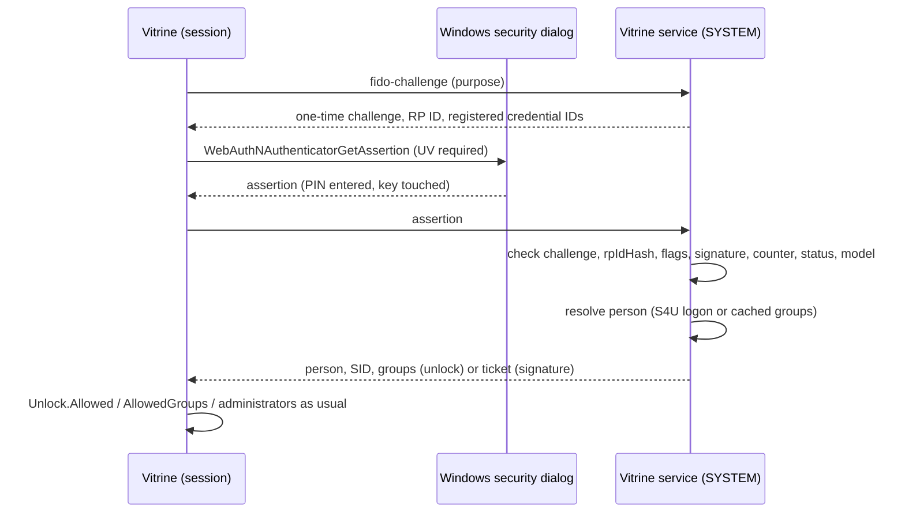
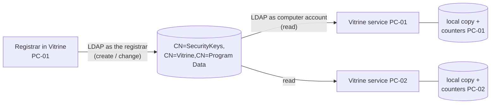

[Vitrine](../README.md) › Security keys

# Security keys

The sign-in method **Security key** (ID `fido`, since 0.5.0) unlocks Vitrine – and confirms administrator actions and
electronic signatures – with a FIDO2 security key that was **registered for Vitrine** on this computer – or, with the
store in [Active Directory](#active-directory), once for all computers of the domain. It needs no
Microsoft Entra app registration, works without network, and the desktop stays visible while the person signs in.
The PIN of the key is always required.

**Contents:** [How it works](#how-it-works) · [Requirements](#requirements) · [Setting it up](#setting-it-up) ·
[Registering a key](#registering-a-key) · [Revoking a key](#revoking-a-key) · [Signing in](#signing-in) ·
[Who the person is](#who-the-person-is) · [Without a domain controller](#without-a-domain-controller) ·
[Model allow-list](#model-allow-list) · [Failed attempts and copied keys](#failed-attempts-and-copied-keys) ·
[Where the keys are stored](#where-the-keys-are-stored) · [Active Directory](#active-directory) · [Audit log](#audit-log) · [Signatures](#signatures) ·
[Limits](#limits) · [Settings](#settings)

## How it works



- **Windows talks to the key.** Vitrine uses the Windows WebAuthn API (`webauthn.dll`): Windows shows its own security
  dialog for PIN and touch and supports USB and NFC keys. Vitrine never speaks CTAP itself.
- **The service checks.** The Vitrine service (SYSTEM) keeps the list of registered keys, issues a one-time challenge
  per attempt and verifies the key's answer in `Vitrine.Core` (`FidoService`, `FidoVerifier`): the challenge (single
  use, 2 minutes, only for the session and purpose it was issued for), the hash of the RP ID, the flags *user present*
  and *user verified* (PIN), the signature (ES256, RS256) over the authenticator data and the hash of the
  `clientDataJSON`, the signature counter, the status of the key and the model allow-list. The app only passes the
  key's answer on; person, groups, counter and status never come from the session.
- **The result looks like a Windows password sign-in:** `DOMAIN\name`, SID, group SIDs (including local groups) and
  *administrator* – so `Unlock.Allowed`, `Unlock.AllowedGroups`, `Unlock.AllowedUsers` and the administrator rule work
  unchanged.

**RP ID and `clientDataJSON`.** Keys are registered for the RP ID in `Fido.RpId` (default `vitrine` – deliberately not
a DNS name, so no website can claim it). Vitrine builds the `clientDataJSON` itself, like a browser:

```json
{"type":"webauthn.get","challenge":"<challenge, Base64url>","origin":"vitrine://vitrine","crossOrigin":false}
```

The origin `vitrine://<RP ID>` is never produced by a browser, so an answer a key gave to a website can never pass the
service's check. Windows only hashes the `clientDataJSON`; the service checks type (`webauthn.get` or
`webauthn.create`), challenge and origin.

## Requirements

- Windows 10 version 1903 or later (WebAuthn API version 1 or later; otherwise VIT-0400).
- **The Vitrine service** – the default installation with the MSI or `install.ps1`. Without it (portable exe,
  `SERVICE=0`, or the service could not load its audit key) the method is not offered (VIT-0402).
- FIDO2 security keys with a **PIN** (Windows asks to set one at registration if the key has none) and ES256 or RS256
  (practically all FIDO2 keys; EdDSA-only keys are refused, VIT-0418).
- `CredentialUIBroker.exe` and `CredDialogHost.exe` in `Security.AuthUiProcesses` (both are in the default list):
  the Windows security dialog runs in one of them and must receive input while the workstation is locked. If one is
  missing, the overview and the audit log warn with VIT-0423.

## Setting it up

1. Register keys for the people who should use them – [below](#registering-a-key).
2. Switch on **Security key** under *Settings › Unlocking › Sign-in methods*, or add `fido` to `Unlock.Methods`
   (policy *Sign-in methods*). The method is **off by default**.
3. Optionally set the rules on the page *Security keys* or by policy (category *Security keys*): allowed models,
   keys per person, failed attempts, offline time.

The dialog offers the method only when the WebAuthn API is present, the service is reachable and at least one active
key is registered for the current RP ID.

## Registering a key

Registration is a deliberate, recorded act – by an **authorized person** for **another** person:

1. *Settings › Security keys › Register key…*: enter the person's **Windows account** (`CONTOSO\jdoe`,
   `AzureAD\jdoe@contoso.com`, `.\labuser` or a SID), a **name for the key** (e.g. "Key 1, blue") and a **reason** (at
   least 10 characters, e.g. "New lab operator, badge 17").
2. The registrar **signs in** in Vitrine's administrator dialog – with the Windows password, Microsoft Entra ID or their
   own security key. The **service** checks this sign-in itself and gives a one-time ticket that is only valid for
   registering and revoking keys. Windows Hello, the Windows sign-in dialog, the shared unlock password and plugins
   cannot be checked by the service and are not offered.
3. The service checks: the registrar has the role **security key registration** (`Roles.Registrars`; empty = local
   administrators while `Security.LocalAdministratorsArePrivileged` is on – the same `RoleCheck` as in the app, with the
   device configuration and policies the service reads; [Roles and governance](roles-and-governance.md#roles)), the account exists and is a user, it is **not the
   registrar's own account** (unless `Fido.AllowSelfRegistration`, VIT-0414; compared by SID – for a Microsoft sign-in the SID formed from the object ID and `onprem_sid` – and by UPN; a registrar whose sign-in has no SID is refused), the person has fewer than
   `Fido.MaxKeysPerPerson` active keys (VIT-0415), and the account is usable (S4U logon, VIT-0411; without a domain
   controller the registration is allowed, but no groups are cached yet).
4. The person holds their key ready: Windows asks for the key's PIN (or to set one) and a touch. Vitrine asks for a
   non-discoverable credential with **user verification required**, attestation **direct**, cross-platform keys only
   (no Windows Hello) and passes **all registered credential IDs as exclude list** – the same key cannot be registered
   twice (VIT-0419).
5. The service checks the answer (challenge, origin, `rpIdHash`, flags, COSE key, allowed model) and stores the key
   with: credential ID and its SHA-256 (`keyId`), public key (COSE) and algorithm, AAGUID (model), attestation format
   and – for the format `packed` – whether the attestation signature verified, plus the subject and SHA-256 of the
   attestation certificate; person SID, name and UPN; label and reason; time, registrar (SID and name) and computer.
   The entry `FidoKeyRegistered` is written to the signed audit log.

A registration started in step 2 is valid for 5 minutes and only in the same Windows session (VIT-0426).

## Revoking a key

*Settings › Security keys*, **Revoke…** next to the key, enter a reason (at least 10 characters), sign in as an
authorized person (as for registering). The key stays in the list as *revoked* with time, person and reason; it can
never be used again (VIT-0406). The service writes `FidoKeyRevoked`.

Revoke keys that are lost, of people who left, and after VIT-0408.

## Signing in

In the unlock dialog the person chooses **Key** (tooltip *Security key*) and *Continue with Key*. Windows shows its
security dialog: insert the key or hold it to the NFC reader, enter the PIN, touch the key. The covers become
click-through while the Windows dialog is open, as with Windows Hello (2-minute limit). With the separate lock desktop (`Lock.Mode = Desktop`) Vitrine switches back to the Windows desktop for the
sign-in, as for Windows Hello and Microsoft – the Windows security dialog only appears there.

All active keys of the current RP ID are passed to Windows (`allowCredentials`). With more than 16 keys, Vitrine asks
in groups of 16; if the key presented holds none of a group, the next group follows – the person then touches the key
again. With very many registered keys this costs one touch per group.

## Who the person is

After a valid answer the service determines who the key belongs to – the account stored at registration – and its
**current** state and groups:

| Account | How | Groups | `groupsSource` |
|---|---|---|---|
| Active Directory account | S4U logon (`LsaLogonUser`, `KERB_S4U_LOGON`) by the service – an identification token without a password | from the token: domain and local groups (deny-only groups such as *Administrators* of a filtered token count as membership) | `live` |
| Local account | S4U logon with `MSV1_0_S4U_LOGON` | from the token | `live` |
| Microsoft Entra-only account (`S-1-12-1-…`) | S4U is not possible | direct membership in *Administrators*, *Users* and the local groups in `Unlock.AllowedGroups`, read on this computer | `local` |

A **disabled, locked out, expired or restricted** account, an account that no longer exists or now has another SID is
refused (VIT-0411). Other Windows errors that are not network errors are refused too.

**Entra-only accounts – be aware:** Windows cannot check such an account without network, so Vitrine cannot see
whether it was disabled in Microsoft Entra ID, and Entra group memberships are not known (only local groups, including
Entra groups that are members of a local group are **not** expanded). Revoke the keys of people who leave. Use
`Unlock.AllowedGroups` with local groups (e.g. `.\Vitrine unlockers` containing the account) or `Unlock.AllowedUsers`
with the SID.

## Without a domain controller

If S4U fails because no domain controller is reachable (no logon server, no such domain, RPC unavailable, network
errors), the service uses the groups it read **last** for that person (stored in the key list, see below), as long as
they are at most `Fido.OfflineMaxHours` old (default 24 h). Older ones, or none at all, are refused (VIT-0412). The
audit entry then has `groupsSource` `cached` and `groupsResolvedAt`. Every successful live resolution renews the
cache; registration stores the first one. `Fido.OfflineMaxHours = 0` means: never without a domain controller.

Local accounts and Entra-only accounts do not need a domain controller.

## Model allow-list

`Fido.AllowedModels` lists the AAGUIDs of key models that may be **registered and used** (one per line; case and
braces do not matter). Empty = every model. A list with only invalid entries allows nothing. A key whose model is no
longer allowed is refused at sign-in (VIT-0407), even if it was registered earlier.

The AAGUID is reported by the key. Vitrine records the attestation (format, certificate subject and SHA-256, whether a
`packed` signature verified), but does **not** check the certificate chain against the manufacturers' roots (FIDO
Metadata Service). The allow-list is therefore a control against wrong models in normal use, not against a key built
to lie about its model.

## Failed attempts and copied keys

- **Failed attempts:** the service checks the **signature first**. An answer without a valid signature of the
  registered key (unknown key, wrong challenge, forged or incomplete data) could have been built by any program, so it
  counts only against the **requesting Windows session**: after `Fido.MaxFailedAttempts` that session gets no
  challenges for `Fido.BlockMinutes` (VIT-0409) – nobody can lock other people out with forged answers. An answer that
  is validly signed by the key but refused (no PIN, revoked, model not allowed, counter) counts for the key **and** for
  its person; after `Fido.MaxFailedAttempts` (default 5) both are blocked for `Fido.BlockMinutes` (default 5) – also the
  person's other keys (VIT-0409). A successful sign-in resets the counts. Challenges are limited to 10 per session and
  minute (VIT-0314).
  The counts are kept in the service's memory; restarting the service resets them. In addition the unlock dialog's
  general [failed-attempt rules](sign-in.md#failed-attempts) (delay, `FailureAction`) apply as for every method, and
  the PIN of the key itself is protected by the key (it locks after a few wrong PINs).
- **Signature counter:** the service stores the counter of each key and accepts an answer only if the key's counter
  increased. If it did not, the key may have been **copied**: the answer is refused (VIT-0408) and the service writes
  `FidoCloneSuspected`. Keys without a counter always report 0 and are not checked.

## Where the keys are stored

`%ProgramData%\ICT-Baden\Vitrine\fido-credentials.json`, written **only by the service** (new file, then renamed;
owner SYSTEM; SYSTEM full control, Administrators read – standard users cannot read it, since 0.5.0 the service also
tightens files written by earlier builds at its start). It holds no secrets: public keys, the people, the
counters and the cached groups. The service reads it only if standard users cannot change it – the same check as for
the device configuration (VIT-0012); otherwise no key works and the service logs VIT-0420. A file that cannot be read
is never overwritten (VIT-0421).

Back it up with the computer's configuration. The store is behind an interface (`IFidoCredentialStore`, asynchronous;
the group cache `IFidoGroupCache`); the second implementation keeps the keys in [Active Directory](#active-directory)
(`Fido.Store = ActiveDirectory`) with the same checks.

**RP ID changes:** keys only work with the RP ID they were registered with. If `Fido.RpId` is changed afterwards,
the keys of the old RP ID are not offered; the page *Security keys* and the audit log (service start) report
VIT-0422. Change it back or register the keys again.

## Active Directory

With `Fido.Store = ActiveDirectory` the keys are kept in **Active Directory** instead of the file of one computer: a key
registered once works on **every computer of the domain** that uses the same container and RP ID. Default is `Local`.
The store is chosen when the Vitrine service starts – restart the service (or the computer) after changing it. Keys of
the local file are not moved; register them again.



### Objects

No schema extension: one object of class `serviceConnectionPoint` per key in
`CN=SecurityKeys,CN=Vitrine,CN=Program Data,<domain DN>` (container configurable with `Fido.DirectoryContainer`, which
names the `CN=Vitrine,…` part).

| Attribute | Content |
|---|---|
| `cn` | SHA-256 of the credential ID, hex, lower case (= `keyId` in the audit log) – the service looks a key up directly by it |
| `keywords` | `VitrineFidoCredential`, `status=active` or `status=revoked`, `rp=<RP ID>` |
| `serviceBindingInformation` | the key as JSON, the same fields as an entry of the local file (credential ID, COSE public key, algorithm, AAGUID, attestation format and result, person SID/name/UPN, label, reason, registered at/by/on, revoked at/by/reason) with a version `"v": 1`; split into values `vitrine-fido:1:<i>/<n>:<text>` because multi-valued attributes have no order |
| `description` | reason of the revocation |
| owner | the registrar (set by Active Directory when the object is created) |

The service accepts an object only if it is complete and consistent: known payload version, all parts present once,
`cn` equal to the SHA-256 of the credential ID, the same RP ID in keyword and payload, a public key and a person SID.
Other objects are ignored (VIT-0475, once per object). A key is **active only if both** the keyword and the payload say
`active`; anything else counts as revoked.

The **signature counter is not stored in Active Directory** – computers cannot write there. Each computer keeps the
counter (and the time of last use) itself, in `HKLM\SOFTWARE\ICT-Baden\Vitrine\FidoCounters` (SYSTEM only). Detection
of copied keys (VIT-0408) therefore works **per computer**: a copy used on another computer than the original is not
detected there until it falls behind that computer's counter. *Last used* on the page *Security keys* is the last use on
this computer.

### Reading and the local copy

- The service reads as the **computer account** (LocalSystem → `DOMAIN\PC$` through Kerberos) with LDAP
  (System.DirectoryServices.Protocols): Negotiate, signing and sealing, a domain controller found by the DC locator
  (`DsGetDcName`) – none is configured.
- It keeps all keys in a **local copy** `%ProgramData%\ICT-Baden\Vitrine\fido-directory-cache.json` (written only by the
  service, protected and readable like the local file – SYSTEM and Administrators only; with the group cache for sign-in
  without a domain controller). A copy that
  standard users could change or that cannot be read is discarded and rebuilt from Active Directory.
- **Synchronization:** at service start and every `Fido.SyncMinutes` (default 15) all keys are read. While Active
  Directory is reachable the service also reads the presented key **live at every sign-in** – a revocation on one
  computer applies on all others at once. A key the computer does not know yet is looked up directly (at most once a
  minute per key and 20 lookups in 10 minutes), and when the presented key holds none of the offered credentials, the app
  asks once more after a synchronization (one more touch) – a key registered a minute ago on another computer works.
- **Without Active Directory** (laptop offline, no domain controller): the local copy is used, failed synchronizations
  are retried every minute, the audit log gets VIT-0471 once. Group memberships follow
  [Without a domain controller](#without-a-domain-controller) (`Fido.OfflineMaxHours`). Keys revoked elsewhere stay usable
  on an offline computer until it synchronizes again – limit the offline time with `Fido.OfflineMaxHours`.
- Never synchronized (first start offline): no key works (VIT-0476).

### Writing: register and revoke

Computers never write to Active Directory. Registering and revoking write **with the account of the registrar**:

- Registrar signed in with the **Windows password**: the service keeps the Windows token of that sign-in (the
  interactive logon it verified) only until it has signed in to Active Directory for this registration, then releases
  it – no second password.
- Registrar signed in with **Microsoft Entra ID** or **a security key**: Vitrine asks for the registrar's domain account
  and Windows password (*Sign in to Active Directory*). The password goes through the protected pipe to the service, is
  used only for the LDAP sign-in (Negotiate) and is never stored or logged.
- The identity of the LDAP connection (*Who am I*, RFC 4532) must be the registrar who signed in in Vitrine (VIT-0473).
  A **Microsoft Entra ID** sign-in has the Entra SID (`S-1-12-1-…`), not the SID of the domain account, even for
  synchronized (hybrid) accounts – so with the store in Active Directory, registrars sign in with the **Windows
  password** of their domain account (recommended, no second prompt) or with **their own security key** registered for
  their domain account.
  The connection is opened when the registration starts (errors appear before the key is touched) and closed after it
  (at the latest after 5 minutes).

### Permissions

| Who | Where | Rights |
|---|---|---|
| Registrars group (e.g. `CONTOSO\Vitrine Registrars`) | `CN=SecurityKeys` | *Create* and *Delete* child objects of class `serviceConnectionPoint`; on `serviceConnectionPoint` objects (inherited): *Read*, *Write* `keywords`, `serviceBindingInformation`, `description` |
| Readers – default *Domain Computers* | `CN=Vitrine` and below | *Read* (list contents, read properties) |
| Domain Admins | | as usual (full control) |

`Roles.Registrars` in Vitrine decides who may register; the Active Directory rights decide who **can** write. Keep them in
line – usually the same group. Anybody who can create or change objects in `CN=SecurityKeys` can register keys for any
person of the domain, so treat these rights like administrative rights; the audit log of the computer where a key was
registered records the registration, Active Directory records the owner and `whenChanged`.

`deploy/Initialize-VitrineDirectory.ps1` creates the containers and sets these rights (ActiveDirectory module; run as a
domain administrator, `-WhatIf` shows what it would do):

```powershell
.\Initialize-VitrineDirectory.ps1 -RegistrarsGroup 'Vitrine Registrars' -WhatIf
.\Initialize-VitrineDirectory.ps1 -RegistrarsGroup 'Vitrine Registrars'
# other container or readers:
.\Initialize-VitrineDirectory.ps1 -RegistrarsGroup 'Vitrine Registrars' -ReadersGroup 'Lab Computers' `
    -Container 'CN=Vitrine,OU=Lab,DC=contoso,DC=com'
```

Then set the policies *Security key store* = *Active Directory* (and *Active Directory container* if not the default)
for the computers and restart the Vitrine service.

### Setting it up step by step

1. Create the registrars group and run `Initialize-VitrineDirectory.ps1` (above).
2. Policy *Security key store* = *Active Directory*; optionally *Active Directory container*, *Synchronization with
   Active Directory*. Set the same *RP ID* (`Fido.RpId`) on every computer.
3. Restart the Vitrine service; *Settings › Security keys* shows *stored in Active Directory* with the last
   synchronization.
4. Register keys as described [above](#registering-a-key).

## Audit log

| Event | Written by | When | `Data` |
|---|---|---|---|
| `Unlocked` | app | unlocked with a key | `method` `fido`, `keyId` (SHA-256 of the credential ID), `credential` (label), `aaguid`, `groupsSource` (`live`, `local`, `cached`), `groupsResolvedAt` (cached only), `assurance` `verified` (the service checked the key; the entry itself is reported by the app, assurance `client`) |
| `FidoKeyRegistered` | service | key registered | `person`, `personSid`, `label`, `reason`, `rpId`, `keyId`, `aaguid`, `attestation`, `attestationVerified`, `attestationCertificate`, `registrarSid`, `store` (`local`, `activeDirectory`) |
| `FidoKeyRevoked` | service | key revoked | `person`, `personSid`, `keyId`, `credential`, `aaguid`, `reason`, `registrarSid`, `store` |
| `FidoKeyRejected` | service | a sign-in or registration with a key was refused | `code`, `problem`, `purpose` (`unlock`, `admin`, `signature`, `registrar`, `registration`), `keyId`, `credential`, `aaguid` if known |
| `FidoCloneSuspected` | service | signature counter did not increase | as `FidoKeyRejected` |
| `SignatureGranted` | service | signature with a key | method `fido`, assurance `verified`, `keyId`, `credential`, `aaguid`, `groupsSource` |

The app cannot write the four `Fido…` events. Event IDs in the Windows event log: 1028–1031 –
[Audit log](audit-log.md#windows-event-log). With the store in Active Directory, a registration or revocation is in the
audit log of the computer where it was done; the service of every computer logs problems with Active Directory as
`Error` (VIT-0471 to VIT-0476, once per change of state).

## Signatures

Signatures with a security key are checked by the service like the Windows password: the service issues the
challenge for the purpose *signature*, verifies the answer and only then gives the one-time ticket for the signature
entry. `assurance` is **`verified`** – see [GxP](gxp.md). A challenge for unlocking cannot be used for a signature
and vice versa (VIT-0403).

**The Windows dialog does not show the purpose.** It only names the RP ID (`vitrine`), never "sign batch 4711" or
"unlock". To keep a program in the session from triggering a signature or a key registration while the person thinks
they are unlocking, Vitrine requests a challenge for a signature only while its signature dialog (with reason and
meaning) is open, and for registrars only while the registrar dialog is open (otherwise VIT-0428). Only `Vitrine.exe`
from the program folder may talk to the service. **Residual risk:** a program that controls Vitrine's own process (for
example a debugger of the session user) could still request a signature challenge while the unlock dialog is shown,
and the person would see the same Windows dialog. Treat signatures by security key like other signatures of a session
the user controls: the application that requests the signature shows what is signed, and the audit entry records
reason and meaning.

## Limits

- **USB and NFC** keys through Windows; Bluetooth/hybrid (phone) only as far as Windows offers it for cross-platform
  authenticators – restrict with `Fido.AllowedModels` if only hardware keys are wanted.
- **PIN required**, not configurable: answers without user verification are refused (VIT-0410).
- **Entra-only accounts:** groups from local groups only, account state not checked – see
  [Who the person is](#who-the-person-is).
- **Attestation chains** are not checked against manufacturer roots – see [Model allow-list](#model-allow-list).
- **Service required**; without it the method is not available.
- **Failed-attempt counters** of the service are not persistent.
- **The list of registered keys** (names, SIDs, UPNs, registrars, revocation reasons) is shown only to registrars,
  configuration administrators and auditors – decided from the Windows account of the session (VIT-0427). Everybody
  else sees only the number of active keys.
- **Purpose not shown by Windows** – see [Signatures](#signatures).
- **Active Directory store:** signature counters (copied-key detection) and failed-attempt counters are per computer;
  offline computers see revocations made elsewhere only after their next synchronization; changing `Fido.Store` needs a
  restart of the service.
- The Windows security dialog is a separate process; while it is open the covers are click-through like for Windows
  Hello (see [Sign-in › Input while the Microsoft or Hello window is open](sign-in.md#input-while-the-microsoft-or-hello-window-is-open)).

## Settings

Section `Fido`, policies in the category *Security keys*:

| Setting | Default | Meaning |
|---|---|---|
| `Fido.RpId` | `vitrine` | RP ID for registering and checking; do not change after the first registration (VIT-0422) |
| `Fido.AllowSelfRegistration` | `false` | registrars may register keys for their own account |
| `Fido.AllowedModels` | empty | allowed AAGUIDs; empty = any model |
| `Fido.MaxKeysPerPerson` | `2` | active keys per person |
| `Fido.MaxFailedAttempts` | `5` | refused sign-ins per key and per person before a block; `0` = never |
| `Fido.BlockMinutes` | `5` | duration of the block |
| `Fido.OfflineMaxHours` | `24` | maximum age of cached groups without a domain controller; `0` = never offline |
| `Fido.Store` | `Local` | `Local` (file on this computer) or `ActiveDirectory` – [Active Directory](#active-directory) |
| `Fido.DirectoryContainer` | empty | DN of the Vitrine container; empty = `CN=Vitrine,CN=Program Data,<domain>` |
| `Fido.SyncMinutes` | `15` | full synchronization with Active Directory every … minutes |

The PIN (user verification) is always required and has no setting. The method itself is switched on with `fido` in
`Unlock.Methods`. All settings: [Settings](settings.md#fido--category-security-keys).

---

<p align="center"><sub>
<a href="installation.md">Installation</a> · <a href="usage.md">Usage</a> · <a href="settings.md">Settings</a> · <a href="sign-in.md">Sign-in</a> · <a href="error-codes.md">Error codes</a> · <a href="audit-log.md">Audit log</a> · <a href="gxp.md">GxP</a><br>
<a href="../README.md">← Back to Vitrine</a>
</sub></p>
