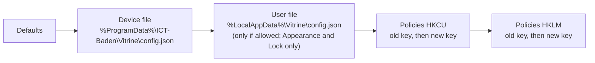

[Vitrine](../README.md) › Settings

# Settings

Where Vitrine reads its settings from, which one wins, and every setting with its default. Policies through **Group Policy or Intune** always take precedence and are locked in the settings window.

**Contents:** [Layers and precedence](#layers-and-precedence) · [File locations](#file-locations) · [config.json](#configjson) · [Policies and the registry](#policies-and-the-registry) · [All settings](#all-settings) · [Language](#language) · [Scripts](#scripts) · [Example](#example)

## Layers and precedence

Vitrine merges its settings from several layers. **Later layers win:**



1. **Built-in defaults** – the values in the [table below](#all-settings).
2. **Device file** `%ProgramData%\ICT-Baden\Vitrine\config.json` – written by the settings window. If it does not exist yet, Vitrine reads the old file `%ProgramData%\Vitrine\config.json` instead (builds up to 1.0.0). Either file is used only if standard users cannot change it – otherwise it is ignored with VIT-0012, see [File locations](#file-locations).
3. **User file** `%LocalAppData%\Vitrine\config.json` – only when `Security.AllowUserConfig` is on (*Own settings per user*). If it does not exist, the old file `%AppData%\Vitrine\config.json` is read instead. Only the sections **`Appearance`** and **`Lock`** are taken from it – without `Appearance.Masks` and `Appearance.RevealProcesses`, which protect confidential content; everything else in the file is ignored.
4. **Policies of the user** – `HKCU\SOFTWARE\Policies\Vitrine` (old key), then `HKCU\SOFTWARE\Policies\ICT-Baden\Vitrine`.
5. **Policies of the computer** – `HKLM\SOFTWARE\Policies\Vitrine` (old key), then `HKLM\SOFTWARE\Policies\ICT-Baden\Vitrine`. Computer policies therefore win over user policies, and the new key wins over the old key of the same hive.

> [!IMPORTANT]
> Whether the user file is read is decided from `Security.AllowUserConfig` **after** the policies: defaults, device file and policies together. The policy *Allow per-user config* therefore wins – `0` switches the user file off even if the device file allows it. When the user file is allowed, it can only change `Appearance` and `Lock` (for example the hotkey, idle time or notice text); `Security`, `Unlock`, `Entra`, `Audit`, `Scripts` and `Integration` in it are ignored. Policies still take precedence over it.

When values come from the old policy key, the *Overview* page shows **Old policy path in use**; when the device file is read from the old folder, it shows **Configuration still in the old folder**. See [Installation › Upgrading](installation.md#upgrading-from-earlier-builds-100-and-older).

**When settings are read:** at start, after *Save* in the settings window, and on *Reload policies* (Settings › About). A Group Policy refresh alone does not reach a running Vitrine.

## File locations

| What | Location | Written by |
|---|---|---|
| Device configuration | `%ProgramData%\ICT-Baden\Vitrine\config.json` | settings window (*Save*), `install.ps1 -Config`, `--apply-config` |
| Device configuration, old location (read only) | `%ProgramData%\Vitrine\config.json` | builds up to 1.0.0 |
| User configuration (only with `Security.AllowUserConfig`) | `%LocalAppData%\Vitrine\config.json` | you – the settings window never writes it, and never copies its values into the device file |
| User configuration, old location (read only) | `%AppData%\Vitrine\config.json` | builds up to 1.0.0 |
| Language choice of the user | `%LocalAppData%\Vitrine\preferences.json` | About window |
| Policies | `HKLM` / `HKCU\SOFTWARE\Policies\ICT-Baden\Vitrine\<section>` | Group Policy, Intune (ADMX) |
| Policies, old key (read only) | `HKLM` / `HKCU\SOFTWARE\Policies\Vitrine\<section>` | ADMX of builds up to 1.0.0 |
| Audit log (default) | `%ProgramData%\ICT-Baden\Vitrine\Logs`, fallback `%LocalAppData%\Vitrine\Logs` | Vitrine – see [Audit log](audit-log.md) |
| Autostart of the user (*Start with Windows*) | `HKCU\Software\Microsoft\Windows\CurrentVersion\Run`, value `Vitrine` | settings window, page *Lock* |

`%LocalAppData%\Vitrine` also holds small state files (backup of the Ctrl+Alt+Del values, lock marker for the watchdog). What is stored where and how to delete it: [Data and privacy](data-and-privacy.md).

**The device configuration must be protected.** Vitrine reads `%ProgramData%\ICT-Baden\Vitrine\config.json` (and the old `%ProgramData%\Vitrine\config.json`) only if the file, its folder and the folder above are owned by Administrators, SYSTEM or TrustedInstaller, are not junctions or other reparse points, and no other account has the right to change, delete, rename or re-permission them (creating new files in the folder is allowed). Otherwise the file is ignored, *Overview* shows *Configuration has errors* with **VIT-0012**, and the other layers apply. Without this check, any user could create the folder before Vitrine is installed and set rules, scripts and the unlock password for everyone.

After an installation with MSI or `install.ps1`, only administrators can write the device configuration; saving in the settings window then asks for administrator rights through UAC. **Saving as administrator** (directly or through UAC with `--apply-config`) first secures the folder and the folder above it, if they are not protected yet – owner Administrators, permissions without inheritance: Administrators and SYSTEM full control, Users read – refuses junctions, writes a new file and makes Administrators its owner. This also repairs a folder that a standard user created beforehand (e.g. by starting the [single exe](installation.md#single-exe-without-installation) first): save the settings once as administrator.

## config.json

- **Only differences needed.** Files are merged deeply; a file with a few values is enough.
- **Tolerant syntax.** Comments and trailing commas are allowed, property names are not case-sensitive.
- **Enums as text**, flags separated by commas: `"Allowed": "SessionUser, Administrators"`.
- **Schedule** as objects: `{ "Time": "18:00", "Days": ["Monday", "Friday"] }`, empty `Days` = every day. A time Vitrine
  cannot read (e.g. `6:30 PM`) is reported as `VIT-0015` and never triggers.
- **Covered areas** (`Appearance.Masks`) as text like in the policy, `["1:0,0,30,100", "*:70,0,30,12"]`, or as objects
  `{ "Monitor": 1, "X": 0, "Y": 0, "Width": 30, "Height": 100 }`. Saving writes the object form. A text entry that cannot
  be read makes the file invalid (`VIT-0001`).
- **At most 1 MB** per file; larger files are not read.
- **Syntax errors** (or a file that is not a JSON object): the file is skipped, the other layers still apply, and *Overview* shows *Configuration has errors* with `VIT-0001` and the file name.
- **Wrong value types or unknown enum names** (e.g. `"IdleMinutes": "ten"` or `"FailureAction": "Lock"`): the whole file is skipped like a syntax error – the other layers and all policies still apply – and *Overview* shows *Configuration has errors* with `VIT-0001`. Check files before distributing them; `Vitrine.exe --apply-config <file>` refuses such a file (VIT-0008).

**Saving in the settings window** writes only the values that do not come from policies – defaults and device file, never the user file – atomically, to `%ProgramData%\ICT-Baden\Vitrine\config.json`. Without write access Vitrine starts itself elevated as `Vitrine.exe --apply-config <temp file> --sha256 <checksum>`; the elevated process writes only if the temporary file still has that checksum (otherwise VIT-0014), checks the JSON and saves it. If the elevated save fails, the settings window shows *Saving failed* (VIT-0006) instead of *Saved* – [Command line](command-line.md#--apply-config-file-internal). Every save is recorded as `ConfigChanged` in the audit log. The device file stores all settings, not only differences – remove what you do not need before using a saved file as a template.

## Policies and the registry

The ADMX template (see [Installation › ADMX templates](installation.md#admx-templates-for-group-policy-and-intune)) writes to `SOFTWARE\Policies\ICT-Baden\Vitrine\<section>\<property>`, e.g. `…\Lock\IdleMinutes`. Vitrine reads **every** property this way, including those without a policy in the template – you can set them with Group Policy Preferences, Intune (custom OMA-URI or remediation script) or `reg add`.

| Registry type | Becomes |
|---|---|
| `REG_DWORD` | number; boolean (`0` = off, everything else = on); enum by its number (e.g. `Unlock.Allowed` = `7`, `Security.FailureAction` = `1`) |
| `REG_SZ` | text; enum by name (not case-sensitive, flags separated by commas); number or boolean written as digits; a list with entries separated by `;` |
| `REG_MULTI_SZ` | list, one entry per line; for a text setting the lines are joined with `;` |

- **Schedule** entries: `18:00` (every day; `18.00` works too), `07:30@Mon,Tue,Wed` or `07:30@Mon-Fri` (ranges across the weekend like `Fri-Mon` too) – days as English or German abbreviations or English names. An entry that cannot be read – including a single unknown day – is skipped and shown in *Overview* as `VIT-0015`; it never means "every day".
- **Covered areas** (`Appearance.Masks`): one entry per line `monitor:x,y,width,height`; unreadable entries are skipped with `VIT-0015`.
- **Unknown enum names** or values that cannot be converted are **ignored** – the setting keeps its value from the files, and it is not marked as managed.
- Every value read from a policy is locked in the settings window and counted in *Partly managed centrally*.
- If a policy key cannot be read, *Overview* shows `VIT-0002`.

```bat
reg add "HKLM\SOFTWARE\Policies\ICT-Baden\Vitrine\Scripts" /v TimeoutSeconds /t REG_DWORD /d 60 /f
reg add "HKLM\SOFTWARE\Policies\ICT-Baden\Vitrine\Lock" /v Schedule /t REG_MULTI_SZ /s "|" /d "12:00@Mon,Tue,Wed,Thu,Fri|18:00" /f
```

## All settings

Column **Policy** = name in the English ADMX template (category as the section). **–** means: not in the template – set it in the settings window (if it is there), in `config.json`, or as a registry value under the policy key. Ranges are those of the ADMX template.

### Lock – category *Locking*

| Setting | Type | Default | Policy | Meaning |
|---|---|---|---|---|
| `Lock.Hotkey` | text | `Ctrl+Alt+L` | Lock hotkey | Shortcut to lock; also opens the unlock dialog. Empty = off. Syntax: [Usage › Locking](usage.md#locking) |
| `Lock.IdleMinutes` | number | `0` | Lock after idle (minutes) | Lock after N minutes without keyboard or mouse input; `0` = off. 0–1440 |
| `Lock.LockOnStartup` | boolean | `false` | Lock on startup | Lock immediately when Vitrine starts – for control rooms and measurement PCs |
| `Lock.KeepAwake` | boolean | `true` | Keep display awake while locked | No screen saver and no sleep while locked |
| `Lock.BlockMouseMove` | boolean | `true` | Block mouse movement while locked | Off: the pointer may move; clicks stay blocked |
| `Lock.ReplaceWinL` | boolean | `false` | Win+L locks with Vitrine | <kbd>Win</kbd>+<kbd>L</kbd> locks with Vitrine instead of Windows, also when unlocked. While Vitrine runs, `DisableLockWorkstation` is set (also hides *Lock* on the Ctrl+Alt+Del screen) and a keyboard-only hook watches for Win+L. Removed on exit and after a crash – [Limitations › Win+L](limitations.md#winl-and-other-ways-windows-locks) |
| `Lock.Schedule` | list of `{Time, Days}` | empty | Lock schedule | Fixed lock times, e.g. `18:00`, `07:30@Mon,Tue,Wed`, `07:30@Mon-Fri`. The settings window does not save while a line cannot be read |
| `Lock.Mode` | enum | `Overlay` | Lock mode | `Overlay`: covers on top of the Windows desktop, programs stay visible. `Desktop`: Vitrine switches to its own desktop – other windows get no input there and cannot draw over the lock screen; programs keep running hidden. Windows Hello, the Windows sign-in dialog and the Microsoft sign-in return to the Windows desktop for the sign-in. Falls back to overlays if the desktop cannot be used (VIT-0450 to VIT-0453) – [Usage › Separate lock desktop](usage.md#separate-lock-desktop), [Limitations](limitations.md#separate-lock-desktop) (since 0.5.0) |
| `Lock.DesktopShowPreview` | boolean | `true` | Preview of the Windows desktop | Only with `Mode = Desktop`: read-only picture of the running programs on the lock screen, put together from their windows. Follows `Appearance.Visual`, `Masks` and `RevealProcesses` (nothing with `Blank`) |
| `Lock.DesktopPreviewSeconds` | number | `2` | Refresh preview every (seconds) | Seconds between two pictures of the preview, 1–60; `0` = one picture when locking |

*Start with Windows* is a per-user switch (`HKCU\…\Run`) and not a setting – see [Installation › Autostart](installation.md#autostart).

### Unlock – category *Unlocking*

| Setting | Type | Default | Policy | Meaning |
|---|---|---|---|---|
| `Unlock.Allowed` | flags | `SessionUser, Administrators` (3) | Who may unlock (bit mask) | `SessionUser` 1, `Administrators` 2, `Groups` 4, `Users` 8, `AnyAuthenticated` 16; add up. 0–31. Details: [Sign-in](sign-in.md) |
| `Unlock.AllowedGroups` | list | empty | Allowed groups | `DOMAIN\group`, local group, SID, Entra group ID or app role (e.g. `Vitrine.Unlock`). Only with `Groups` |
| `Unlock.AllowedUsers` | list | empty | Allowed accounts | `DOMAIN\name`, UPN or SID. Only with `Users` |
| `Unlock.AllowedDomains` | list | empty | Restrict to domains | NetBIOS names or UPN suffixes; empty = no restriction |
| `Unlock.Methods` | list | `entra, windows, hello` | Sign-in methods | Methods in the order shown: `entra`, `windows`, `hello`, `windowslogon` (Windows sign-in dialog, since 0.4.0, [details](sign-in.md#windows-sign-in-dialog)), `fido` (security keys registered for Vitrine, since 0.5.0, [details](security-keys.md)), `pin`, or a plugin ID |
| `Unlock.Trigger` | enum | `AnyInput` | Prompt opens on | `AnyInput`, `KeyOnly`, `HotkeyOnly` – [Usage](usage.md#unlocking) |
| `Unlock.PrefillUserName` | boolean | `true` | Prefill user name | Fill in the signed-in user in the dialog |
| `Unlock.PromptTimeoutSeconds` | number | `30` | Prompt timeout (seconds) | Dialog closes after N seconds without input; at least 5. 5–600 |
| `Unlock.BypassGroups` | list | empty | Emergency sign-in groups (category *Roles and governance*) | Members may unlock with their Windows password even if `Unlock.Allowed` does not allow them, only with a reason; logged as `UnlockBypass` and as event log warning. Empty = off. [Roles and governance](roles-and-governance.md#emergency-sign-in) |
| `Unlock.BypassReasonMinLength` | number | `10` | Minimum length of the emergency reason | Characters; at least 1. 1–500 |
| `Unlock.PinHash` | text | empty | – | PBKDF2 hash of the shared unlock password (method `pin`). Set it in the settings window (*Own unlock password* › *Set…*, at least 10 characters), not by hand. Every user can read it – see [Sign-in](sign-in.md#shared-unlock-password) |

### Appearance – category *Appearance*

| Setting | Type | Default | Policy | Meaning |
|---|---|---|---|---|
| `Appearance.Visual` | enum | `Transparent` | Visual mode | `Transparent`, `Blank` (covered) or `Windows` (only the programs in `RevealProcesses` visible) |
| `Appearance.DimPercent` | number | `8` | Dim (%) | Dimming in transparent mode; 0 = clear, 100 = black. 0–100 |
| `Appearance.ShowStatusPill` | boolean | `true` | – | *Show notice bar* at the bottom |
| `Appearance.Message` | text | empty | Message | *Notice text*, title of the notice bar |
| `Appearance.Accent` | text | empty | Accent colour | `#RRGGBB`; empty = Windows accent colour |
| `Appearance.LogoPath` | text | empty | Logo path | PNG or JPG shown in the dialog above the name; a local path or a file share (`\\server\share\logo.png`) only, no `http` |
| `Appearance.HideCursor` | boolean | `false` | Hide cursor | Hide the mouse pointer while locked |
| `Appearance.ShowClock` | boolean | `true` | – | *Clock on the covered screen* |
| `Appearance.Masks` | list | empty | Covered areas | Areas covered while locked: `monitor:x,y,width,height` in percent, `*` = every monitor (e.g. `1:0,0,30,100`). [Usage](usage.md#covered-areas-and-selected-programs) |
| `Appearance.RevealProcesses` | list | empty | Programs that stay visible | Program files (e.g. `Chromeleon.exe`) whose windows stay visible with `Visual = Windows` |
| `Appearance.Language` | text | empty | Language of the user interface | `en`, `de`, `es`, `fr`, `zh-Hans`; empty = Windows language. See [Language](#language) |

### Security – category *Security*

| Setting | Type | Default | Policy | Meaning |
|---|---|---|---|---|
| `Security.MaxFailedAttempts` | number | `5` | Max failed attempts | After this many failed attempts `FailureAction` takes effect; `0` = never. 0–100 |
| `Security.FailureAction` | enum | `None` | Action after too many failures | `None`, `LockWorkstation`, `LogOff`, `Shutdown` |
| `Security.ProgressiveDelay` | boolean | `true` | Progressive delay | From the 3rd failed attempt wait 2, 4, 8 … at most 30 s |
| `Security.RestrictCtrlAltDel` | boolean | `true` | Restrict Ctrl+Alt+Del | Hide Task Manager, Sign out, Change a password, the power button and Lock while locked; <kbd>Win</kbd>+<kbd>L</kbd> does nothing (`DisableLockWorkstation`, never overwriting a policy value) |
| `Security.SettingsAdminOnly` | boolean | `true` | Settings for admins only | Settings only for configuration administrators (`Roles.ConfigAdmins`, by default administrators); auditors read-only. [Roles](roles-and-governance.md#roles) |
| `Security.ExitRequiresAdmin` | boolean | `true` | Exit requires admin | Exiting Vitrine only after the sign-in of a configuration administrator |
| `Security.Watchdog` | boolean | `true` | Watchdog | Lock Windows if Vitrine ends while locked |
| `Security.AuthUiProcesses` | list | `CredentialUIBroker.exe`, `Microsoft.AAD.BrokerPlugin.exe`, `msedgewebview2.exe`, `AccountsControlHost.exe`, `CredDialogHost.exe` | Auth UI processes | Processes whose windows receive input during a Microsoft or Hello sign-in (Vitrine's own sign-in window is always allowed). Only programs from protected folders count (System32, SystemApps, the WebView2 runtime folder, Program Files) A list saved before 0.4.0 lacks the last two – add them if the broker is used |
| `Security.AllowUserConfig` | boolean | `false` | Allow per-user config | Read `%LocalAppData%\Vitrine\config.json`, sections `Appearance` and `Lock` only. Decided after the policies, so the policy can switch it off – [see above](#layers-and-precedence) |

### Roles – category *Roles and governance*

Since 0.5.0; details in [Roles and governance](roles-and-governance.md). Group entries as in `Unlock.AllowedGroups`.
All policies of this block are in the category *Roles and governance*, also those that write to the `Unlock` and
`Security` keys.

| Setting | Type | Default | Policy | Meaning |
|---|---|---|---|---|
| `Roles.ConfigAdmins` | list | empty | Configuration administrators | May open and change the settings and exit Vitrine. Empty = administrators only |
| `Roles.Registrars` | list | empty | Security key registrars | May register and revoke security keys. Empty = administrators only |
| `Roles.Auditors` | list | empty | Auditors | May view and export the audit log and the authorization report, nothing else. Configuration administrators are always auditors |
| `Security.LocalAdministratorsArePrivileged` | boolean | `true` | Local administrators hold all roles | `false`: local administrators have no rights in Vitrine (settings, exit, key registration, emergency sign-in) unless they are in a role group – an administrator can still stop the service; see the [trade-off](roles-and-governance.md#local-administrators). Without `Roles.ConfigAdmins` VIT-0430 |
| `Security.ReasonRequiredForAdminActions` | boolean | `false` | Reason for administrator confirmations | The dialog *Administrator required* asks for a reason (in `Data.reason` of the entry) |
| `Security.ReasonRequiredForConfigChanges` | boolean | `false` | Reason for configuration changes | *Save* asks for a reason; the `ConfigChanged` entry records it with the changed values |
| `Security.ReasonMinLength` | number | `10` | Minimum length of reasons | For the two settings above; at least 1. 1–500 |

Registry: `Roles` → `…\Vitrine\Roles` (`ConfigAdmins`, `Registrars`, `Auditors` as REG_MULTI_SZ), the others under
`…\Vitrine\Unlock` and `…\Vitrine\Security` like the rest of their section.

### Audit – category *Audit*

| Setting | Type | Default | Policy | Meaning |
|---|---|---|---|---|
| `Audit.Enabled` | boolean | `true` | Enable audit log | Off = no file, no network copy, no event log entries |
| `Audit.Directory` | text | empty | Log directory | Empty = `%ProgramData%\ICT-Baden\Vitrine\Logs`; environment variables allowed |
| `Audit.NetworkDirectory` | text | empty | Network copy | Every line is also appended to `<folder>\<COMPUTER>-audit-yyyy-MM.jsonl`, e.g. `\\server\audit$\Vitrine` |
| `Audit.EventLog` | boolean | `true` | Windows event log | Also write to the *Application* log, source `ICT-Baden Vitrine` |
| `Audit.LogLockState` | boolean | `true` | Log lock/unlock | Off = only failed attempts, signatures and changes |

### Entra – category *Microsoft Entra ID*

| Setting | Type | Default | Policy | Meaning |
|---|---|---|---|---|
| `Entra.TenantId` | text | `organizations` | Tenant ID | Directory ID (GUID) or domain. Microsoft sign-in needs a tenant GUID here or in `AllowedTenants`; with `organizations` alone it is refused (VIT-0117) – [Entra ID](entra-id.md) |
| `Entra.ClientId` | text | empty | Client ID | Application ID of the app registration; empty = no *Microsoft* in the dialog |
| `Entra.UseBroker` | boolean | `false` | Use WAM broker | Off (default since 0.4.0): Vitrine's own sign-in window – nothing remembered, any account, FIDO2/passkeys, also on the lock screen; needs the WebView2 Runtime (VIT-0190). On: Windows account broker – Windows Hello for Business and device-based Conditional Access, but it remembers accounts and signs in with the session's account; only for devices with one personal user, the settings page warns (VIT-0191). No effect in a build without the broker ([Entra ID](entra-id.md#sign-in-window)) |
| `Entra.ForceFreshSignIn` | boolean | `true` | Force fresh sign-in | Always ask for a new sign-in; keep it on, otherwise an existing session could unlock without input |
| `Entra.MaxAuthAgeSeconds` | number | `300` | Max auth age (s) | Reject sign-ins older than this (`auth_time`); `0` = no check. 0–86400 |
| `Entra.AllowedTenants` | list | empty | Allowed tenants | Further allowed tenant IDs (GUIDs; other entries are ignored) |
| `Entra.AllowedSignInHosts` | list | empty | Allowed sign-in hosts | Further hosts the Microsoft sign-in window may open, e.g. your federation service (`adfs.contoso.com`, `*.okta.com`). Microsoft's sign-in pages are always allowed; anything else is cancelled (VIT-0193) – [Entra ID](entra-id.md#sign-in-window) |
| `Entra.AuthenticationContext` | text | empty | Authentication context | Conditional Access authentication context (`c1`–`c99`) requested at every sign-in, e.g. to require passkeys – [Entra ID](entra-id.md#requiring-passkeys-and-other-strong-methods) |
| `Entra.SignatureAuthenticationContext` | text | empty | Authentication context for signatures | The same, only for signatures; empty = `AuthenticationContext` |
| `Entra.ShareIdToken` | boolean | `false` | Pass ID token to applications | Interface answers to `authenticate`/`sign` contain the ID token – [Interface](interface.md#tokens-for-the-application) |
| `Entra.AllowedTokenScopes` | list | empty | Access tokens for applications | Scopes for which applications may request an access token through the interface; empty = none |

### Fido – category *Security keys*

Read by the Vitrine service, which checks security keys ([Security keys](security-keys.md)). Page *Security keys* in
the settings window. The PIN of the key is always required and has no setting.

| Setting | Type | Default | Policy | Meaning |
|---|---|---|---|---|
| `Fido.RpId` | text | `vitrine` | RP ID | RP ID keys are registered and checked for; not a DNS name on purpose. Do not change after the first registration – keys of another RP ID do not work (VIT-0422) |
| `Fido.AllowSelfRegistration` | boolean | `false` | Allow registering a key for oneself | Registrars may register a key for their own account (otherwise VIT-0414) |
| `Fido.AllowedModels` | list | empty | Allowed key models | AAGUIDs of allowed key models; empty = any model; checked at registration and every sign-in (VIT-0407) |
| `Fido.MaxKeysPerPerson` | number | `2` | Keys per person | Active keys per person (VIT-0415). 1–20 |
| `Fido.MaxFailedAttempts` | number | `5` | Failed attempts until blocked | Refused sign-ins per key and per person before a block (VIT-0409); `0` = never. 0–100 |
| `Fido.BlockMinutes` | number | `5` | Block time (minutes) | Duration of the block. 1–1440 |
| `Fido.OfflineMaxHours` | number | `24` | Without domain controller (hours) | Maximum age of the cached groups when no domain controller is reachable (VIT-0412); `0` = never offline. 0–720 |
| `Fido.Store` | `Local` \| `ActiveDirectory` | `Local` | Security key store | Where registered keys are kept: a protected file on this computer, or Active Directory (a key registered once works on every computer of the domain) – [Security keys › Active Directory](security-keys.md#active-directory). Read when the Vitrine service starts. Policy for computers only |
| `Fido.DirectoryContainer` | text | empty | Active Directory container | DN of the Vitrine container; keys are in `CN=SecurityKeys` below it. Empty = `CN=Vitrine,CN=Program Data,<domain>`. Policy for computers only |
| `Fido.SyncMinutes` | number | `15` | Synchronization with Active Directory (minutes) | How often the service reads all keys from Active Directory into its local copy. 1–1440. Policy for computers only |

### Integration and Scripts – categories *Integration* and *Scripts*

| Setting | Type | Default | Policy | Meaning |
|---|---|---|---|---|
| `Integration.PipeEnabled` | boolean | `true` | Local pipe API | Off = only `lock` and `settings` are accepted; `status`, `authenticate`, `sign` and `subscribe` are refused – [Interface](interface.md) |
| `Integration.LoadPlugins` | boolean | `true` | Load plugins | Load `Plugins\*.dll` next to `Vitrine.exe` – only if `Unlock.Methods` contains a non-built-in ID, and only from a protected folder (VIT-0013) – [Plugins](plugins.md) |
| `Scripts.OnLock` | text | empty | Script on lock | Command when locking |
| `Scripts.OnUnlock` | text | empty | Script on unlock | Command after unlocking |
| `Scripts.OnFailedAttempt` | text | empty | Script on failed attempt | Command after a failed attempt |
| `Scripts.OnPromptShown` | text | empty | – | Command when the dialog appears |
| `Scripts.TimeoutSeconds` | number | `30` | – | The script's process tree is ended after this time; not in the settings window |

## Language

`Appearance.Language` has two roles:

- **In the device file** (Settings › Appearance › *Language*) it is a **default** for the device. Every user can choose their own language in the About window.
- **As a policy** (*Language of the user interface*) it is **fixed**: the choice in the About window is locked.

Values: `en`, `de`, `es`, `fr`, `zh-Hans`; empty = Windows display language (English if Windows uses another language). Spanish, French and Chinese are machine translations that have not been reviewed yet. The full order, including the environment variable `VITRINE_LANGUAGE`: [Usage › About window and language](usage.md#about-window-and-language).

## Scripts

Vitrine runs a command on events – invisibly as `%SystemRoot%\System32\cmd.exe /d /c <command>` in the context of the signed-in user. Vitrine does not wait for it and ends the process tree after `Scripts.TimeoutSeconds`. Output and errors are not recorded.

| Environment variable | Content | Set on |
|---|---|---|
| `VITRINE_EVENT` | `lock`, `unlock`, `failed` or `prompt` | always |
| `VITRINE_TIME` | time in UTC, ISO 8601 (e.g. `2026-10-19T08:42:00.0000000+00:00`) | always |
| `VITRINE_TRIGGER` | trigger in English: `hotkey`, `tray`, `tray-blank`, `settings`, `win-l`, `startup`, `screensaver`, `api`, `api: <text>`, `idle (N min)`, `schedule HH:mm` | lock |
| `VITRINE_USER`, `VITRINE_METHOD` | account and sign-in method (`entra`, `windows`, `hello`, `windowslogon`, `fido`, `pin` or plugin ID) | unlock, failed attempt |
| `VITRINE_ATTEMPT` | number of the failed attempt | failed attempt |
| `VITRINE_CODE` | error code, e.g. `VIT-0101` – [Error codes](error-codes.md) | failed attempt |

`OnFailedAttempt` also runs for failed signature and administrator sign-ins.

**Values are cleaned.** `cmd.exe` expands `%VARIABLE%` before it parses the line, so a user name typed at the lock screen such as `x&calc` would otherwise run as a command. In every `VITRINE_*` value, control characters and the characters `&` `|` `<` `>` `^` `%` `!` `"` `(` `)` `` ` `` are replaced by `_`, and values are cut to 256 characters. Do not rely on these characters arriving in your script.

```jsonc
// Example: write every lock with time and trigger to a file
"Scripts": { "OnLock": "echo %VITRINE_TIME% %VITRINE_TRIGGER% >> %TEMP%\\vitrine-lock.txt" }
```

## Example

A device file for a laboratory PC: lock after 10 minutes and at 18:00, unlock by the signed-in person, administrators and a lab group, Microsoft first, a notice text, Windows locks after five failed attempts, and a copy of the audit log on a share.

```jsonc
{
  "Lock":   { "Hotkey": "Ctrl+Alt+L", "IdleMinutes": 10, "Schedule": [ { "Time": "18:00", "Days": [] } ] },
  "Unlock": {
    "Allowed": "SessionUser, Administrators, Groups",
    "AllowedGroups": [ "CONTOSO\\Lab-Leads", "Vitrine.Unlock" ],
    "Methods": [ "entra", "windows", "hello" ],
    "PromptTimeoutSeconds": 30
  },
  "Appearance": { "Visual": "Transparent", "DimPercent": 8, "Message": "Measurement running – please do not touch", "Language": "" },
  "Security":   { "MaxFailedAttempts": 5, "FailureAction": "LockWorkstation", "RestrictCtrlAltDel": true },
  "Audit":      { "NetworkDirectory": "\\\\fileserver\\audit$\\Vitrine", "EventLog": true },
  "Entra":      { "TenantId": "00000000-0000-0000-0000-000000000000", "ClientId": "00000000-0000-0000-0000-000000000000" }
}
```

Copy it with `deploy\install.ps1 -Config .\config.json`, or set the same values as policies.
