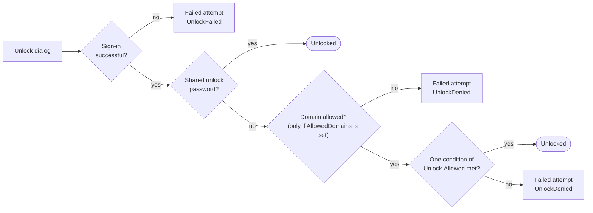
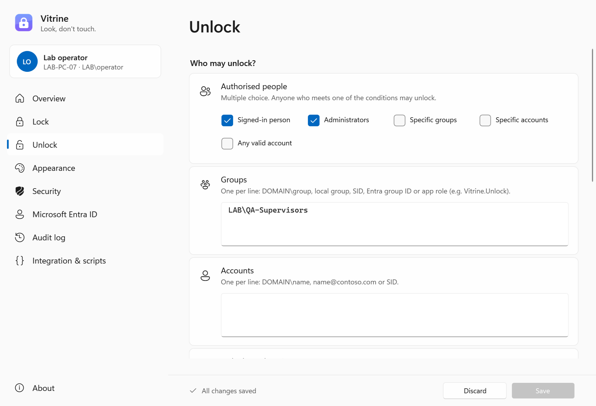
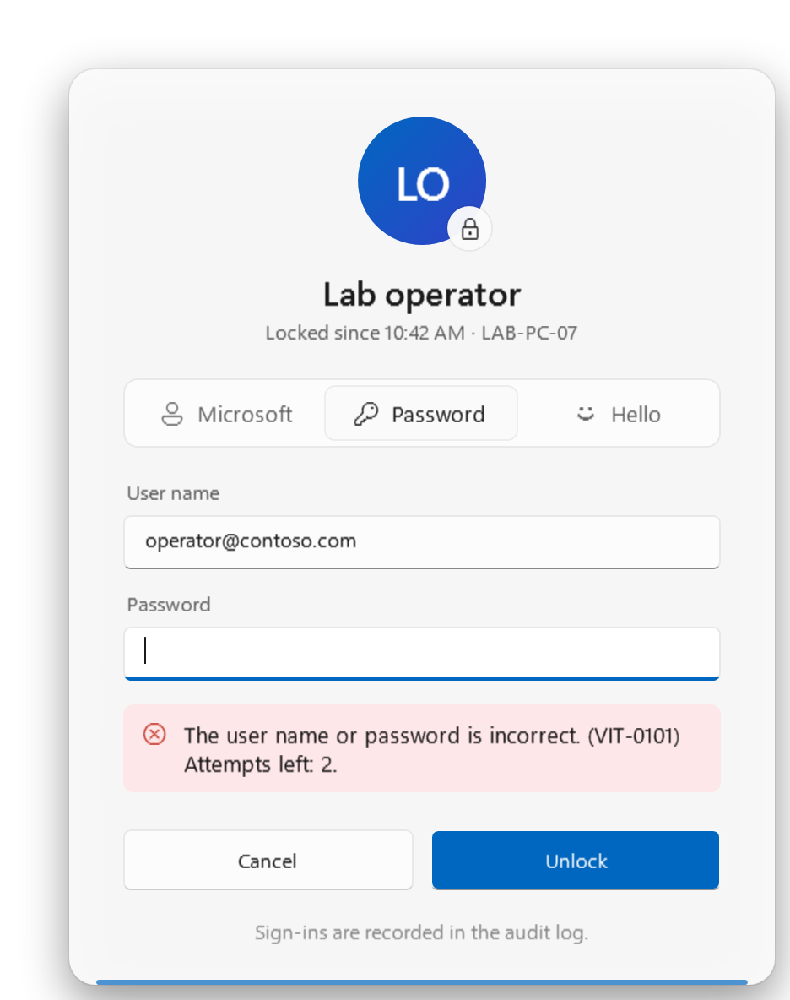

[Vitrine](../README.md) › Sign-in and permissions

# Sign-in and permissions

Vitrine unlocks only after a sign-in. It answers two questions separately: **who is this?** (the sign-in method) and
**may this person unlock here?** (the rules under `Unlock`). Administrator confirmations and electronic signatures use
the same methods with their own rules.

**Contents:** [Sign-in methods](#sign-in-methods) · [Who may unlock](#who-may-unlock) ·
[Administrators](#administrators) · [Signatures](#signatures) · [Shared unlock password](#shared-unlock-password) ·
[Failed attempts](#failed-attempts) · [What the dialog shows](#what-the-dialog-shows) · [Error codes](#error-codes)



## Sign-in methods

| ID | Button in the dialog | How it works | Offered when |
|---|---|---|---|
| `entra` | **Microsoft** | Microsoft Entra ID through MSAL in Vitrine's own [sign-in window](entra-id.md#sign-in-window) (WebView2, nothing remembered, any account; with `Entra.UseBroker = true`: the Windows account broker). Whatever the tenant allows: FIDO2 security keys and passkeys through the Windows security dialog, password + MFA, Authenticator; with Conditional Access (device-based conditions only with the broker). [Set up →](entra-id.md) | `Entra.ClientId` is set; needs the Microsoft Edge WebView2 Runtime unless the broker is used ([VIT-0190](entra-id.md#when-microsoft-is-not-offered-for-unlocking)) |
| `windows` | **Password** | Windows password, checked with `LogonUser` as an interactive logon: local accounts, Active Directory, and Entra accounts (by UPN, through the Windows domain `AzureAD`) | always |
| `hello` | **Hello** | Windows Hello (face, fingerprint, Hello PIN). Confirms **only the person signed in to the Windows session** | Windows Hello is set up for the user |
| `windowslogon` | **Windows** (tooltip *Windows sign-in*) | the Windows security dialog with every credential provider Windows offers there (password, PIN, smart card – **not** FIDO2 security keys, see below), checked with `LsaLogonUser` as an interactive logon – **any** account Windows accepts, also people who never signed in to this computer. Not on by default. [Details →](#windows-sign-in-dialog) | Windows 10 or later |
| `fido` | **Key** (tooltip *Security key*) | a FIDO2 security key **registered for Vitrine** on this computer, through the Windows security dialog (USB, NFC; PIN always required). The **Vitrine service** checks the key's answer and determines the person – name, SID and groups like the Windows password, also without network. No Entra app needed. Not on by default. [Security keys →](security-keys.md) | the service is running, Windows 10 1903 or later, at least one active key is registered |
| `pin` | **PIN** | the [shared unlock password](#shared-unlock-password) | a password has been set |
| *plugin ID* | *plugin name* | your own adapter, e.g. for a LIMS. [Plugins →](plugins.md) | as the plugin reports |

`Unlock.Methods` (default `["entra", "windows", "hello"]`) decides which methods are active and in which order they
appear. The dialog shows only methods that are available at that moment; unknown IDs are skipped without a message.
If no method is available, Vitrine offers the Windows password.

The settings window has switches for the four built-in methods and keeps them in the order `entra`, `windows`,
`hello`, `pin`. A different order and plugin IDs can only be set in `config.json` or through the policy
"Sign-in methods" ([Settings](settings.md)).

### Windows password

User name in the dialog (Vitrine makes exactly one `LogonUser` call per attempt, never a second try with another
domain – every try counts towards the account lockout threshold):

| Input | Meaning | `LogonUser` gets |
|---|---|---|
| *empty* | the person signed in to the session | Entra account: the UPN with domain `AzureAD`; AD account: the UPN without domain; local account: `name`, domain = computer name |
| `jdoe@contoso.com` | UPN | on an Entra-joined device: the UPN with domain `AzureAD` (like `runas /user:AzureAD\jdoe@contoso.com`); on AD-joined, hybrid-joined and workgroup devices: the UPN without domain, resolved by the domain controller |
| `AzureAD\jdoe@contoso.com` | Entra account, written as for `runas` | the UPN with domain `AzureAD` (on every device) |
| `AzureAD\name` | the Windows name of an Entra account | only for the session user: their UPN with domain `AzureAD`; otherwise refused (VIT-0108) |
| `CONTOSO\jdoe` | domain account | `jdoe`, domain `CONTOSO` |
| `.\jdoe` or `LAB-PC-07\jdoe` | local account on this computer | `jdoe`, domain = computer name |
| `jdoe` | account in the domain of the session | `jdoe`, domain of the session; refused in sessions of Entra accounts (VIT-0108) |

Spaces around the input are ignored; `AzureAD` is not case-sensitive. Incomplete names such as `CONTOSO\` are refused
with VIT-0108. Vitrine reads the join state of the device once, as `dsregcmd /status` does
(`NetGetAadJoinInformation`, `NetGetJoinInformation`). If it cannot be read, a session of an Entra account counts as
Entra-joined and any other session as not. The UPN of the session's own Entra account always goes through `AzureAD`.

Windows names Entra accounts `AzureAD\name`, and that is the name Vitrine records (`Actor` in the
[audit log](audit-log.md), `user` in the [interface](interface.md#electronic-signature)) – the same as with Windows
Hello, so `Unlock.AllowedUsers` and `Unlock.AllowedDomains` keep working. The UPN used to sign in is added as
`Data.upn`.

The Windows error from `LogonUser` is shown as a Vitrine code:

| Windows error | Code | Meaning |
|---|---|---|
| 1326 | VIT-0101 | user name or password incorrect |
| 1327, 1328, 1329, 1330, 1907 | VIT-0102 | account restriction (logon hours, allowed workstations), password expired or must be changed |
| 1331 | VIT-0103 | account disabled |
| 1909 | VIT-0104 | account locked out |
| 1311 | VIT-0105 | no logon server reachable |
| 1385 | VIT-0106 | the account may not log on interactively at this device |
| any other | VIT-0109 | the Windows message is shown |

A Windows password sign-in counts towards the domain's account lockout like any other interactive logon.

### Windows Hello

Hello opens the Windows dialog "Vitrine – *reason*" (for example "Vitrine – Unlock workstation"). It can only
confirm the user of the running Windows session; other people sign in with Microsoft or with their password. Vitrine
then takes the name, SID and groups of the session user. Separate messages exist for cancelled (VIT-0111), too many
attempts (VIT-0122), device busy (VIT-0123), turned off by policy (VIT-0124), not set up (VIT-0125) and not available
(VIT-0120).

### Security key

Registered security keys (`fido`) are checked by the Vitrine service, not by the app: one-time challenge, signature,
PIN flag, signature counter, status and model of the key, then the account state and current groups of the person
(S4U logon; without a domain controller the groups read last, at most `Fido.OfflineMaxHours` old). The result has the
same form as a Windows password sign-in, so all unlock rules apply unchanged. Keys are registered and revoked by an
authorized person on the page *Settings › Security keys*. Details, limits and error codes VIT-0400 to VIT-0426:
[Security keys](security-keys.md).

### Windows sign-in dialog

Since 0.4.0. `windowslogon` (tab **Windows** in the unlock dialog, tooltip *Windows sign-in*) opens the Windows security dialog "Vitrine – *reason*" with
`CredUIPromptForWindowsCredentials`, owned by the unlock dialog, with no user pre-filled. It shows whatever Windows
offers there on this device: password, Windows Hello PIN of a user who set one up here, smart card, **FIDO2 security
key** of Entra accounts, other account. Vitrine checks what the person entered with **one** `LsaLogonUser` call
(logon type interactive, origin `Vitrine`) – one attempt per submission, counted towards account lockout like any
interactive logon, no retries. The credential buffer from Windows is overwritten and freed in every case; Vitrine does not
read, keep or log its content. Name (`DOMAIN\name`, Entra accounts `AzureAD\name`), SID, all group SIDs (local groups, domain
groups, Entra group SIDs `S-1-12-1-…`) and administrator membership (including the linked token under UAC) come from
the resulting token – the same result as the [Windows password](#windows-password), so `Unlock.Allowed`,
`Unlock.AllowedGroups`, `Unlock.AllowedUsers` and administrators apply unchanged. Errors map as for the Windows
password (VIT-0101 … VIT-0109); cancelling is VIT-0111. When the 2-minute limit runs out or the attempt is cancelled,
Vitrine closes the Windows security dialog and enables the unlock dialog again; only one dialog is open at a time
(VIT-0194 if the old one could not be closed). The same clean-up applies to Windows Hello.

Typical use: a technical account stays signed in to Windows, and **any member of a local group** unlocks with their
own credential (password, PIN or smart card), without an app registration. For **FIDO2 security keys** use `entra` – local groups work there too ([Local groups with Microsoft sign-in](#local-groups-with-microsoft-sign-in)):

```powershell
net localgroup Vitrine-Entsperrer /add
net localgroup Vitrine-Entsperrer /add "AzureAD\jdoe@contoso.com"
```

With Intune, fill the group with the *Local user group membership* policy (Endpoint security › Account protection),
which accepts Entra users and Entra groups. Then:

```json
"Unlock": {
  "Methods": [ "windowslogon" ],
  "Allowed": [ "Groups" ],
  "AllowedGroups": [ "Vitrine-Entsperrer" ]
}
```

`AllowedGroups` accepts the local group as `Vitrine-Entsperrer`, `.\Vitrine-Entsperrer`, `LAB-PC-07\Vitrine-Entsperrer`
or its SID. Add `Administrators` to `Allowed` if administrators should always be able to unlock.

Notes:

- **Windows does not offer FIDO2 security keys in this dialog**, even when security-key sign-in to Windows is enabled
  and the key is attached locally (tested on Windows 11, 2026-10-27; Microsoft's FIDO credential provider only runs on
  the Windows sign-in and lock screen). Use `entra` for security keys and passkeys.
- A person who has never signed in to this computer needs a connection to the domain or Microsoft Entra ID (no cached
  logon yet).
- What the dialog offers is decided by Windows and its credential providers, not by Vitrine.
- The sign-in does not create a user profile and does not start a session for the person.
- Signatures and administrator confirmation work with this method. The service cannot check it (the logon happens in
  the session), so a signature is recorded with assurance `client`, like Windows Hello and plugins – it is **not** a
  21 CFR Part 11 verified signature method. Use `windows` or `entra` where `verified` is required.

### Input while the Microsoft or Hello window is open

The Windows sign-in dialog is handled the same way (its window belongs to `CredentialUIBroker.exe`).

Vitrine's **Microsoft sign-in window** belongs to Vitrine and is allowed by window handle, like the unlock dialog;
the web page inside it (child windows of `msedgewebview2.exe`) counts as part of it. It lies above the dialog and the
covers.

While the Microsoft or Hello window is open, Vitrine also lets input through to
- pop-ups (for example a drop-down list) owned by the unlock dialog or the sign-in window – only windows of Vitrine
  itself and of the WebView2 browser process of Vitrine's sign-in window and its child processes, not of other
  programs (since 0.4.0), and
- windows of the processes listed in `Security.AuthUiProcesses` (default `CredentialUIBroker.exe`,
  `Microsoft.AAD.BrokerPlugin.exe`, `msedgewebview2.exe`, `AccountsControlHost.exe`, `CredDialogHost.exe`) – for
  `msedgewebview2.exe` only windows that were not already visible when the sign-in started. This covers the Windows
  security dialog for a security key or passkey. **A process counts only if its program file is in a protected
  folder** (since 0.4.0; before, the file name was enough): `CredentialUIBroker.exe`, `Microsoft.AAD.BrokerPlugin.exe`,
  `AccountsControlHost.exe` and `CredDialogHost.exe` only from `%SystemRoot%\System32` or `%SystemRoot%\SystemApps`,
  `msedgewebview2.exe` only from `Microsoft\EdgeWebView\Application` under *Program Files (x86)* or *Program Files*
  (not a per-user WebView2 installation), other entries from System32, SystemApps or *Program Files*.

**Never** let through, whatever the process: standard dialogs (window classes `#32770` and `NUIDialog` – open, save,
print, browse for folder), except those of Windows' own sign-in processes. Together with the page restrictions of the
[sign-in window](entra-id.md#sign-in-window) (only sign-in hosts, no printing, no file selection), nobody can browse
the file system or start a program from the locked device through a sign-in.

For UWP frames (`ApplicationFrameHost.exe`), Vitrine checks the process of the content, not the frame, so that not
every UWP app is let through. The overlays move behind the sign-in window, and the dialog timeout pauses until the
sign-in window closes; the sign-in itself is cancelled after 2 minutes.

Before 0.4.0 the window of the Windows account broker got no input while locked: on current Windows versions its
account picker runs in `AccountsControlHost.exe` (inside `ApplicationFrameHost.exe`), which was not in the list.

## Who may unlock

<p align="center">
  <picture>
    <source media="(prefers-color-scheme: dark)" srcset="assets/screenshots/settings-unlock-dark.png">
    
  </picture>
</p>

`Unlock.Allowed` combines these conditions. **One condition that is met is enough.**

| Value | JSON name | In the settings window | Effect |
|:---:|---|---|---|
| 1 | `SessionUser` | Signed-in person | the person signed in to the Windows session |
| 2 | `Administrators` | Administrators | see [Administrators](#administrators) |
| 4 | `Groups` | Specific groups | members of the groups and app roles in `Unlock.AllowedGroups` |
| 8 | `Users` | Specific accounts | accounts in `Unlock.AllowedUsers` |
| 16 | `AnyAuthenticated` | Any valid account | any successful sign-in |

**Default: 3** (signed-in person + administrators). In JSON the names are written comma-separated; as a policy, the
sum is a DWORD (0–31).

```jsonc
"Unlock": {
  "Allowed": "SessionUser, Administrators, Groups",          // = 7
  "AllowedGroups": [ "CONTOSO\\Lab-Leads", "Vitrine.Unlock" ]
}
```

| List | Entries | Used only with |
|---|---|---|
| `Unlock.AllowedGroups` | `DOMAIN\group`, local group (also for Microsoft sign-in, [below](#local-groups-with-microsoft-sign-in)), SID, Entra group object ID or app role (e.g. `Vitrine.Unlock`) | `Groups` (4) |
| `Unlock.AllowedUsers` | `DOMAIN\name`, UPN, SID or Entra object ID | `Users` (8) |
| `Unlock.AllowedDomains` | NetBIOS domain (`CONTOSO`) or UPN suffix (`contoso.com`) | always, once it is set |

> [!IMPORTANT]
> A group or role entry alone does nothing: **Specific groups** (flag `Groups`) must also be on. The same applies to
> accounts and **Specific accounts**.

How the rules are checked, in this order:

1. **Shared unlock password:** allowed without any further check ([details](#shared-unlock-password)).
2. **`Unlock.AllowedDomains`**, if set: the domain is taken from the account name the method returns – the part
   before `\` in `DOMAIN\name`, or the part after `@` in a UPN. Names without a domain part are always refused
   (VIT-0141). This check also applies to administrator confirmations and signatures. Look at the audit log after a
   test sign-in to see which name a method returns.
3. **`Unlock.Allowed`:** `AnyAuthenticated`, then signed-in person, administrators, accounts, groups.

Who counts as the **signed-in person**: for the Windows password, the same SID as the session; for Entra, the claim
the claim `onprem_sid` or the SID derived from `oid` equals the SID of the session (since 2026-10-21; no longer the UPN –
[Entra ID](entra-id.md#what-vitrine-checks)); for Hello, always; for plugins, what the plugin reports.

Accounts and groups are compared case-insensitively with the name, the SID or object ID, and – for `DOMAIN\name`
entries – with the SID Windows resolves for that name.

### Local groups with Microsoft sign-in

Since 0.4.0, **local groups** in `Unlock.AllowedGroups` also apply to **Microsoft Entra ID** sign-ins (`entra`), not
only to Windows sign-ins. A Microsoft sign-in has no Windows token, so Vitrine derives the SIDs Windows uses for Entra
accounts on Entra-joined devices: the account `S-1-12-1-…` from the `oid` claim and one `S-1-12-1-…` per Entra group
object ID in the `groups` claim. For every `AllowedGroups` entry that is a local group of this computer
(`Vitrine-Entsperrer`, `.\Vitrine-Entsperrer`, `LAB-PC-07\Vitrine-Entsperrer`, or a SID `S-1-5-21-<computer>-…` /
`S-1-5-32-…`), Vitrine reads the group's members (`NetLocalGroupGetMembers`, once per unlock attempt, nothing cached)
and allows the person if the account itself or one of their Entra groups is a direct member. Domain groups are not
looked up this way.

```powershell
net localgroup Vitrine-Entsperrer /add
net localgroup Vitrine-Entsperrer /add "AzureAD\jdoe@contoso.com"
```

With Intune, use *Endpoint security › Account protection › Local user group membership* and add Entra users or Entra
groups to the local group. The same configuration then works for `windowslogon`, `windows`, `hello` **and** `entra`:

```json
"Unlock": {
  "Methods": [ "entra", "windowslogon" ],
  "Allowed": [ "Groups" ],
  "AllowedGroups": [ "Vitrine-Entsperrer" ]
}
```

- **Entra groups inside the local group** only count if the ID token contains them: in the app registration,
  *Token configuration › Add groups claim › Security groups* ([Entra ID](entra-id.md#app-registration)). The `groups`
  claim already lists transitive (nested) Entra group memberships.
- **More than 200 groups (overage):** Entra then replaces the `groups` claim with `_claim_names`. Vitrine does not call
  Microsoft Graph, so only the account itself (`AzureAD\name` directly in the local group) counts. The same applies
  when the groups claim is not configured.
- Local groups cannot contain local groups; only direct members count.
- The matching local groups are added to the person's groups as SIDs and logged in the audit log as `localGroups`
  (space-separated SIDs), so the log shows why access was granted.
- Membership of the local *BUILTIN\Administrators* group is checked the same way – see [Administrators](#administrators).

If the rules refuse a person who signed in correctly ("*name* may not unlock this workstation.", VIT-0140), this
counts as a failed attempt and is logged as `UnlockDenied`. A failed sign-in is logged as `UnlockFailed`.

## Administrators

A person counts as administrator when:

- **Windows password or Hello:** the account is a member of *BUILTIN\Administrators*. With UAC on, the linked
  full-access token counts too.
- **Microsoft Entra ID:** the `roles` claim contains the app role `Vitrine.Admin`, or the `wids` claim contains the
  directory role *Global Administrator*. Microsoft sign-in works only with a pinned tenant (VIT-0117). Group names in
  the `groups` claim never make someone an administrator. See the [tenant check](entra-id.md#tenant-check).
  Since 0.4.0 also when the account (`S-1-12-1-…` from `oid`) or one of the Entra groups in the `groups` claim is a
  **direct member of the local *BUILTIN\Administrators* group** (`S-1-5-32-544`) – the membership Windows would grant
  ([local groups](#local-groups-with-microsoft-sign-in)). On Entra-joined devices this includes the user who joined
  the device and users or groups added through Intune. The role SIDs Windows adds to the local Administrators group
  for *Global Administrator* and *Microsoft Entra Joined Device Local Administrator* do not match this way (roles are
  not in the `groups` claim); Global Administrators are recognised through `wids`.
- **Plugin:** the plugin reports `IsAdministrator`.

Administrators may unlock when `Administrators` is in `Unlock.Allowed` (default). As **configuration administrators**
(by default the administrators; since 0.5.0 also the groups in `Roles.ConfigAdmins`, see
[Roles and governance](roles-and-governance.md)) they confirm two actions in a separate dialog **"Administrator
required"**:

| Action | When the dialog appears |
|---|---|
| Open settings | `Security.SettingsAdminOnly` is on (default) and the session user is not a configuration administrator. Auditors (`Roles.Auditors`) are accepted too and get the settings read-only (audit log only) |
| Exit Vitrine | always while `Security.ExitRequiresAdmin` is on (default), also for administrators |

The administrator dialog never offers the shared unlock password, preselects the Windows password, has an empty user
name field and closes after 60 s. `Unlock.AllowedDomains` applies. With `Security.ReasonRequiredForAdminActions` it
asks for a reason. A successful confirmation is logged as `ConfigChanged` with the detail `Administrator approval: open
settings` or `Administrator approval: exit Vitrine` (with `Data.roles` and, if given, `Data.reason`). A person without
the needed role is refused with VIT-0142 (no role groups configured) or VIT-0431. With
`Security.LocalAdministratorsArePrivileged = false` local administrators are configuration administrators only if they
are in `Roles.ConfigAdmins`. While the workstation is locked, neither the settings nor exit are available.

### Emergency sign-in

With `Unlock.BypassGroups` set, the unlock dialog offers **Emergency sign-in**: members of these groups may unlock with
their Windows password even if `Unlock.Allowed` does not allow them, only with a reason (at least
`Unlock.BypassReasonMinLength` characters). It is logged as `UnlockBypass` with the reason and always as a warning in
the Windows event log. Details: [Roles and governance › Emergency sign-in](roles-and-governance.md#emergency-sign-in).

## Signatures

For [electronic signatures](interface.md#electronic-signature) other rules apply:

- **Any person with a successful personal sign-in** may sign, including someone other than the session user
  (four-eyes principle at the same workstation). `Unlock.Allowed`, groups and accounts do not apply.
- `Unlock.AllowedDomains` and the Entra tenant check **do** apply. Without them, any account that can sign in can sign.
- The shared unlock password is not offered. A plugin that marks its result as shared is refused with VIT-0144.
- With a **security key** the service checks the key itself (challenge for the purpose *signature*) – `assurance`
  `verified`, like the Windows password ([Security keys](security-keys.md#signatures)).
- If no other method is available, the Windows password is offered.
- While the workstation is **locked**, no signature dialog opens; the interface answers VIT-0209.
- The dialog shows who asks: the `requester` sent by the application and the process that really connected, e.g.
  "Requested by LIMS · lims.exe (PID 1234)". The audit entry of a granted signature contains the process in
  `Data.clientProcess`.

## Shared unlock password

A **shared** password for workstations without personal accounts. Set it under Settings › Unlock › "Own unlock
password" › "Set…" (enter it twice, at least 10 characters). Setting it switches on the method `pin`. "Remove" deletes
only the stored hash: switch "Own unlock password" off as well, otherwise `pin` stays in `Unlock.Methods`.

Only a hash is stored: PBKDF2-HMAC-SHA256 with 210,000 iterations, 16-byte random salt and 32-byte key, as
`pbkdf2-sha256$210000$<salt>$<hash>` in `Unlock.PinHash`. The comparison is constant-time. Stored hashes with fewer
than 10,000 or more than 10 million iterations, or with invalid Base64, are treated as wrong. There is no ADMX
policy for `Unlock.PinHash`.

The hash is in the device configuration, which **every user of the computer can read**. Anyone can therefore try
passwords against it offline; only a long password protects it. That is why at least 10 characters are required
(earlier builds: 6). Passwords set before keep working – set a longer one if yours is shorter.

> [!WARNING]
> **Unlocks with the shared password cannot be attributed to a person.** Whoever knows it unlocks regardless of
> `Unlock.Allowed` and `Unlock.AllowedDomains`. The audit log records the method `pin` and `"shared": "true"` instead
> of a person. It is never accepted for administrator confirmations (VIT-0143) or signatures (VIT-0144). The settings
> overview warns "Shared unlock password active". Do not use it where actions must be attributable (GxP).

## Failed attempts

| Setting | Default | Effect |
|---|---|---|
| `Security.ProgressiveDelay` | on | waiting time from the 3rd failed attempt: 2 s, 4 s, 8 s, 16 s, then 30 s ("Please wait *N* s.", VIT-0145) |
| `Security.MaxFailedAttempts` | 5 | after this many failed attempts the action runs (0 = never) |
| `Security.FailureAction` | **`None`** | `LockWorkstation` (Windows lock screen), `LogOff` (forced sign-out) or `Shutdown` (immediate shutdown with the comment "Vitrine: too many failed attempts") |

> [!IMPORTANT]
> Out of the box **no action** is set (`None`). Until you set `Security.FailureAction`, the only limit is the
> growing waiting time.

- With an action set, the unlock dialog adds "Attempts left: *N*." when one or two attempts are left. The action is
  logged as `FailureActionTriggered` (`5 failed attempts -> LogOff`).
- A **cancelled** Microsoft or Hello sign-in (VIT-0111) counts as a failed attempt, with a log entry and the script
  `OnFailedAttempt`. Closing the Vitrine dialog itself (Cancel, Esc, timeout) does not.
- Failed attempts in unlock, signature and administrator dialogs share **one counter**. It is reset only by a
  successful **unlock** – not by locking, and not by a successful signature or administrator confirmation. Only the
  unlock dialog triggers the action.
- The waiting time applies across dialogs: closing and reopening the dialog (or opening another one) does not end it.
  While it runs, Vitrine does not even attempt a sign-in and shows "Please wait *N* s." (VIT-0145), which does not
  count as a failed attempt.

## What the dialog shows

<p align="center">
  <picture>
    <source media="(prefers-color-scheme: dark)" srcset="assets/screenshots/unlock-error-dark.png">
    
  </picture>
</p>

| Part | Unlock | Administrator | Signature |
|---|---|---|---|
| Window title | Vitrine – Unlock | Vitrine – Administrator | Vitrine – Electronic signature |
| Heading | display name and initials of the session user | "Administrator required" | display name of the session user |
| Line below | "Locked since *time* · *computer*" | the action ("Open settings", "Exit Vitrine") | "Requested by *application* · *process* (PID *n*)" |
| Content | method buttons (if more than one), user name and password, or a short text for Microsoft, Hello and plugins | same | "You are signing electronically", the reason, "Meaning: …", then the methods |
| Button | "Unlock" or "Continue with *method*" | "Confirm" | "Sign" |
| Footer | "Sign-ins are recorded in the audit log." | same | "Your signature is recorded with name, time and meaning." |
| Timeout | `Unlock.PromptTimeoutSeconds` (default 30 s, at least 5 s) without input | 60 s | as unlock, but at least 60 s |

A bar shows the time left. `Unlock.PrefillUserName` (default on) fills in the session user's UPN or name. An optional
logo (`Appearance.LogoPath`, PNG or JPG, local file or file share only) appears above the name. Errors appear in a red bar above the button.

## Error codes

Every error in the dialog ends with a code, for example "The user name or password is incorrect. (VIT-0101)". The
code is the same in every language; the audit log records only the code. Sign-in and rule codes are VIT-0100 to
VIT-0151; plugins can use their own codes. Full list: [Error codes](error-codes.md).

---

<p align="center"><sub>
<a href="installation.md">Installation</a> · <a href="usage.md">Usage</a> · <a href="command-line.md">Command line</a> · <a href="settings.md">Settings</a> · <b>Sign-in</b> · <a href="entra-id.md">Entra ID</a> · <a href="audit-log.md">Audit log</a> · <a href="interface.md">Interface</a> · <a href="plugins.md">Plugins</a> · <a href="gxp.md">GxP</a> · <a href="data-and-privacy.md">Data and privacy</a> · <a href="error-codes.md">Error codes</a> · <a href="limitations.md">Limitations</a> · <a href="development.md">Development</a><br>
<a href="../README.md">← Back to Vitrine</a>
</sub></p>
