[Vitrine](../README.md) › Usage

# Usage

How Vitrine is used day to day, and every page of the settings window. Labels are quoted as they appear in the English user interface; in other languages the same elements are in the same places.

**Contents:** [Notification area](#notification-area) · [Locking](#locking) · [Transparent or covered](#transparent-or-covered) · [While locked](#while-locked) · [Unlocking](#unlocking) · [Signature dialog](#signature-dialog) · [Settings window](#settings-window) · [About window and language](#about-window-and-language) · [Appearance and themes](#appearance-and-themes)

> [!NOTE]
> The screenshots are drawn by the real application with sample data (`Vitrine.exe --screenshots`, see [Development](development.md)). Names, times and values are examples.

## Notification area

<table>
  <tr>
    <td width="55%" valign="top">
      <picture>
        <source media="(prefers-color-scheme: dark)" srcset="assets/screenshots/tray-dark.png">
        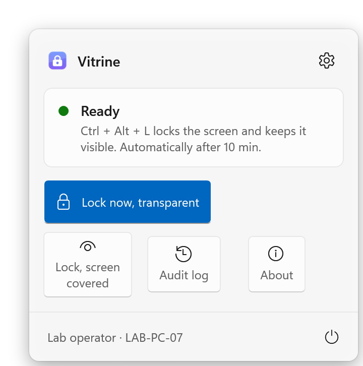
      </picture>
    </td>
    <td width="45%" valign="top">
      <b>Left-click</b> on the Vitrine icon opens the flyout:  
      • gear icon <i>Settings</i> 
      • status card: <i>Ready</i> with the shortcut hint, or <i>Locked</i> – <i>Since HH:mm</i>; below it <i>Responsible: name since HH:mm</i> (since 0.5.0) 
      • <i>Lock now, transparent</i> 
      • <i>Lock, screen covered</i> 
      • <i>Audit log</i> – opens Settings › Audit log 
      • <i>About</i> – opens the About window 
      • footer: user · computer, <i>Exit Vitrine</i>  
      <b>Right-click</b> shows a menu: <i>Lock now</i>, <i>Settings…</i>, <i>About Vitrine</i>, <i>Exit</i>.
    </td>
  </tr>
</table>

- The flyout closes when it loses focus or with <kbd>Esc</kbd>. The tooltip changes between *Vitrine – ready* and *Vitrine – locked*.
- If the shortcut is already taken by another program, the status card shows *Shortcut in use* with the message.
- When Vitrine starts without its own autostart entry and without *Lock immediately at startup*, the balloon *Vitrine is running* appears ([why](installation.md#autostart)).
- **Exit** asks for an administrator when *Exit by administrators only* is on (default) and the signed-in person is not an administrator. While locked, neither settings, About window nor exit can be opened.

## Locking

| Way | How | Trigger in the audit log |
|---|---|---|
| **Shortcut** | Default <kbd>Ctrl</kbd> + <kbd>Alt</kbd> + <kbd>L</kbd>, system-wide (`Lock.Hotkey`, empty = off) | `hotkey` |
| **Notification area** | Flyout *Lock now, transparent* or right-click menu *Lock now* | `tray` |
| | Flyout *Lock, screen covered* | `tray-blank` |
| **Win+L** | Only with *Win+L locks with Vitrine* (`Lock.ReplaceWinL`, default off). Without it, <kbd>Win</kbd>+<kbd>L</kbd> shows the Windows lock screen as usual while unlocked, and does nothing while Vitrine is locked – see [Limitations › Win+L](limitations.md#winl-and-other-ways-windows-locks) | `win-l` |
| **Idle time** | After *N* minutes without keyboard or mouse input (`Lock.IdleMinutes`, default 0 = off) | `idle (N min)` |
| **Schedule** | Fixed times, e.g. `18:00` every day or `07:30@Mon,Tue,Wed,Thu,Fri` | `schedule HH:mm` |
| **At startup** | *Lock immediately at startup* (`Lock.LockOnStartup`) – for control rooms and measurement PCs; or `Vitrine.exe --lock` when Vitrine is not running yet | `startup` |
| **Screen saver** | Vitrine renamed to `.scr` – see [Command line › Screen saver](command-line.md#screen-saver) | `screensaver` |
| **Settings** | *Lock now* (Overview) or *Test the lock* (Appearance) | `settings` |
| **Interface** | `{"cmd":"lock"}` over the [named pipe](interface.md), optionally with an own trigger text; also `Vitrine.exe --lock` while Vitrine is running | `api` or `api: <trigger>` |

**Shortcut.** Join the parts with `+`: modifiers `Ctrl`, `Alt`, `Shift`, `Win` (in `config.json` and policies also `Control`, `Windows`, `Strg`, `Umschalt`), plus one key (WPF key name such as `L`, `F12`, `Pause` or a digit). In the settings window you record the shortcut by pressing it; it must contain <kbd>Ctrl</kbd>, <kbd>Alt</kbd> or <kbd>Win</kbd> (*Please use Ctrl, Alt or Win*), and <kbd>Del</kbd> clears it.

**Schedule.** One entry per line, `HH:mm` or `HH:mm@days`. Days as English abbreviations (`Mon … Sun`), German abbreviations (`Mo Di Mi Do Fr Sa So`), English names, or short and long names in the language of the user interface. An entry fires only within the first minute after its time, at most once a day, and only when not locked already. Missed times (PC off, Vitrine not running) are not made up.

## Transparent or covered

<table>
  <tr>
    <td width="50%" valign="top">
      <picture>
        <source media="(prefers-color-scheme: dark)" srcset="assets/screenshots/lock-dark.png">
        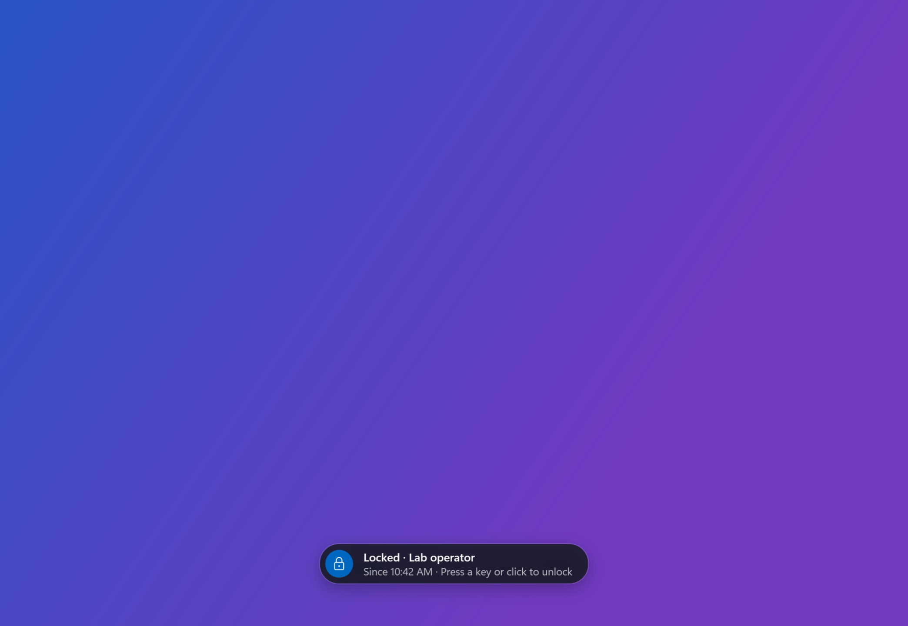
      </picture>
       <b>Transparent</b> (default) 
      All programs stay visible and keep running. Only a light dimming lies over them (<code>Appearance.DimPercent</code>, 0–100 %, default 8 %).
    </td>
    <td width="50%" valign="top">
      <picture>
        <source media="(prefers-color-scheme: dark)" srcset="assets/screenshots/blank-dark.png">
        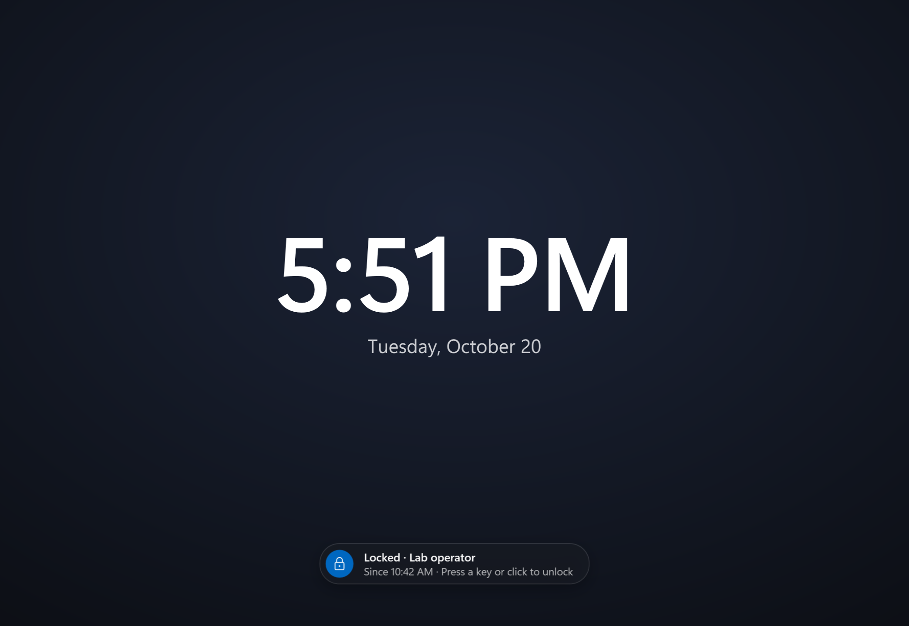
      </picture>
       <b>Covered</b> 
      The screen is covered, with a large clock and the date (<code>Appearance.ShowClock</code>). Programs still keep running.
    </td>
  </tr>
</table>

- **One overlay per monitor**, covering the whole monitor including the taskbar, placed again when the DPI changes – also with different scaling per monitor. If a monitor is plugged in or out or the resolution changes while locked, Vitrine rebuilds the overlays.
- **Notice bar** at the bottom centre with a lock in the accent colour (*Show notice bar*, `Appearance.ShowStatusPill`). Without a notice text it shows *Locked · name* and *Since HH:mm · hint*. With a *Notice text* (`Appearance.Message`, e.g. “Measurement running – please do not touch”) that text becomes the title, followed by *Locked by name since HH:mm · hint*. The hint depends on what opens the dialog (see [Unlocking](#unlocking)).
- **Which mode?** `Appearance.Visual` sets it. *Lock now, transparent* in the flyout and *Lock now* in the right-click menu use the configured mode – if it is set to *Covered*, both lock covered. Only *Lock, screen covered* forces a mode.

## Covered areas and selected programs

Between *transparent* and *covered* there are two finer options (Settings › Appearance, or the policies *Covered areas*
and *Programs that stay visible*):

- **Covered areas** (`Appearance.Masks`): rectangles that stay covered while locked, e.g. the part of a LIMS window
  with patient names. *Draw areas…* puts a semi-transparent layer over every monitor: drag to add an area, right-click
  an area to remove it, Enter or *Done* to keep the result, Esc to discard it. Areas are stored in percent of the
  monitor (`monitor:x,y,width,height`, `*` = every monitor), so they stay in place when the resolution changes. Monitor 1
  is the main monitor, then from left to right. Areas apply in the transparent mode and with *Only selected programs*.
- **Only selected programs** (`Appearance.Visual = Windows`): everything is covered except the windows of the programs
  in `Appearance.RevealProcesses` (program file name, e.g. `mes.exe`). The visible part follows the window when
  it is moved or resized (checked about three times per second). A window of another program lying on top of it stays
  covered, and so do the taskbar and minimised windows.

  <picture>
    <source media="(prefers-color-scheme: dark)" srcset="assets/screenshots/lock-masked-dark.png">
    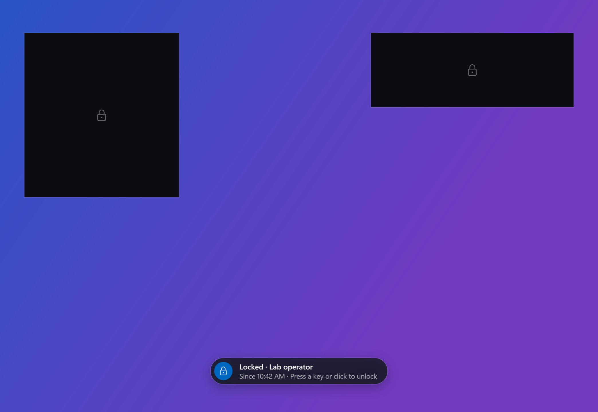
  </picture>

> [!NOTE]
> Areas are rectangles on the screen, not tied to a window: if a window moves, a covered area stays where it is. Use
> *Only selected programs* when the position changes. Both are a privacy aid; input is blocked as in every mode.

## Separate lock desktop

By default Vitrine locks with **overlays** on top of the Windows desktop – programs stay visible. With
*Lock mode › Separate desktop* (`Lock.Mode = Desktop`, Settings › Locking, since 0.5.0) Vitrine creates a desktop of its
own (like the Windows sign-in screen does) and switches to it when locking:

- Windows of other programs are on another desktop: they cannot receive keyboard or mouse input, cannot come to the
  foreground and cannot draw over the lock screen – also windows running as administrator. Keyboard hooks of other
  programs on the Windows desktop do not see what is typed in the unlock dialog.
- **Programs keep running but are not visible.** Optionally the lock screen shows a read-only **preview** of them
  (`Lock.DesktopShowPreview`, refreshed every `Lock.DesktopPreviewSeconds`, default 2 s; the time of the picture is shown
  in the top right corner). The preview follows the [visual mode](#transparent-or-covered): nothing when covered, only the
  selected programs, covered areas stay black. Use the overlay mode when a process must stay **live** visible.
- The lock screen shows the notice bar as with overlays; a key or click opens the unlock dialog **on the lock desktop**
  (Windows password, unlock password, plugins with a password field).
- **Windows Hello, Windows sign-in dialog, Microsoft sign-in:** their windows belong to other processes and only appear on
  the Windows desktop. When you choose one of them, Vitrine switches back to the Windows desktop for the sign-in – the
  programs are covered by the overlays there and input is blocked as in the overlay mode – and returns to the lock
  desktop if the sign-in fails or is cancelled.
- The overlays and the input blocker stay active on the Windows desktop during the whole lock (second line of
  defence). If the lock desktop cannot be created or used, the lock uses them alone (audit log VIT-0450 to VIT-0453).

## While locked

- **Keyboard and mouse** are intercepted system-wide. The overlays themselves block nothing; they are only the visible part.
- **System shortcuts** stay without effect, also while the dialog is open: Windows keys, the menu key, <kbd>Alt</kbd>+<kbd>Tab</kbd>, <kbd>Alt</kbd>+<kbd>Esc</kbd>, <kbd>Alt</kbd>+<kbd>F4</kbd>, <kbd>Ctrl</kbd>+<kbd>Esc</kbd>.
- **Mouse pointer** stands still (*Hold the mouse pointer*, `Lock.BlockMouseMove`, default on). When off, it may move, e.g. to point at something; clicks and the wheel are always discarded. Optionally the pointer is hidden (*Hide mouse pointer*, `Appearance.HideCursor`).
- **Screen stays on** (*Keep the screen on*, `Lock.KeepAwake`, default on): no screen saver, no sleep.
- **Ctrl + Alt + Del**: Task Manager, Sign out, Change a password, the power button and Lock are hidden (*Restrict Ctrl + Alt + Del*) – on every lock, even if a backup of the original values is still there from an earlier lock. <kbd>Win</kbd>+<kbd>L</kbd> does nothing. Switch user remains – see [Limitations](limitations.md#winl-and-other-ways-windows-locks).
- **Desktop switches** (both lock modes, since 0.5.0): if another desktop becomes the active one while locked – e.g. Task Manager from the Ctrl + Alt + Del screen, or a virtual-desktop tool that uses Windows desktops – Vitrine logs `DesktopSwitchDetected` and switches back within a quarter of a second; if that fails three times, Windows locks (VIT-0452). The Windows sign-in, Ctrl + Alt + Del and UAC screens are left alone. If Windows itself locks while Vitrine is locked, Vitrine logs `WindowsLockDetected`.
- **Watchdog**: if Vitrine is ended or crashes while locked, Windows locks (*Watchdog*, `Security.Watchdog`). Vitrine tells the watchdog about every lock and unlock directly; deleting the marker file `%LocalAppData%\Vitrine\locked` does not stop it.

## Unlocking

<table>
  <tr>
    <td width="33%" valign="top">
      <picture>
        <source media="(prefers-color-scheme: dark)" srcset="assets/screenshots/unlock-dark.png">
        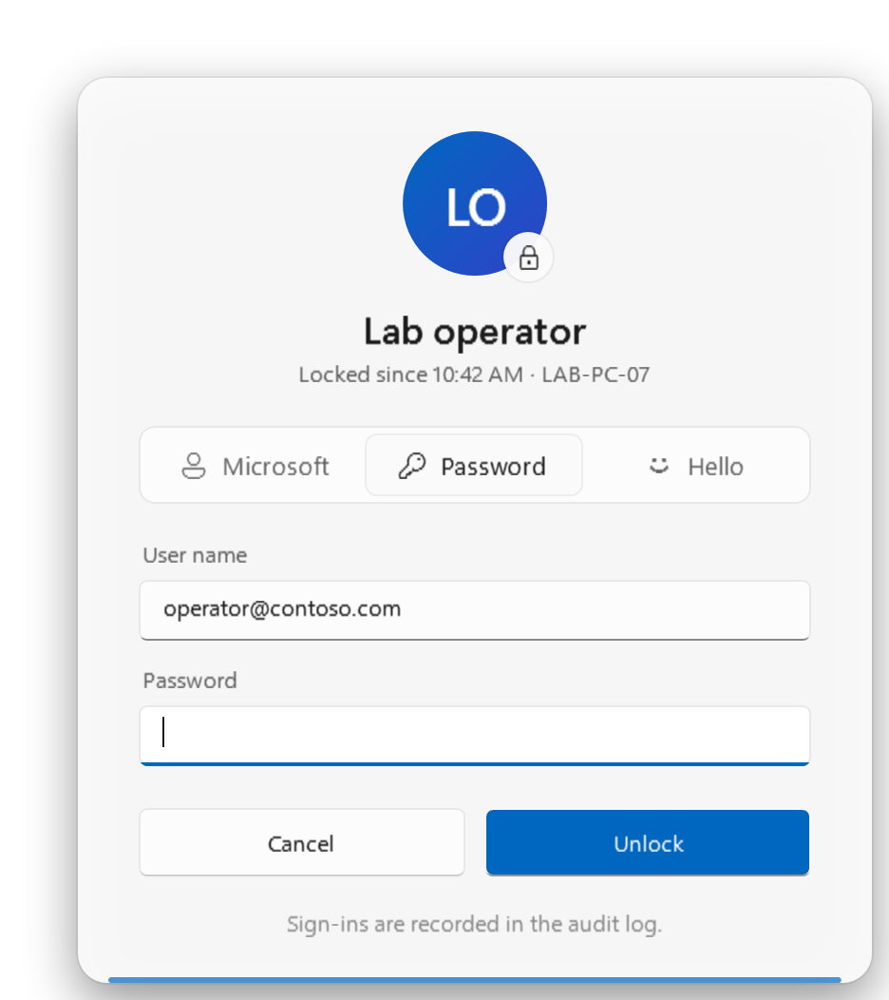
      </picture>
       <b>Windows password</b>
    </td>
    <td width="33%" valign="top">
      <picture>
        <source media="(prefers-color-scheme: dark)" srcset="assets/screenshots/sign-entra-dark.png">
        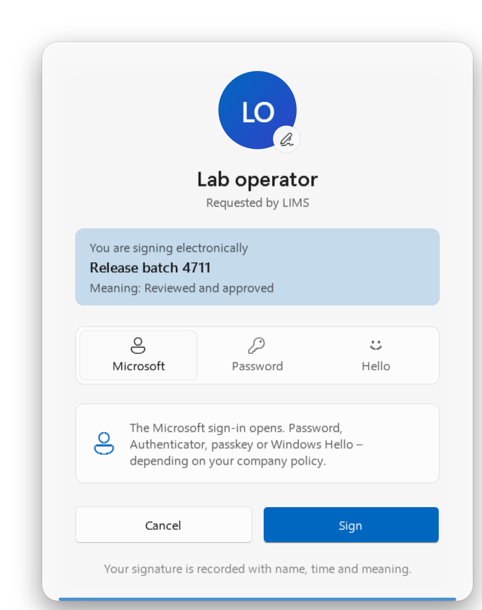
      </picture>
       <b>Microsoft Entra ID</b> – unlocking and signatures, through the Windows account broker (<a href="entra-id.md">set up</a>)
    </td>
    <td width="33%" valign="top">
      <picture>
        <source media="(prefers-color-scheme: dark)" srcset="assets/screenshots/unlock-error-dark.png">
        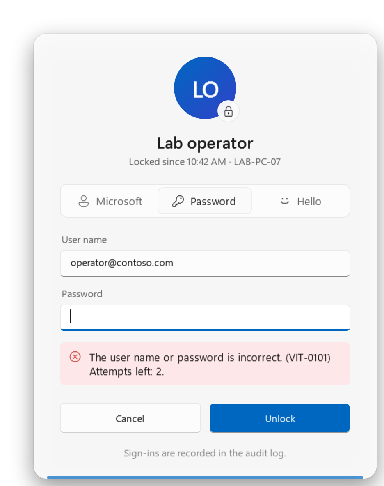
      </picture>
       <b>Failed attempt</b> – message with error code
    </td>
  </tr>
</table>

**What opens the dialog** – *Dialog opens on* (`Unlock.Trigger`):

| Setting | Effect | Hint in the notice bar |
|---|---|---|
| *Key press or mouse click* (`AnyInput`, default) | any key or click | *Press a key or click to unlock* |
| *Key press only* (`KeyOnly`) | keys only; clicks are silently discarded | *Press a key to unlock* |
| *Shortcut only* (`HotkeyOnly`) | only the lock shortcut | *shortcut to unlock* |

The lock shortcut opens the dialog in every mode; modifier keys alone open nothing.

> [!CAUTION]
> `HotkeyOnly` together with an empty `Lock.Hotkey` makes unlocking impossible.

**The dialog** (*Vitrine – Unlock*) appears on the monitor with the mouse pointer: initials, name, *Locked since HH:mm · computer*, and optionally a company logo (`Appearance.LogoPath`, PNG or JPG). With more than one method there is a switch **Microsoft · Password · Hello · PIN** (or the name of a plugin). For Microsoft and Hello the button reads *Continue with Microsoft* or *Continue with Hello*, otherwise *Unlock*. Footer: *Sign-ins are recorded in the audit log.*

- **Which methods appear?** *Microsoft* only with an application ID (`Entra.ClientId`), *Hello* only when Windows Hello is available, *PIN* (the unlock password) only when one is set, plugins only when listed in `Unlock.Methods`. Who may unlock and what each method checks: [Sign-in and permissions](sign-in.md).
- **User name** is filled in with the UPN or `DOMAIN\name` of the signed-in person (*Fill in the user name*, default on).
- **Timeout** (*Dialog closes after*, default 30 s, at least 5 s) is shown as a shrinking bar. Every key in the dialog and every mouse movement over it resets it. <kbd>Esc</kbd> or *Cancel* closes the dialog; everything stays locked.
- **Failed attempts**: from the 3rd failed attempt the waiting time grows to 2, 4, 8, 16 and at most 30 s (*Please wait N s.*, VIT-0145), unless *Increase waiting time* is off. If an action after too many failed attempts is set and at most two attempts are left, the dialog shows *Attempts left: N.* Every error message ends with an error code such as `(VIT-0101)` – see [Error codes](error-codes.md).
- **Input** while the dialog is open: the pointer may move. Keys only arrive when the dialog is in front, clicks only on the dialog. During a Microsoft or Hello sign-in, only the processes in *Sign-in windows during external sign-in* receive input.

## Signature dialog

<table>
  <tr>
    <td width="45%" valign="top">
      <picture>
        <source media="(prefers-color-scheme: dark)" srcset="assets/screenshots/sign-dark.png">
        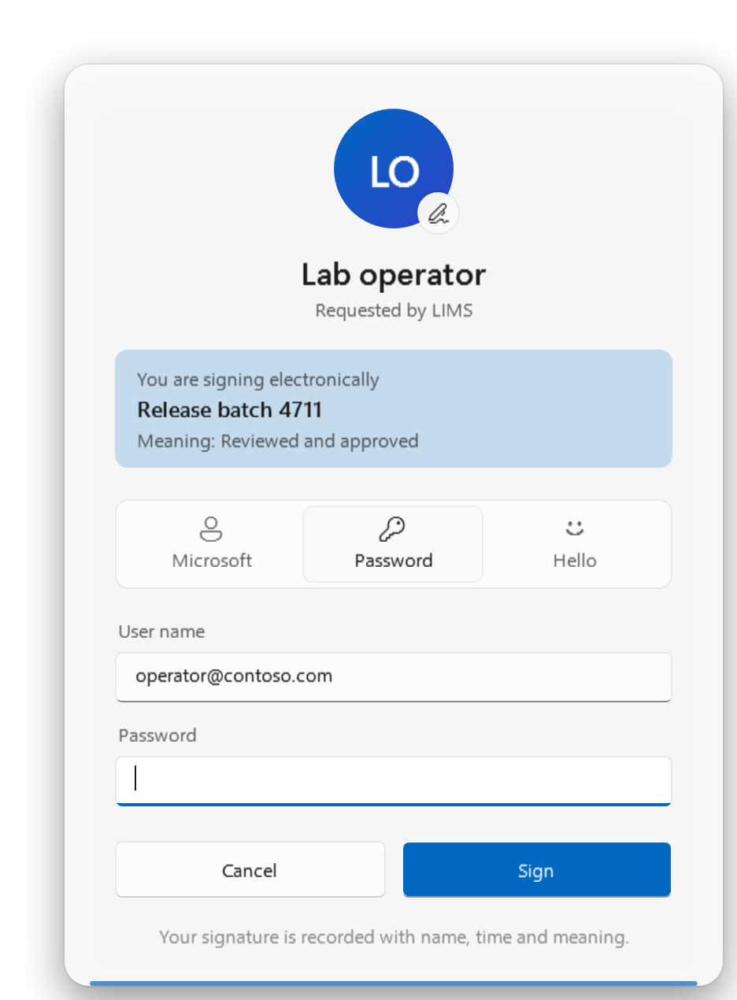
      </picture>
    </td>
    <td width="55%" valign="top">
      A line-of-business application (LIMS, MES, instrument software) can request an electronic signature over the <a href="interface.md">local interface</a>. The dialog <i>Vitrine – Electronic signature</i> shows:  
      • <i>You are signing electronically</i> and the reason sent by the application 
      • <i>Meaning: …</i> (e.g. reviewed, approved) 
      • <i>Requested by …</i> – the name the application sends and its process with PID, e.g. <i>LIMS · lims.exe (PID 1234)</i> 
      • the sign-in methods, and the button <i>Sign</i>  
      Footer: <i>Your signature is recorded with name, time and meaning.</i> A signature always needs a personal sign-in; the shared unlock password is not accepted (VIT-0144). While the workstation is locked, no signature dialog opens (VIT-0209).
    </td>
  </tr>
</table>

The flow, the commands and what goes into the audit log: [Interface and e-signatures](interface.md).

The same dialog appears as *Vitrine – Administrator* with the button *Confirm* when an administrator is required – to open the settings or to exit Vitrine. Who counts as administrator: [Sign-in and permissions](sign-in.md).

## Settings window

Open it with the gear icon in the flyout, *Settings…* in the right-click menu or `Vitrine.exe --settings`. If *Settings for administrators only* is on (default) and the signed-in person is not a configuration administrator (by default: an administrator), Vitrine first asks for an [administrator](sign-in.md). An [auditor](roles-and-governance.md#roles) who confirms gets only the page *Audit log*, read-only. While locked the settings cannot be opened.

The window *Vitrine – Settings* has ten pages; *About* is at the bottom of the navigation.

<table>
  <tr>
    <td width="50%" valign="top">
      <b>Overview</b> 
      <picture>
        <source media="(prefers-color-scheme: dark)" srcset="assets/screenshots/settings-home-dark.png">
        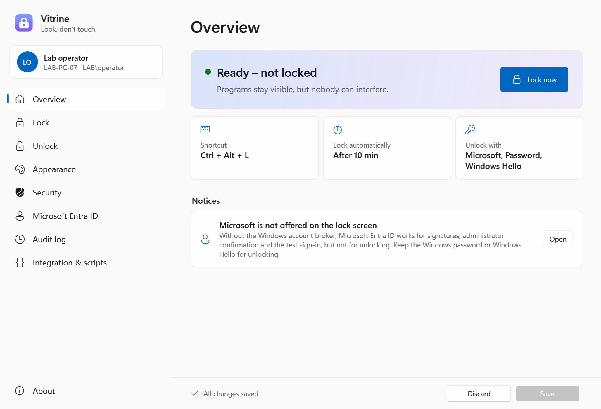
      </picture>
    </td>
    <td width="50%" valign="top">
      <b>Lock</b> 
      <picture>
        <source media="(prefers-color-scheme: dark)" srcset="assets/screenshots/settings-lock-dark.png">
        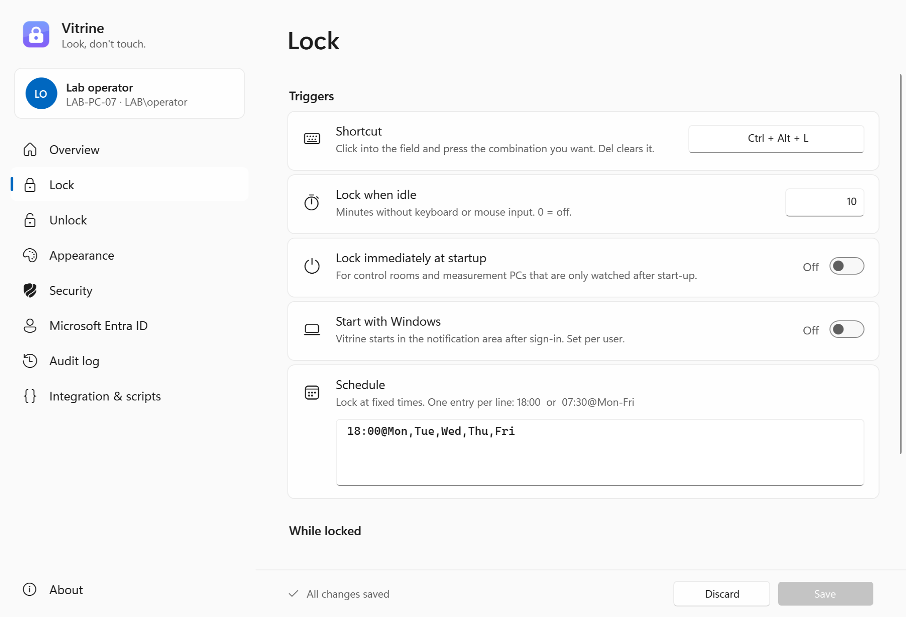
      </picture>
    </td>
  </tr>
  <tr>
    <td valign="top">
      <b>Unlock</b> 
      <picture>
        <source media="(prefers-color-scheme: dark)" srcset="assets/screenshots/settings-unlock-dark.png">
        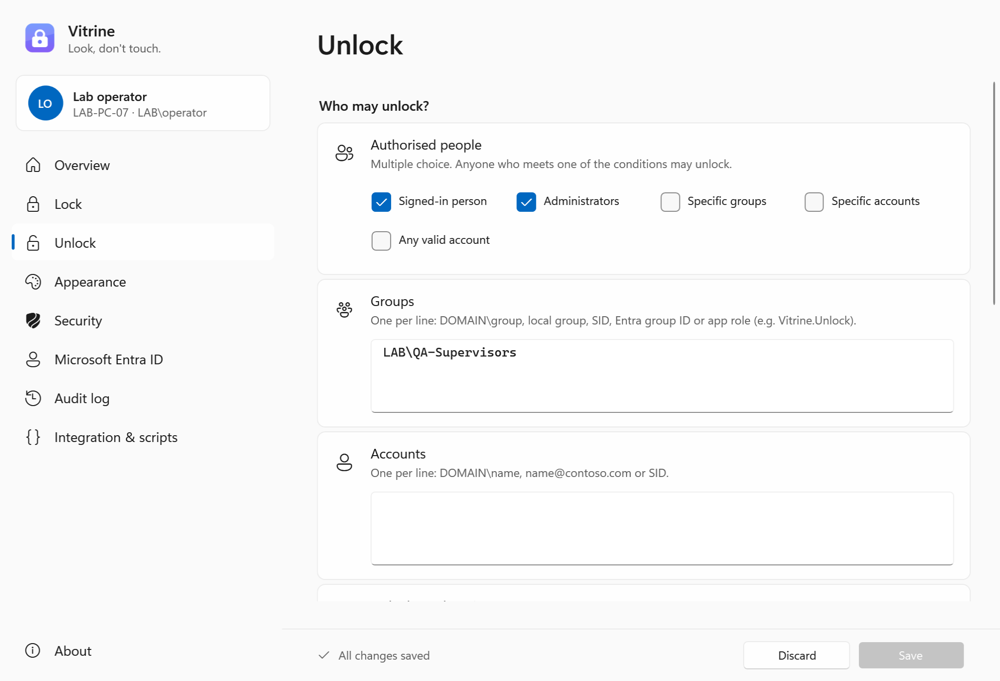
      </picture>
    </td>
    <td valign="top">
      <b>Appearance</b> 
      <picture>
        <source media="(prefers-color-scheme: dark)" srcset="assets/screenshots/settings-look-dark.png">
        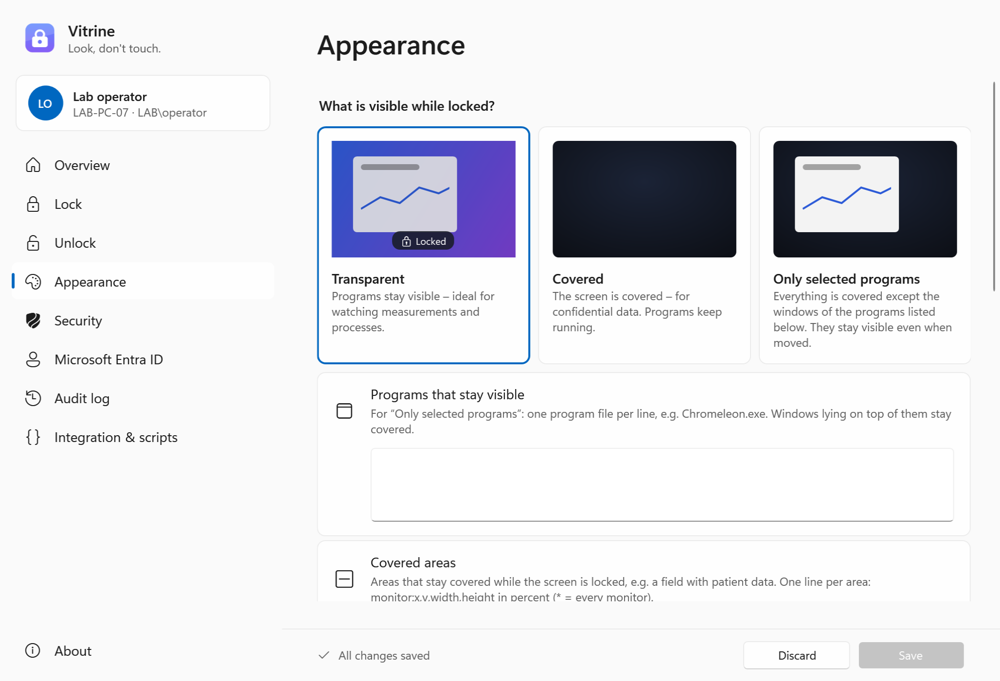
      </picture>
    </td>
  </tr>
  <tr>
    <td valign="top">
      <b>Security</b> 
      <picture>
        <source media="(prefers-color-scheme: dark)" srcset="assets/screenshots/settings-security-dark.png">
        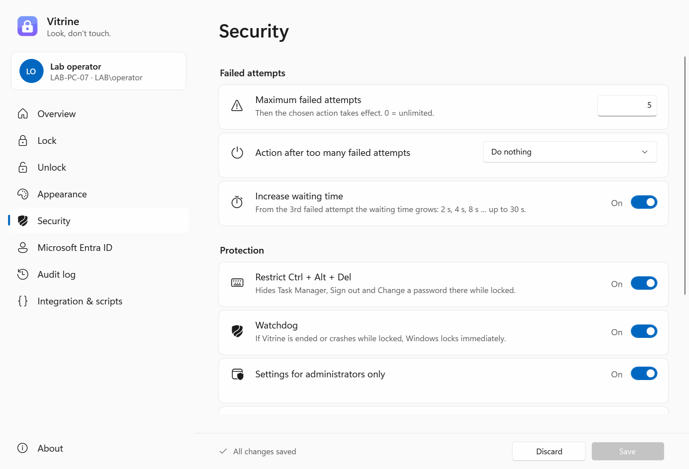
      </picture>
    </td>
    <td valign="top">
      <b>Microsoft Entra ID</b> 
      <picture>
        <source media="(prefers-color-scheme: dark)" srcset="assets/screenshots/settings-entra-dark.png">
        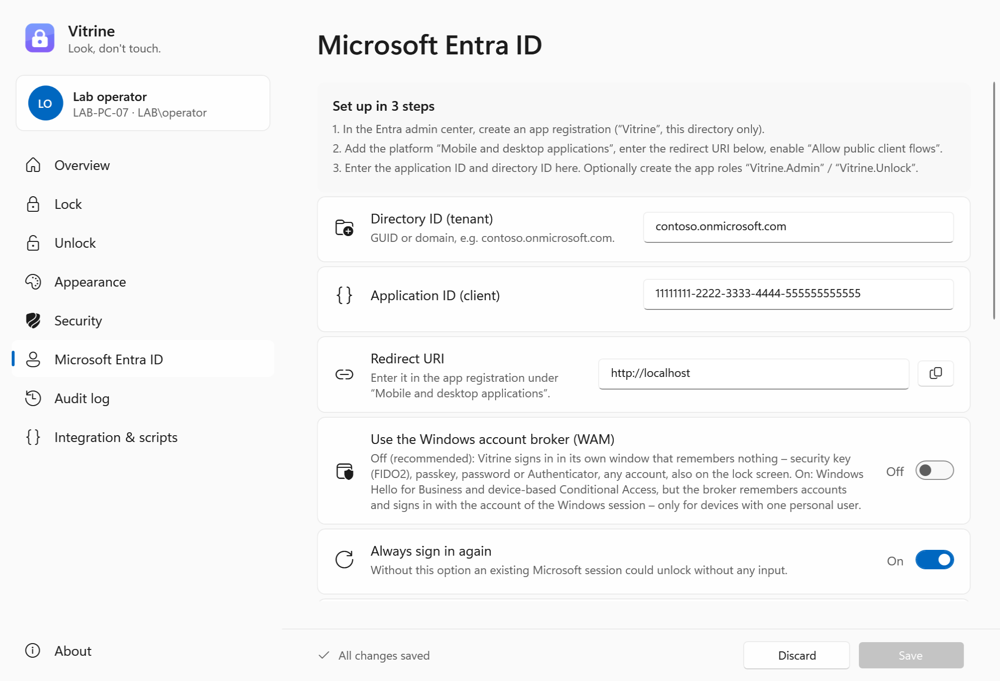
      </picture>
    </td>
  </tr>
  <tr>
    <td valign="top">
      <b>Audit log</b> 
      <picture>
        <source media="(prefers-color-scheme: dark)" srcset="assets/screenshots/settings-audit-dark.png">
        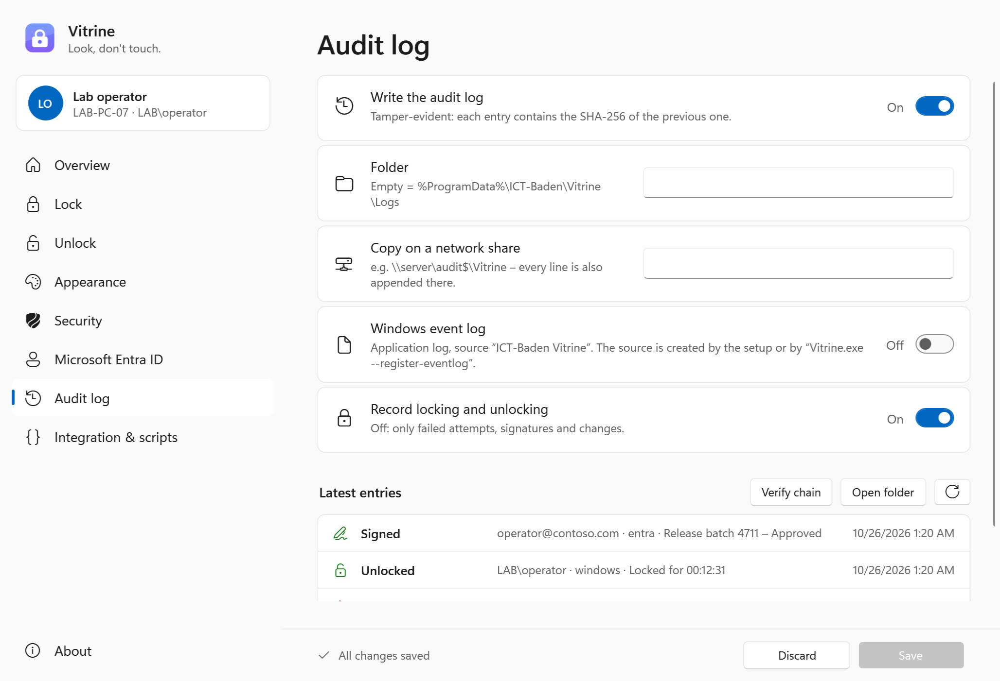
      </picture>
    </td>
    <td valign="top">
      <b>Integration & scripts</b> 
      <picture>
        <source media="(prefers-color-scheme: dark)" srcset="assets/screenshots/settings-integration-dark.png">
        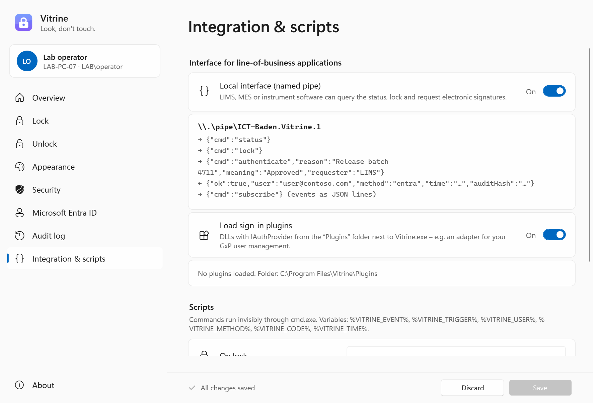
      </picture>
    </td>
  </tr>
</table>

| Page | What is on it |
|---|---|
| **Overview** | Status (*Ready – not locked*) with *Lock now*, *Last unlocked by …* and *Responsible: … since …*; tiles *Shortcut*, *Lock automatically* and *Unlock with*; *Notices*, most of them with a jump to the right page: *Entra ID is not set up yet*, *Shortcut not available*, *Partly managed centrally*, *Old policy path in use*, *Configuration still in the old folder*, *Configuration has errors*, *Plugin not loaded*, *Shared unlock password active* |
| **Lock** | *Triggers*: *Shortcut*, *Lock when idle*, *Lock immediately at startup*, *Start with Windows* (per user, [note](installation.md#autostart)), *Schedule*. *While locked*: *Keep the screen on*, *Hold the mouse pointer* |
| **Unlock** | *Who may unlock?*: *Authorised people* (*Signed-in person*, *Administrators*, *Specific groups*, *Specific accounts*, *Any valid account*), *Groups*, *Accounts*, *Only these domains*. *Sign-in methods*: Microsoft Entra ID, *Windows password*, Windows Hello, *Windows sign-in*, *Security key*, *Own unlock password* with *Set…*. *Dialog*: *Dialog opens on*, *Fill in the user name*, *Dialog closes after* |
| **Appearance** | *What is visible while locked?* – cards *Transparent* and *Covered*; *Dim*, *Notice text*, *Show notice bar*, *Clock on the covered screen*, *Hide mouse pointer*, *Accent colour*, *Company logo in the dialog*, *Language* (default for this device), *Preview* with *Test the lock* |
| **Security** | *Failed attempts*: *Maximum failed attempts*, *Action after too many failed attempts* (*Do nothing*, *Lock Windows*, *Sign out*, *Shut down*), *Increase waiting time*. *Protection*: *Restrict Ctrl + Alt + Del*, *Watchdog*, *Settings for administrators only*, *Exit by administrators only*, *Own settings per user*, *Sign-in windows during external sign-in* |
| **Roles** | *Who may do what in Vitrine*: *Configuration administrators*, *Security key registration*, *Auditors*, *Local administrators hold all roles*. *Emergency sign-in*: *Emergency sign-in groups*, *Minimum length of the emergency reason*. *Reasons*: *Reason for administrator confirmations*, *Reason for configuration changes*, *Minimum length of these reasons* – see [Roles and governance](roles-and-governance.md) |
| **Security keys** | Status (active keys, RP ID, problems such as VIT-0402 or VIT-0422), *Registered keys* with *Register key…* and *Revoke…* per key (both ask an authorized person to sign in first), *Rules*: *RP ID*, *Register for oneself*, *Keys per person*, *Failed attempts until blocked*, *Block (minutes)*, *Without domain controller (hours)*, *Allowed models* – see [Security keys](security-keys.md) |
| **Microsoft Entra ID** | *Set up in 3 steps*, *Directory ID (tenant)*, *Application ID (client)*, *Redirect URI* with *Copy*, *Use the Windows account broker (WAM)* (greyed out only in builds without the broker), *Always sign in again*, *Maximum age of the sign-in (seconds)*, *Further allowed tenants*, *Test the connection* with *Test sign-in* – see [Entra ID](entra-id.md) |
| **Audit log** | *Write the audit log*, *Folder*, *Copy on a network share*, *Windows event log*, *Record locking and unlocking*; *Latest entries* (the last 80 of the newest file) with *Authorization report*, *Verify chain*, *Open folder* and *Refresh* – see [Audit log](audit-log.md) |
| **Integration & scripts** | *Local interface (named pipe)* with the pipe name of this session, *Load sign-in plugins* with the loaded plugins or the plugin folder, *Scripts*: *On lock*, *On unlock*, *On failed attempt*, *When the dialog appears* – see [Interface](interface.md), [Plugins](plugins.md), [Settings › Scripts](settings.md#scripts) (variables, and why special characters in `%VITRINE_*%` values become `_`) |
| **About** | Version, *Licences, legal notice and privacy* (opens the [About window](#about-window-and-language)), *Device configuration* with the file path and *Open* (Notepad), *Manage centrally* with *Reload policies*, *Command line* (short reference) |

**Saving and policies**

- *Save* is only active when something changed; the footer then shows *Unsaved changes*. *Discard* returns to the saved values.
- *Save* writes the device configuration `%ProgramData%\ICT-Baden\Vitrine\config.json`. If the user may not write there (the normal case after MSI or script installation), Vitrine asks for administrator rights through UAC (`Vitrine.exe --apply-config`). If the UAC prompt is cancelled: *Saving cancelled – administrator rights are required. (VIT-0007)*. If the elevated save fails, the footer shows *Saving failed* (VIT-0006), not *Saved*. Saving as administrator also protects the folder, so that a configuration ignored with VIT-0012 is used again – [Settings › File locations](settings.md#file-locations). Every save is recorded in the audit log.
- Values set by **policy** are locked and marked *Set by your organisation through a policy*. *Overview* then shows *Partly managed centrally* with the number of such settings.
- *Lock now* and *Test the lock* use the **saved** settings – unsaved changes to the appearance are not applied.
- *Discard* does not undo an accent colour that was already applied live from a colour swatch; it stays visible until the next save or restart.
- *Test sign-in* on the Entra page uses the current values, also unsaved ones.

Where the settings are stored and how layers and policies combine: [Settings](settings.md).

## About window and language

<table>
  <tr>
    <td width="50%" valign="top">
      <picture>
        <source media="(prefers-color-scheme: dark)" srcset="assets/screenshots/about-dark.png">
        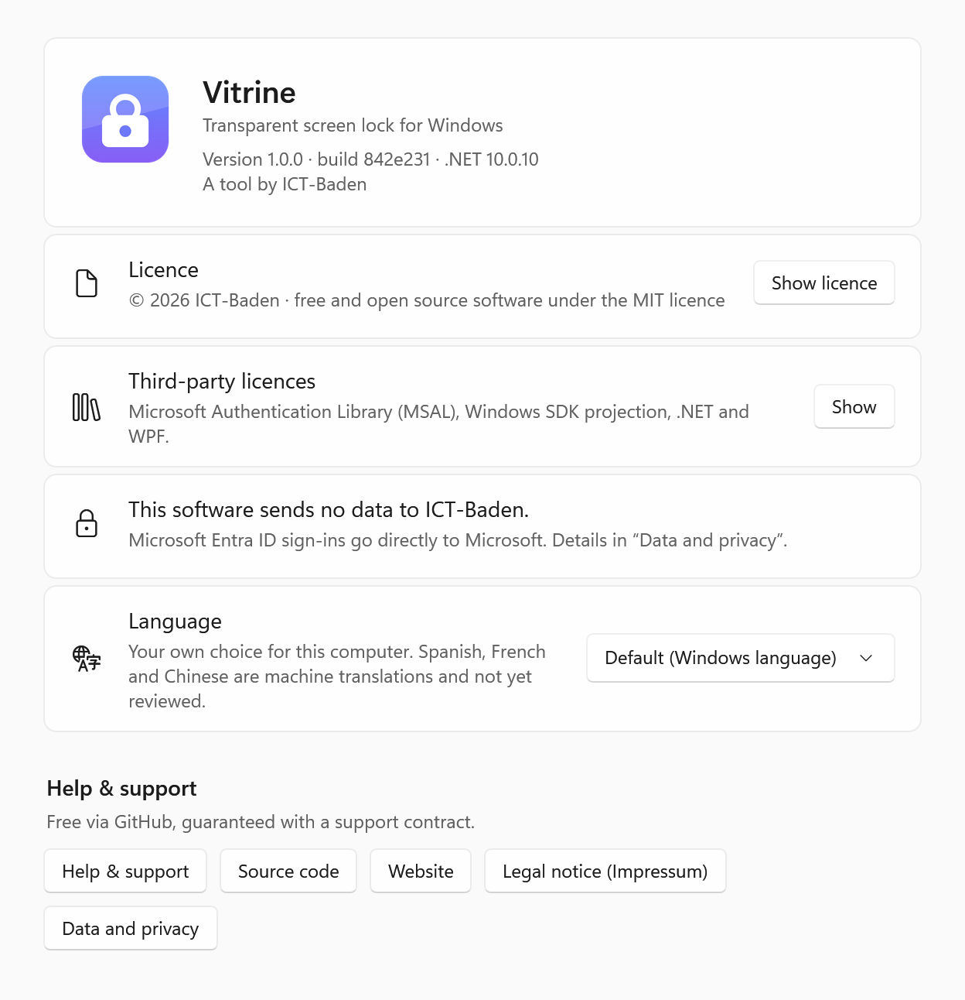
      </picture>
    </td>
    <td width="50%" valign="top">
      The window <b>About Vitrine</b> is open to every user, without administrator rights: tray menu <i>About Vitrine</i>, flyout tile <i>About</i>, or Settings › About › <i>Open</i>. It shows:  
      • version, build (commit) and .NET version 
      • © ICT-Baden, <i>Licence</i> (MIT) with <i>Show licence</i> 
      • <i>Third-party licences</i> with <i>Show</i> 
      • <i>This software sends no data to ICT-Baden.</i> with <i>Data and privacy</i> 
      • <i>Language</i> 
      • <i>Help & support</i>, <i>Source code</i>, <i>Website</i>, <i>Legal notice (Impressum)</i>, <i>Data and privacy</i> – they open in the default browser
    </td>
  </tr>
</table>

**Language.** The user interface is available in English, German, Spanish, French and Chinese (simplified). Spanish, French and Chinese are machine translations and not yet reviewed by native speakers; missing texts appear in English. Each user picks a language in the About window under *Language*; the choice is saved per user in `%LocalAppData%\Vitrine\preferences.json` and applies at once. *Default (…)* follows the device default or, without one, the Windows display language.

Which language applies, highest priority first:

1. environment variable `VITRINE_LANGUAGE` ([Command line](command-line.md#environment-variable-vitrine_language))
2. policy *Language of the user interface* (`Appearance.Language`) – the choice in the About window is then locked: *Set by your organisation through a policy.*
3. the user's choice in the About window
4. device default `Appearance.Language` (Settings › Appearance › *Language*)
5. the Windows display language, if it is one of the five
6. English

Dates, times and numbers in the user interface follow the chosen language. The audit log, the event log and the interface answers are always English with UTC times, whatever the language.

## Appearance and themes

- Vitrine follows the Windows app mode: light, dark or high contrast; changes apply live.
- **Mica** only in the settings window and only on Windows 11. Overlays, dialogs and flyout have their own, almost opaque backgrounds so they stay readable over any content.
- **Accent colour** (`Appearance.Accent`): empty = Windows accent colour, otherwise a company colour as `#RRGGBB`. The settings window offers colour swatches; a click applies as a preview at once.
